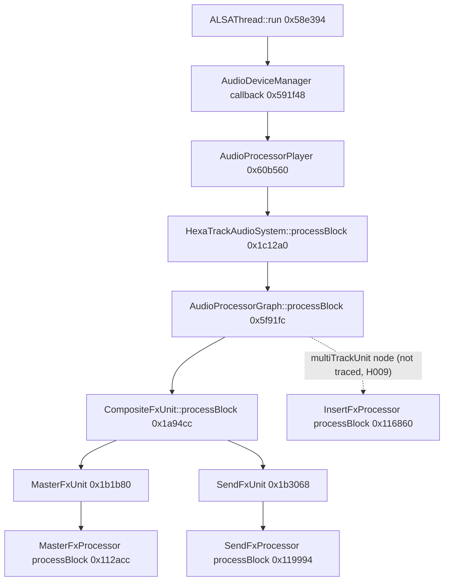

# Effects (FX) in firmware 1.60

How the TORAIZ SP-16 application processes its effects: where the audio goes, how an
effect is selected, the interface every effect implements, and, for four effects plus
the shared modulation oscillator, the full algorithm. This is the part of the research
someone would need to understand, reimplement or replace an SP-16 effect.

**Scope: firmware 1.60 only.** Every address is a virtual address in the 1.60
`EP085_Main_R` (12,000,396 bytes, SHA-256
`3d1392a61323e73ea4f2fddef8fe9e0142add7a6f6fab79ab0eb0d5396555464`, image base `0x8000`).
It is wrong for every other version. A few facts carried over from earlier 1.50 work
are marked **[1.50]** and have not been re-located in 1.60. No firmware bytes, no
disassembly and no decompiled listings are reproduced here. Read
[DISCLAIMER.md](../../DISCLAIMER.md) first.

## How to read this

- Labels: **confirmed** = shown in the code and checked (for algorithms, bit-exact in
  emulation, see below); **likely** = strong evidence, not proven; **guess** =
  plausible. Unlabelled statements on these pages are confirmed.
- Every claim carries a finding ID (`F0xx`). The IDs refer to the scrubbed research
  ledger [research-notes/F-effects/findings-ledger.md](../../research-notes/F-effects/findings-ledger.md),
  which records the evidence and how it was checked. Open questions have `H0xx` IDs
  (see [open-questions.md](../open-questions.md#effects)).
- "Bit-exact" always means **bit-exact to the 1.60 routine run in a single-function
  emulator**. Nothing here was measured on a physical SP-16.

## Status

| Effect | Class (RTTI) | Insert index | Master index | Status | Page |
|---|---|---|---|---|---|
| LoFi | `LoFi` | 5 | 6 | **Reconstructed** (F026–F031) | [lofi.md](lofi.md) |
| Multi-mode filter | `MultiModeFilter` | 3 | 5 | **Reconstructed** (F032–F037) | [multimode-filter.md](multimode-filter.md) |
| 2-band EQ | `ParametricEqualizer` | 2 | 4 | **Reconstructed** (F038–F044) | [parametric-eq.md](parametric-eq.md) |
| Phaser | `Phaser` | 8 | 9 | **Reconstructed** (F045–F050) | [phaser.md](phaser.md) |
| Shared oscillator | (no vtable) | — | — | **Reconstructed** (F051–F053) | [oscillator.md](oscillator.md) |
| Chorus | `Chorus` + kernel `c_chorus` | 0 | 2 | **Partial**: delay-line kernel and its modulation confirmed (F054, F055); parameter formulas and an end-to-end model not done (H033) | [oscillator.md](oscillator.md#chorus-and-flanger) |
| Flanger | `Flanger` + kernel `c_flanger` | 1 | 3 | **Partial**: as Chorus (F054, F055; H034) | [oscillator.md](oscillator.md#chorus-and-flanger) |
| Distortion | `Distortion` + kernel `c_distortion` | 6 | 8 | **Not started** (algorithm). Construction emulated (F056); processing structure *likely*, from decompiled code only (H035) | — |
| Delay | `InsertFxDelay` / `SendFxDelay` | 4 | 0 | Not started | — |
| Reverb | `SendFxReverb` (+ `Reverb9NXSBase`) | — | 1 | Not started (H005) | — |
| Compressor | `InsertFxCompressor` / `SendFxCompressor` (base `FxCompressor`) | 7 | 7 | Not started | — |
| Ducker | `Ducker` | 9 | — | Not started | — |
| Performance-FX LoFi | `PerformanceFxLoFi` | — | — | Not started (class and slot 25 `0xfc434` known) | — |
| Limiter | UI class `FxLimiterViewController` only; no processing class identified | — | — | Not started | — |
| Send FX | `SendFxProcessor` builds the same 10 classes as Master (F019) | — | — | Selectable types unknown (H020) | — |
| EffectBase wrapper (activation, dry/wet, 10 Hz post-stage) | `EffectBase`, `EffectInOutGain` | all | all | **Partial** (F022–F024; H014, H018, H022) | [below](#the-effectbase-interface) |
| Mixer (track level, pan, summing) | — | — | — | Not started (H009) | — |
| Sends and returns | `SendFxUnit`, `CompositeFxUnit` | — | — | Partial: call chain only (F013); levels and pre/post not started (H010) | [below](#audio-path) |

"Reconstructed" means all of the following: signal flow, every parameter's
normalised-value → coefficient formula, object layout, 1.60 addresses, and a Python model
in [tools/fx/](../../tools/fx/) that is bit-exact to the emulated routine. Each page
also lists what is still unknown. The four reconstructed effects were run in the
**Insert** context only. Master and Send build the same classes (F019), but those
contexts were not exercised (H027).

## How effects work in the 1.60 app

### Where the DSP runs

All effects processing is ordinary ARM code inside `EP085_Main_R`. It runs on the
i.MX6 CPU, on the path that produces the ALSA output (F010, F013). The application has
no FX offload device: there is one JUCE audio-device type (ALSA), and nothing points
to an FPGA, DSP chip or remote processor (F015). This was checked **for the
application binary only**. The kernel codec drivers were not examined (H017). The graph
and all effects work on 32-bit float buffers. Conversion to integer happens after all
FX, when the samples are written to ALSA (F014).

### Classes

The published class map ([symbols/classes-1.60.md](../../symbols/classes-1.60.md))
holds only the FX **user-interface** classes (`Fx*ViewController`), `CompositeFxUnit`
and `prj::EffectData` (F005). The processing classes have RTTI too and were recovered
separately (F007). Inheritance from the RTTI base fields (F008):

```
juce::AudioProcessor ← … ← FxProcessorBase ← InsertFxProcessor, MasterFxProcessor, SendFxProcessor
                                            ← MasterFxUnit, SendFxUnit
EffectBase ← LoFi, MultiModeFilter, ParametricEqualizer, Phaser, Chorus, Flanger, Distortion, Ducker,
             PerformanceFxLoFi, FxCompressor (← InsertFxCompressor, SendFxCompressor),
             InsertFxDelay, SendFxDelay, SendFxReverb
c_effect_base ← c_chorus, c_flanger, c_distortion   (inner kernels, held at effect +0x1b8)
```

Shared building blocks (filters, gates, delay modules, reverb parts, parameter objects)
also have RTTI. The ones used by the reconstructed effects are listed under
[Shared building blocks](#shared-building-blocks). Distortion is the generic
`Distortion`/`c_distortion` pair. There is no separate Insert or Master distortion
class (F007).

### Audio path

The render loop is JUCE's ALSA thread inside the application (`ALSAThread::run`
`0x58e394`). It writes three output PCMs (`hw:ak4458audio,0`, `hw:ak4452audio,0`,
`hw:ak4452audio,1`), then runs the device callback. So a block rendered in one loop
iteration is written in the next (F012). The static call chain to the Master and Send
effect processors, every edge checked (F013):



- The audio graph has eight named nodes: multi-track unit, live sampling, composite FX
  unit, master out, headphone, master assignable selector and two "DSF drive" nodes
  (F013).
- `CompositeFxUnit` passes **its own internal buffers** to the Master and Send units,
  filled from the incoming channels (F013).
- A `ParallelAudioProcessingManager` with four worker threads can run FX units in
  parallel, but always inside the same device callback (F013). Per-block job
  assignment by load estimate is *likely*.
- The app requests 44,100 Hz and 64-frame buffers (F014). That these reach ALSA
  unchanged, so that one period = one callback = one 64-sample FX block, is *likely*
  (H016).
- Each FX processor's `processBlock` calls the current effect **once per block with a
  hard-coded count of 64** samples. It does not read the buffer's own size (F010).
- The route from the multi-track unit to each track's `InsertFxProcessor`, the mixer,
  and the send levels are **not traced** (H009, H010).

### How an effect type is selected

Each FX processor builds **one object of every effect type** in its constructor and
keeps them in a list owned by `FxProcessorBase` (data `+0x80`, count `+0x88`) (F016).
Switching type changes an index. That nothing is constructed or re-pointed later is
*likely*: the processor's own methods never touch the list, but other writers were not
swept (F017).

- `InsertFxProcessor` (ctor `0x118b0c`): current index at `+0xa4`, pending at `+0xa8`,
  both −1 (no effect) after construction (F017). Master and Send use `+0xa0` / `+0xa4`
  (F019).
- `setFxType` is processor vtable slot 47 (Insert `0x11735c`, Master `0x1132e4`, Send
  `0x11a254`). It sets the pending index. `processBlock` swaps pending into current once
  the old effect reports (slot 9) that it has finished (F017, F022). The swap is
  *likely* a crossfade. Its law is open (H018).
- The parameter manager translates a stored **effect ID** into an array index:
  Insert table at `0x843d98`, Master/Send tables at `0x8436e0` / `0x8445c8` (F018,
  F019). Array order is **not** effect-ID order.

| Index | Insert effect (effect ID) | Master effect |
|---|---|---|
| 0 | Chorus (4) | Delay (`SendFxDelay`) |
| 1 | Flanger (6) | Reverb (`SendFxReverb`) |
| 2 | 2-band EQ (8) | Chorus |
| 3 | Multi-mode filter (10) | Flanger |
| 4 | Delay (1) | 2-band EQ |
| 5 | LoFi (14) | Multi-mode filter |
| 6 | Distortion (12) | LoFi |
| 7 | Compressor (16) | Compressor (`SendFxCompressor`) |
| 8 | Phaser (18) | Distortion |
| 9 | Ducker (20) | Phaser |
| −1 | Off (any other ID) | Off |

The Master processor's "Delay", "Reverb" and "Compressor" run the `SendFx*` classes
(F019). The names in the table are the type-name strings written into
`prj::EffectData` (F018). The on-screen labels were not checked (H019).

The Insert processor feeds the current tempo (clamped to 1…999 BPM) to parameter 7 of
Chorus, Flanger, Delay, Phaser and Ducker before every block (F017). These are exactly
the five classes that register a "BPM" parameter.

### The EffectBase interface

Every effect derives from `EffectBase` (vtable `0x841fb8`, 32 slots) (F009). These are
the slots that matter for reimplementing an effect:

| Slot (byte offset) | Role | Evidence |
|---|---|---|
| 14 (`+0x38`) | `setParameter(index, value)`, shared `0x105d24`. The value is a float in a **core register** (soft-float calling convention) | F011, F021, F025 |
| 18 (`+0x48`) | Shared dispatcher `0x106de4`, never overridden. Activation gate, dry copy, then slot 25, post-stage, dry/wet mix | F009, F010, F022, F023 |
| 23–26 | Pure virtual in the base; overridden by all 15 concrete effects | F009 |
| 25 (`+0x64`) | **Per-effect audio entry** `int process(this, float* L, float* R, int n)`, n ≤ 64. The reconstructed effects return 0 | F010 |
| 26 | Updates the dry/wet pair: wet at `+0x14`, dry at `+0x10` (the PEQ forces dry 0, wet 1) | F028, F034, F038, F048 |
| 27 | Reset (clears filter state); read in code for LoFi/MMF/PEQ, emulated for Phaser | F046; *likely* for the others |
| 5, 7, 8, 9 | Activation and fade control through the `EffectInOutGain` gate at `[e+0xc8]`; slot 9 reports whether the gate is still active | F022 |
| 10 | Retrigger (Phaser: restart the oscillator at its peak) | F046 |

What slot 18 does around every effect (these stages are **not** inside the
per-effect models in [tools/fx/](../../tools/fx/)):

1. **Activation.** Until the effect's in/out gate has been started, slot 18 returns
   with the buffers untouched. A freshly built Insert processor starts its effect on
   the first block (F022). The fade's shape and length are open (H018).
2. **Dry copy and slot 25.** The input is copied, and slot 25 runs on the copy (F023).
   The dispatcher can also skip a call, offset the pointers or clamp `n`, depending on
   fields at `+0xa8…+0xb8`. Those roles are open (F010, H012).
3. **Post-stage `0x106c88`.** Filters the wet signal. It is set to 10 Hz during Insert
   initialisation. Its measured coefficients fit a one-pole high-pass at 10 Hz
   (*likely*) (F024).
4. **Dry/wet mix `0x10770c`.** With mix = 0 the output is the input bit for bit, even
   with the effect's own code disabled. So the mix lives in `EffectBase`, not in the
   effects (F023).

Two rules apply to every effect built on the shared parameter objects:

- **Change detection.** A new value is applied only if it differs from the
  parameter's last value. Each constructor sets a "last" value (often 0.5). Setting
  exactly that value before the first block does nothing (F026; *likely* for every
  effect, confirmed for the four reconstructed ones).
- **Normalised values.** Continuous parameters arrive as 0…1. Choice parameters
  arrive as a float that is truncated to an integer (F026). The exceptions are the
  tempo parameters, which receive the BPM value itself (F045).

### Shared building blocks

The reconstructed effects reuse a small set of classes. All are modelled in
[tools/fx/](../../tools/fx/).

| Block | 1.60 address | Used by | Notes |
|---|---|---|---|
| `LinearParameter` / `ToggleParameter` | vtables `0x840ac8` / `0x840b20` | all | 0x5c-byte parameter objects; change detection `0xf0ffc` (F026, F045) |
| `SignalGate` | vtable `0x840e40`, ctor `0xf4e5c` | LoFi, MMF, PEQ | linear fade, 132 samples (3 ms) in these effects (F029) |
| `IirFilter` → `IirLpf/Hpf/Bpf2ndOrder`, `IirOff` | process `0xe16dc` | LoFi, MMF, PEQ | bilinear biquads, direct form I, NEON with L/R in two lanes (F027, F028) |
| `IirFilter2` → `LowShelvingFilter`, `PeakingFilter` | vtable `0x83bc60` | PEQ | Zölzer boost forms (F040) |
| GainRamp (no RTTI name) | `0xe8900` / `0xe895c` / `0xe89f0` | MMF, PEQ | linear gain ramp over N samples (F033, F035) |
| Oscillator (no vtable) | ctor `0x100af0`, process `0x101bdc` | Phaser, Chorus, Flanger; also `LfoProcessor` | seven waveforms (F051–F054) |

Several effects that are not yet reconstructed also have RTTI building blocks:
delay modules, `Reverb9NXSBase`, reverb comb/all-pass filters and pre-delay, and an
RTTI `LFO` class. Note that the Phaser does **not** use the RTTI `LFO` class (F007,
F047).

## How the effects were validated

The algorithms were found by static analysis: RTTI recovery, disassembly and Ghidra
decompilation, each result read again by a separate review pass. Every claim was then tested by
**single-function emulation**: the real 1.60 machine code, run one routine at a time in
the unicorn emulator (F020).

- **Loader.** The main executable's two load segments are mapped from the file at their
  1.60 addresses, with their permissions. The device's own 1.60 `libm.so.6` and
  `libgcc_s.so.1` are mapped and relocated. Every other import is either served by a
  listed stub (allocation, `memcpy`/`memmove`/`memset`, static-init helpers) or traps
  by name, so nothing unexpected runs silently.
- **Construction.** Each effect is built with its real constructor `(obj, 44100, 64)`
  after the static initialisers (`.init_array` entries) it depends on. Then the
  Insert initialisation the processor performs is applied. Chorus, Flanger and
  Distortion are built inline in the Insert processor constructor, so those exact
  instruction ranges are emulated (F056).
- **Comparison.** The harness sets parameters through slot 14 and calls slot 25
  directly on 64-sample stereo blocks of impulses, silence, a 1 kHz sine and seeded
  noise. It compares the output with the Python model as raw float32 bits. It also
  compares stored coefficients ("readbacks") with the closed-form formulas, and object
  fields with the model's state.
- **Review.** A second, independent pass re-ran every comparison and got identical
  output hashes. It added its own cases (random parameter walks, odd block sizes,
  extreme and denormal inputs, out-of-range values), and planted deliberate errors in
  each model to show that the comparison catches them.
- **Determinism.** Runs are bit-identical across independent emulator instances and
  processes. Filling the heap or stack with garbage does not change the output (F020).

What this **shows**: for the tested settings and signals, the documented formulas and
the Python models reproduce exactly what the original 1.60 routine computes, given the
same object state. It also confirms the object layouts the code reads and writes.

What it does **not** show:

- Behaviour on a physical SP-16. Nothing here was measured on hardware.
- The stages outside slot 25: the processor-level dry copy, the post-effect mix
  `0xe8228` (role untested, H014), the activation fade, and threading.
- The device's floating-point mode. The emulator runs with FPSCR = 0 (no flush-to-zero
  in scalar code). That this matches the device is *likely* (F020).
- Fresh-heap contents on the device. Some routines read memory their constructor
  never wrote (see the oscillator quirks, F051, H036).
- What the screen shows. The mapping from on-screen knob positions to normalised
  values, and the type labels, were not checked (H019, H030).
- Settings and signals outside the tested sets, and the Master/Send contexts (H027).

Emulator caveats (F020): library pages are mapped read-write-execute; a NULL pointer
plus an offset ≥ `0x8000` lands in mapped code instead of faulting; denormals follow
the emulator's VFPv3/NEON model. On one macOS host, unicorn could not start inside a
restricted sandbox, because its start-up cache-size query (`mrs ctr_el0`) raised an
illegal-instruction fault. A small shim emulated that single host instruction. Results
were identical with other shim values, and on Linux without it.

## Using and citing

- Docs and the symbol table are CC BY 4.0. The models in
  [tools/fx/](../../tools/fx/) are MIT. See [NOTICE.md](../../NOTICE.md). Cite as
  *SP-16 firmware research, `docs/effects/<page>`, finding F0xx, firmware 1.60
  (`EP085_Main_R` SHA-256 `3d1392a6…5464`)*.
- Function addresses with confidence levels:
  [symbols/fx-functions-1.60.csv](../../symbols/fx-functions-1.60.csv).

## Continuing the work

The open questions, each with a suggested next test, are in
[open-questions.md → Effects](../open-questions.md#effects). The method that worked
for each reconstructed effect, in order:

1. Build the effect with its real constructor in a single-function emulator. Log
   which parameters it registers (name, index, object offset, "last" value).
2. Read slot 25 and its callees in a disassembler. Write down the per-sample signal
   flow with an address for each stage.
3. Set each parameter through slot 14 at several values (0, 0.1, 0.3, 0.5, 0.7, 0.9,
   1). Read the stored coefficients back and fit closed-form formulas. Keep a formula
   *likely* until it matches bit for bit.
4. Write a pure-Python model and compare it with slot 25 sample by sample on
   impulses, sine and noise, including mid-run parameter changes. Then try to break
   it: random walks, odd block sizes, edge values, and deliberate model errors.
5. Test at least one alternative explanation and record what was refuted.

Keep every claim bound to the 1.60 addresses. Keep the confirmed/likely/guess
labels. Do not commit firmware bytes, tables copied from firmware data, or
disassembly listings (see [CONTRIBUTING.md](../../CONTRIBUTING.md)).
