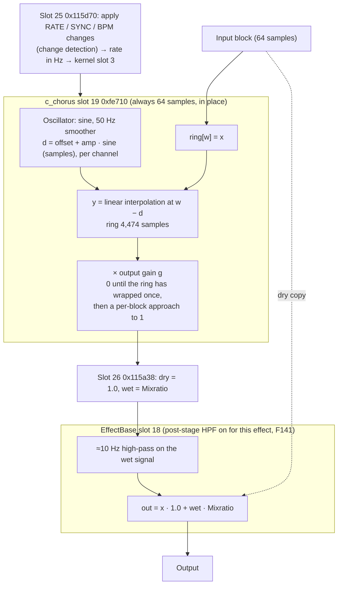

# Chorus (Insert index 0, Master/Send index 2)

Part of [Effects and mixer in firmware 1.60](README.md). Findings F054–F062, with
F017, F139–F149, F156, F159, F165, F183–F186 for the surroundings, in the
[findings ledger](../../research-notes/F-effects/findings-ledger.md). Model:
[tools/fx/chorus.py](../../tools/fx/chorus.py) (uses
[tools/fx/osc.py](../../tools/fx/osc.py)).

## Summary

Chorus is **fully reconstructed**: signal chain, every parameter formula, the object
and kernel layouts, start-up behaviour, reset and retrigger. The Python model is
**bit-exact to the 1.60 routine run in a single-function emulator** in 38 worker runs
of 160 blocks (778,240 samples) and 12 independent review runs, with every object
field equal after every block (F060). Through the shared `EffectBase` wrapper it is
also bit-exact end to end (F149, F151). It has not been compared with audio recorded
from an SP-16.

Chorus is **one modulated delay tap per channel**. The shared oscillator
([oscillator.md](oscillator.md)) runs a smoothed sine. Its output is the **delay time in
samples**, read from a 4,474-sample ring buffer with linear interpolation. There is no
feedback. Slot 25 outputs the wet signal only; the dry signal is added later by the
shared wrapper **at unity gain**, so the effect output is dry + Mixratio × wet, not a
crossfade (F055, F061).

All three FX processors build the same Chorus with identical code (F062). The Insert,
Master and Send defaults are identical, including **Mixratio 0**: at the processor
defaults, Chorus adds nothing to the dry signal (F156).

## Where it sits

| Context | Array index | Effect ID (Insert) | Built by | Tempo feed |
|---|---|---|---|---|
| Insert FX1/FX2 | 0 | 4 | inline in `InsertFxProcessor` ctor `0x118b50–0x118c64` (F056) | yes, parameter 7 every block (F017) |
| Master FX | 2 | — | inline in `MasterFxProcessor` ctor, block `0x114cfc` (F062) | yes (F156) |
| Send FX | 2 | — | inline in `SendFxProcessor` ctor, block `0x11bd28` (F062) | yes (F156) |

The three construction blocks (67–68 instructions) are identical after resolving
literals, and a Master-built object gives output identical to an Insert-built one over
100 noise blocks (F062). The processors and the type switch are described in
[fx-processors.md](fx-processors.md); the track and bus positions in
[signal-flow.md](signal-flow.md).

## Signal flow



Per block, slot 25 (`0x115d70`) consumes changes of RATE, SYNC and BPM. If any of them
changed, it computes the rate in Hz and passes it to kernel slot 3 (`0xfeb10`), which
clamps it and calls the oscillator's setFrequency. Then it runs kernel slot 19
(`0xfe710`) on the block in place and updates the dry/wet pair (slot 26). It returns 0
(F057, F060).

## Parameters

Index = the `EffectBase` slot-14 index the 1.60 code uses. Slot 14 is Chorus's own
`0x116224`; it always returns 0 (F057). The **shared quantiser** used by every formula
below is (F058):

```math
i = \operatorname{rint}\big(\mathrm{F}(lo + \mathrm{F}(v\cdot(hi-1-lo)))\big)
```

F() is float32 rounding (the multiply-add is not fused); rint rounds half to even. The
{lo, hi} pairs come from small code helpers, not tables (F058).

| # | Parameter | Formula (v = 0…1; float32) | Range | Insert default (slot 52, F057) | When applied |
|---|---|---|---|---|---|
| 0 | RATE, SYNC off | Hz = 0.1 · rint(1 + 99v) ({1, 101}) | 0.1…10 Hz in 0.1 Hz steps | 19/99 (→ 2.0 Hz) | next slot 25 |
| 0 | RATE, SYNC on | i = rint(9v) ({0, 10}); Hz = F(F(F(b·BPM)/a)·F(1/60)), (a, b) from the table below | one cycle per 16 … 1/16 beats | — | next slot 25 |
| 1 | DEPTH | d = rint(100v), clamped 0…100 | 0…100 | 1.0 (d = 100) | at once (kernel slot 5 `0xfed90`) |
| 2 | PHASE | deg = rint(180v), clamped 0…180; R offset φ = deg · (1/380) cycles | 0…170.5° | 0 | at once (kernel slot 6 `0xfec34`) |
| 3 | DEPTH SCALE | s = 0.1 · rint(10 + 90v), clamped 1…100 | 1.0…10.0 from v = 0…1 | 0 (s = 1.0) | at once (kernel slot 7 `0xfeecc`) |
| 4 | — | ignored (no case) | — | — | — |
| 5 | MIXRATIO | plain float `+0x29c`, no clamp; becomes the wrapper's wet gain | 0…1 | 0 | at once |
| 6 | SYNC | toggle: v ≥ 1 → on, v ≤ 0 → off, otherwise unchanged | 0/1 | 0 | next slot 25 |
| 7 | BPM | stored unclamped; the processor feeds the tempo clamped to 1…999 every block | 1…999 | fed (120 in the ctor) | next slot 25 |

Sync divisions, index i = 0…9 (pairs (a, b), one oscillator cycle lasts a/b beats; table
`0xf61f50` in `.bss`, filled by the static initialiser `0x6cb20`) (F058):

| i | 0 | 1 | 2 | 3 | 4 | 5 | 6 | 7 | 8 | 9 |
|---|---|---|---|---|---|---|---|---|---|---|
| beats per cycle | 16 | 8 | 4 | 2 | 1 | 3/4 | 1/2 | 1/4 | 1/8 | 1/16 |

An index above 9 (only for v outside 0…1) logs an assertion and uses index 2 (F058).

**Depth to delay.** With t = F(F(d·s)·0.01), and only if 0 ≤ t ≤ 100 (F058):

```math
amp = \mathrm{F}\big(\mathrm{F}(\mathrm{F}(t\cdot f_s)\cdot 0.001)\cdot 0.5\big),\qquad offset = amp + 0.2,\qquad d(n) = offset + amp\cdot \sin(n)
```

So the delay sweeps 0.2 … 2·amp + 0.2 samples. At the Insert defaults (d = 100, s = 1)
amp = 22.05 and the delay is 0.2…44.3 samples (≈1 ms). At the UI maximum (d = 100,
s = 10) amp = 220.5 and the delay reaches 441.2 samples = 10.0 ms. Depth scale values
up to 100 (v ≥ 11, not reachable from 0…1) give up to 4,410 samples; the review emulated
that too (F058).

**Rate clamp.** Kernel slot 3 clamps |Hz| to 0.00104167…64 Hz before setFrequency. At
999 BPM, sync indices 7 and above hit the 64 Hz clamp. BPM 0 hits the lower clamp; a
negative BPM gives |Hz| (F058). The oscillator itself floors frequencies at 0.0044100005
Hz (F051).

**Change detection** (F026, F057). RATE, SYNC and BPM are parameter objects. A value is
applied only if it differs from the stored copy (`+0x2a0`/`+0x2a4`/`+0x2a8`, ctor 0.5 / 0 /
120). Any change sets the dirty byte `+0x2ac`, and the rate is recomputed once. Before
the first block, RATE 0.5 equals the ctor copy, so the kernel keeps its ctor rate of
0.1 Hz until RATE changes.

**Phase.** The divisor is 380, not 360, so the largest right-channel lead is 0.4737
cycle = **170.5°**. The value is confirmed; that /380 is a slip in the firmware is a
*guess* (F058).

**UI side** (F159, F170, F183–F186). FxParamIndex rows 0–4 map to Chorus slot-14
indices {0, 1, 2, 3, 5}. The RATE knob steps on the "chorus" time family: free mode
1…100 (0.1 Hz steps), sync mode 0…9. With the encoder alone in free mode the knob moves
on a coarse grid (4–5 steps); holding SHIFT gives single steps; sync mode always moves
one division (F185). The screen shows the free rate as "%.1f" Hz and sync rates as
"%d/%d" (F186). The SYNC button calls the manager's SYNC toggle, which converts the
current rate between Hz and beats at the tempo of the press and snaps to the nearest
step of the new mode (F183, model `tools/fx/sync_convert.py`). The per-knob layout of
the Chorus page was not tabulated (F170). See [parameters.md](parameters.md).

## Processing (kernel slot 19 `0xfe710`)

Per block of `block` = 64 samples (the kernel always processes its stored block size;
slot 25 passes no count) (F059, F060):

1. **Reset flag** `+0xe2` (set by the ctor, so only on the first block): write index 0,
   ring zeroed, full flag 0, oscillator resetPhase(0), flag cleared.
2. **Retrigger flag** `+0xe0`: oscillator resetPhase(0), flag cleared.
3. The oscillator fills 64 delay values per channel (sine, 50 Hz output smoother; R
   leads by φ cycles).
4. Per sample, per channel: ring[w] = x; pos = w − d (+4,474 if negative);
   i0 = trunc(pos), fr = pos − i0; y = F(F(fr·ring[i0 + 1]) + F((1 − fr)·ring[i0])),
   with i0 + 1 wrapping to 0. Then w += 1; the first wrap of w sets the full flag
   `+0xf8`.
5. **Output gain** g (`+0xe8`). After the sample loop: target = 1 if the ring is full,
   else 0; step = F((target − g) · 1/(0.0033·fs)); then g += step per sample and the
   block is multiplied by g. If g is then within 0.01645 of the target, it snaps to the
   target.

**Start-up mute and fade-in** (F060, correcting F055). After construction, the output
is exactly 0 for blocks 0–68: the ring (4,474 samples) wraps during block 69. From then
on each block covers 64/145.5 = 44 % of the remaining distance: g = 0.4398, 0.6861,
0.8242, 0.9015, 0.9448, 0.9691, 0.9827 at the ends of blocks 69…75, then snaps to 1.0
after block 76. It is not one linear 3.3 ms ramp. Because the wrapper adds the dry
signal at unity, the effect output equals the input exactly during the mute (F061).

The ring is int(fs/10) + block = 4,474 samples. The constructor and the reset always
use the literals 64 and 44,100 (F059, F060).

## Object layout

`Chorus` (0x2b0 bytes) (F059):

| Offset | Contents |
|---|---|
| `+0x10` / `+0x14` | EffectBase dry / wet (slot 26 writes 1.0 / Mixratio) |
| `+0x1b8` | → `c_chorus` kernel |
| `+0x1bc` | RATE `LinearParameter` (0x5c bytes, id 0, ctor 0.5) |
| `+0x218` | SYNC `ToggleParameter` (0x28 bytes, id 6) |
| `+0x240` | BPM `LinearParameter` (id 7, 1…999, ctor 120) |
| `+0x29c` | Mixratio (ctor 1.0; the processor default is 0) |
| `+0x2a0` / `+0x2a4` / `+0x2a8` | stored copies of rate / sync / BPM (0.5 / 0 / 120) |
| `+0x2ac` | dirty byte |

`c_chorus` kernel (0x100 bytes, ctor `0xff008(k, 64, 44100)`) (F054, F059):

| Offset | Contents |
|---|---|
| `+0x04` / `+0x08` | fs / block |
| `+0x0c` / `+0x10` / `+0x14` / `+0x18` | rate Hz (ctor 0.1) / depth (100) / phase degrees (0) / depth scale (1.0) |
| `+0x1c`, `+0x20`, `+0xe4` | unused by Chorus (`+0x20` written by kernel slot 9) |
| `+0x28` | oscillator (0x98 bytes, [oscillator.md](oscillator.md)); ctor: sine, 0.1 Hz, amp 0.0005·fs = 22.05, offset amp + 0.2, phase offset 0, smoother 50 Hz |
| `+0xc0` | ring length (4,474) |
| `+0xc4` / `+0xc8` | → ring L / R |
| `+0xcc` | write index |
| `+0xd0` / `+0xd4` | → oscillator output (delay) buffers L / R |
| `+0xd8` / `+0xdc` | 1/(0.0033·fs) and its negative |
| `+0xe0` / `+0xe1` / `+0xe2` | retrigger byte / byte set by slots 16/17 (no effect on the output) / reset byte (ctor 1) |
| `+0xe8` / `+0xec` / `+0xf0` | output gain / gain target / per-sample step |
| `+0xf4` | snap tolerance 0.01645 (= (64/(0.0033·fs))⁵) |
| `+0xf8` | ring-full flag |

## 1.60 code map

| Address | What it is |
|---|---|
| `0x842920` | `Chorus` vtable |
| `0x841ba0` | `c_chorus` vtable |
| `0x118b50–0x118c64` | inline construction in the Insert processor ctor (`new(0x2b0)`, EffectBase ctor `0x1067d8(obj, 44100, 64, 0)`) |
| `0xff008` | `c_chorus` ctor `(k, block, fs)` |
| `0x115d70` | Slot 25: audio entry |
| `0x116224` / `0x116140` | Slot 14 setParameter / slot 15 getParameter (*likely*, not emulated) |
| `0x115a38` | Slot 26: dry 1.0, wet Mixratio |
| `0x115a14` | Slot 27: reset → kernel slot 2 (64, 44100) |
| `0x115a4c` | Slot 10: retrigger → kernel slot 18 `0xfe300` |
| `0x115a68` / `0x115a70` | Slots 23 / 24 (return 0) |
| `0x115be0` / `0x116758` | Destructors (slots 0 / 1) |
| `0xfe710` | Kernel slot 19: process |
| `0xfeb10` | Kernel slot 3: set rate (clamp, setFrequency) |
| `0xfed90` / `0xfec34` / `0xfeecc` | Kernel slots 5 / 6 / 7: depth / phase / depth scale |
| `0xfe6f4` → `0xfe59c` | Kernel slot 2: re-allocate and zero ring and oscillator buffers |
| `0xfe2c8` / `0xfe2e4` | Kernel slots 16 / 17: set / clear `+0xe1` |
| `0xfebc4`, `0xfe4a0`, `0xfe450`…`0xfe310` | Kernel slot 4 setPeriodMs, slot 9, slots 10–13 and 15 getters (*likely*, not used by Chorus) |
| `0x349778`, `0x349798`, `0x3497e0`, `0x349800`, `0x349858` | rate range / index → Hz / sync range / index → fraction (assert string) / sync reader |
| `0xf61f50` | sync fraction table (`.bss`), filled by `.init_array` entry `0x6cb20` |

## Lifecycle

- **Activation.** Chorus uses gate mode 0 and the 10 Hz post-stage high-pass (F140,
  F141). Each activation (`EffectBase` slot 5) runs the 147-sample activation fade at
  44.1 kHz (160 at 48 kHz) and calls slot 27 (F144, F149). See
  [effectbase.md](effectbase.md).
- **Reset (slot 27 `0x115a14`).** Only re-allocates and zeroes the ring and the
  oscillator buffers. It does **not** reset the write index, the full flag or the output
  gain, and it does not restart the oscillator (F060). So the start-up mute of blocks
  0–68 happens once after construction, not after a re-activation. (A consequence of
  F060; the wrapper composition runs with stops and re-activations were bit-exact,
  F149.)
- **Retrigger (slot 10 `0x115a4c`).** Sets `+0xe0`; the oscillator restarts at phase 0
  on the next block (F060). Slot 10 is called by FxProcessorBase slot 49 (`0x112774`)
  (F139). When the device calls that (for example on sequencer start) is open (H032).
- **Bypass and type switching** are processor features: a 132-sample crossfade to the
  dry copy (Insert only), and a sequential fade-out → swap → fade-in on a type change
  (F149, F154, F157). See [fx-processors.md](fx-processors.md).
- **Tempo feed.** Every block, the processors send the tempo clamped to 1…999 as index
  7 (F017, F156). It matters only with SYNC on; free Chorus output does not change when
  the feed is removed (F156).
- **SYNC.** In sync mode the rate follows tempo changes through the BPM feed. A rate
  produced by switching SYNC off is frozen at the tempo of the press. At 120 BPM, 8 of
  100 free rate steps survive an off → on → off round trip exactly (F183).
- **Project load.** Selecting Chorus stores the live values in `prj::EffectData`; a
  reload sends them back through slot 14. The Master/Send reload skips index 4 and
  sends SYNC as index 6 (F161, F165, F166). See [parameters.md](parameters.md).

## Validation evidence

- **End to end** (F060): 38 worker runs × 160 blocks (778,240 samples): 10 settings ×
  impulse/sine/noise, Sync at 87.5/120/200/999 BPM, mid-run changes of every index,
  retrigger, reset and two tempo-change runs. Review: 12 more runs (delays up to 4,410
  samples, BPM 1 and 133.37, six random parameter/tempo storms × 260 blocks). Max error
  0; state and the final ring equal.
- **Read-backs** (F058): 157 worker and 1,079 review read-backs of the stored values, 0
  mismatches.
- **Planted errors** (F057–F062): 7 of 7 deliberate model errors caught (for example no
  gain snap, phase /360).
- **Refuted alternatives** (F060): unquantised rate, phase /360, dry = 1 − mix, ring
  without +block, unquantised depth scale, linear fade-in, reversed sync table.
- **Recorded hashes** (F057–F062): report `09032fa8…6052`, result JSON `a04fce64…c286`,
  sorted concatenated outputs (38 files) `ef54794e…ce3d`, mutant report
  `bc99eae1…e446`; all reproduced byte-identically by the review.
- **Output law** (F061): at slot-18 level, out = F(in + F(mix·wet)) bit-exact at mix
  0.25 and 1.5; out == in in every mute block.
- **Wrapper and processors** (F149, F151, F154): bit-exact through the real slot 18
  (25,600 of 25,600 samples) and in the Master/Send type matrix.
- **Contexts** (F062): Insert, Master and Send construction identical; Master-built
  output identical over 100 noise blocks.

## Known quirks

- **Mixratio default 0** in all three contexts: at the processor defaults Chorus
  outputs the dry signal only. Whether the UI or a project overrides this on the device
  is untested (F156, F165).
- **The dry signal is never reduced.** Mixratio adds the wet signal on top; at Mixratio
  1 the output is dry + wet (F061). A Mixratio change glides over 147 samples in the
  wrapper (F061, F146).
- Phase tops out at 170.5°, not 180° (F058).
- The first 69 blocks after construction are dry only (F060).
- Index 4 does nothing (F057).

## Unknowns

- What calls the retrigger on the device (H032).
- The Chorus knob layout on screen and the on-screen labels (F170, H019).
- The kernel is always built and reset with fs = 44,100 and block = 64; its behaviour
  after a sample-rate change was not checked (F059, F149).
- LFO modulation of Chorus parameters and per-step locks (H068, H003/H070).
- See [open-questions.md → Effects](../open-questions.md#effects).

## Model

[tools/fx/chorus.py](../../tools/fx/chorus.py): own code, no firmware bytes. Classes
`Chorus` (slot 14 `set_param(idx, v)`, slot 25 `process(L, R)` in place on 64-sample
lists, slot 10 `retrigger()`, slot 27 `reset()`, and `dry`/`wet` after each block) and
`Kernel` (`c_chorus`). It imports `osc.py`, which uses `crmath.py` and
`fdlibm_sincosf.py`. Chorus uses only the sine waveform, so it does **not** need the
user-supplied random table (F051). The model is slot 25 only: feed BPM as index 7 every
block, as the processor does, and use `tools/fx/effectbase.py` for the wrapper (gate,
10 Hz high-pass, dry/wet). The oscillator's resync phase depends on heap contents the
constructor never writes; the model assumes zero (F051, H036).
