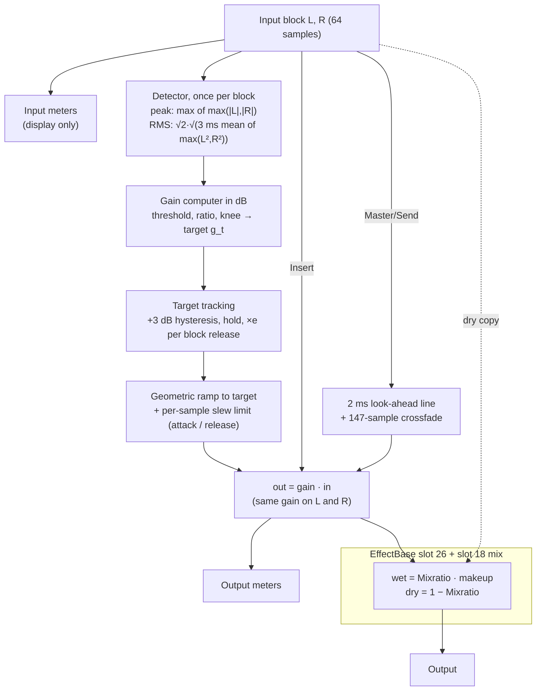

# Compressor (Insert index 7, Master/Send index 7)

Part of [Effects and mixer in firmware 1.60](README.md). Findings F081–F087, F141,
F148, F149, F156, F162–F169 in the
[findings ledger](../../research-notes/F-effects/findings-ledger.md). Model:
[tools/fx/compressor.py](../../tools/fx/compressor.py).

## Summary

The compressor is **fully reconstructed**: detector, gain computer, gain smoothing,
make-up and mix, every parameter formula, object layout, reset and the look-ahead of
the Master/Send version. The Python model is **bit-exact to the 1.60 routine run in a
single-function emulator**: 79 worker runs and 20 review fuzz runs on the Insert
compressor (about 5.1 million samples), plus 10 runs of the Send compressor with
look-ahead, all with error 0 and equal object state after every block (F085, F087).
It is also bit-exact end to end through the shared `EffectBase` wrapper (F149). It has
not been compared with audio recorded from an SP-16.

It is a **feed-forward, stereo-linked** compressor. Once per 64-sample block it measures
one level from the input (peak, or a 3 ms RMS), turns it into a target gain with a
dB-domain gain computer (threshold, ratio, optional soft knee), and moves the gain to
that target with a geometric ramp and a per-sample slew limit (attack and release).
The same gain multiplies both channels. Make-up gain and the dry/wet mix are applied
by `EffectBase` (F083).

There are three classes (F084):

- `FxCompressor` (vtable `0x841590`): the shared core. Its own slot 25 `0xf8050` is
  never used by a built object (*likely* unused).
- `InsertFxCompressor` (vtable `0x841618`, `new(0x790)`): the Insert effect, index 7.
- `SendFxCompressor` (vtable `0x8416a0`, `new(0x798)`): the Master and Send effect,
  index 7 in both arrays. It runs the same core plus a **2 ms look-ahead** (F087).

The three vtables differ only in slots 0/1 (destructors) and 25 (F084).

## Where it sits

- **Insert:** FX1 or FX2 of any track, Insert array index 7, effect ID 16 (see
  [README](README.md#status)). The Insert processor sends it **no tempo** (processBlock
  case 7 goes straight to slot 18; F081).
- **Master and Send:** index 7 of the Master or Send array (`SendFxCompressor`). The
  Master/Send processors send it no tempo either (they feed only indices 0, 2, 3 and 9;
  F156).
- Every call goes through the shared slot-18 wrapper (gate mode 0, no input fade). The
  processors do **not** switch on the 10 Hz post-stage high-pass for the compressors
  (F141). The Insert compressor alone keeps the wrapper's skip/clamp flag set, so its
  processing starts 147 samples late after every activation
  ([below](#activation-and-the-insert-start-delay)).

## Signal flow



Per block, slot 25 (Insert `0xf8718`, Send `0xf8270`) updates the input meters, runs
the detector (`0xf8b88` peak, or RMS inline in slot 25), runs the gain stage `0xf8c40`
(which ends by calling slot 26), updates the output meters (`0xf9490`) and returns 0
(F083, F084). Only scalar VFP is used, no NEON, and nothing writes the FPSCR (F084).

## Parameters

Index = the `EffectBase` slot-14 index. The constructor registers 14 parameter objects
at `+0x1b8 + 0x5c·k` (F081). **Nothing applies immediately and there is no change
detection**: every slot 25 re-reads all parameters. Only Threshold, Ratio and Knee keep
a last-value copy; when one of them changes, the ramp length is reset to max(n, 44)
(F081).

All formulas below matched the stored values in call-site read-back sweeps with 0
mismatches (F082). q(lo, hi) is the shared index law of the range helpers
`0x34b640…0x34b850`, unclamped, with F = round to float32 (F082):

```math
q(lo, hi) = \operatorname{rint_{even}}\big(F(lo + F(v\cdot(hi - 1 - lo)))\big)
```

| # | Parameter | Formula (v = 0…1) | Range | Insert default (F081) | Constructor value |
|---|---|---|---|---|---|
| 0 | Threshold | T = q(−52, 1) dB | −52…0 dB, 1 dB steps | 1.0 (0 dB) | 1.0 |
| 1 | Ratio | R = F(q(10, 301) · 0.1f); the gain computer uses F(1/R) | 1.0…30.0, steps of 0.1 | 0 (1:1) | 0 |
| 2 | Attack | i = q(1, 0x3fc); ms = F(i · 0.05f) for i ≤ 20, else i − 19 | 0.05…1.0 ms, then 2…1000 ms | 0 (0.05 ms) | 1.0 |
| 3 | Release | ms = q(10, 0xfa1) | 10…4000 ms, 1 ms steps | 0 (10 ms) | 1.0 |
| 4 | Gain (make-up) | G = q(0, 51) dB; makeup = powf(10, F(G · 0.05f)) | 0…50 dB, 1 dB steps | 0 (0 dB) | 0.5 |
| 5 | Mixratio | slot 26: dry = F(1 − v), wet = F(v · makeup) | 0…1 | 1.0 | 0 |
| 6 | LookAhead | toggle: v ≥ 1 on, v ≤ 0 off, 0 < v < 1 unchanged (returns 3) | off / on | — (Master/Send default 0) | off |
| 7 | Knee | K = F(18 · v) dB; knee width W = 2K; K ≤ 0 is a hard knee | 0…18 dB | 0 (hard) | 0 |
| 8 | LevelDetect | stores trunc(v); 1 = RMS, every other integer = peak | peak / RMS | 0 (peak) | 0 |
| 9–13 | ViewInputLevelL/R, ViewRatio, ViewOutputLevelL/R | written by slot 25 (meters), not on the audio path | — | — | — |

Notes on the table:

- **The default compressor is neutral**: threshold 0 dB, ratio 1:1, make-up 0 dB,
  Mixratio 1 (F081). The Master/Send slot-52 defaults are the Insert defaults plus
  index 6 = 0 (look-ahead off) (F156).
- **Attack has a gap**: there is no value between 1.0 and 2.0 ms (F082).
- **Ratio index 0** (v ≈ −0.036…−0.033, outside 0…1) gives R = 0 and 1/R = +inf on the
  device; the model raises an error there instead (F085, H048).
- **Knee from the UI is only 0 or 1** (hard, or K = 18 dB = a 36 dB wide knee), because
  the UI sends it as an enum name, "CompressorKneeHard" → 0 and "CompressorKneeSoft" →
  1 (converter `0x11d6f0`, F164, F165). LevelDetect likewise arrives as
  "LevelDetectPeak" → 0 or "LevelDetectRMS" → 1 (converter `0x11d818`).
- The on-screen names are images. Strings at `0x877a77…` read COMPRESSOR RATIO / ATTACK
  / RELEASE / THRESHOLD / OUTPUT GAIN / MIX RATIO; that each label goes with the
  matching index is *likely* (F081, F170).

### How the parameters reach the compressor

- **Insert, knobs and locks.** FxParamIndex rows 50–55 map to slot-14 indices 0–5 of
  Insert index 7 (F159). The parameter manager passes the normalised value unchanged
  to slot 14 (F160). Indices 6, 7 and 8 have no FxParamIndex row (F081).
- **Encoders.** The Insert and the Master/Send compressor boxes map encoders 1…6 to
  indices 1, 2, 3, 0, 4, 5 (Ratio, Attack, Release, Threshold, Gain, Mixratio). The
  box-to-layout pairing is *likely* (F170).
- **Buttons** (F169). Insert: Peak/RMS buttons (LevelDetect, index 8) and a Knee toggle
  (index 7). Master/Send: a LookAhead toggle (index 6, through manager slot 36, which
  writes the EffectData byte `+0x28` and calls slot 14 when the current effect is the
  compressor), Peak/RMS and Knee. **The Insert compressor has no LookAhead writer in
  the UI** (F169).
- **UI step law.** Knob turns follow the shared integer step law of
  [parameters.md](parameters.md) on the manager's range for each knob (F185). The
  per-knob ranges for the compressor are not tabulated in the ledger.
- **Project reload** sends Compressor 6 (EffectData byte `+0x28`), 7 (Knee) and 8
  (LevelDetect) on Master/Send. The Insert reload sends 7 and 8 but **no index 6**
  (F166).

## Processing stages

### Detector (once per block)

Both detectors look at the **input** of the block (feed-forward) and at both channels
together (F083).

- **Peak** (`0xf8b88`): level = max over the block of max(|L|, |R|), floor 1e-8. The
  routine also records the 1-based in-block index of that maximum; it becomes the ramp
  length of an attack.
- **RMS** (inline in slot 25, LevelDetect = 1): a ring of 132 = trunc(3 ms · fs) values of
  max(L², R²) (each square in float32), summed in double. For each sample the running
  mean is F(sum · (1/132)); level = F(√(largest mean in the block) · √2), floor 1e-8.
  The in-block index of the largest mean is recorded as for peak. Until 132 samples have
  entered the ring after a reset, old values are not subtracted.

### Gain computer (`0xf8c40`)

L = F(20 · log10(level)) uses the 1.60 libm **double** `log10`, which is **not**
correctly rounded (81 of 1,504 tested arguments differ by 1 ulp from a correctly
rounded result); the model ports its algorithm (F082). If L ≤ −160 dB, g_t = 1.

The static curve is the standard quadratic soft knee (F083):

```math
y = \begin{cases} L & L \le T - K \\ L + \left(\tfrac{1}{R} - 1\right)\dfrac{(L - T + K)^2}{4K} & T - K < L \le T + K \\ T + \dfrac{L - T}{R} & L > T + K \end{cases}
\qquad g_t = 10^{-(L - y)/20}
```

The code computes it as an interpolated slope and threshold point, and for bit-exact
results the model follows that order (F083). With s = (L − (T − K)) / 2K inside the knee:
slope = 1 + (1/R − 1)·s, point = (T − K) + K·s (written as lo + (T − lo)·s), and
y = point + (L − point)·slope. Above the knee: slope = 1/R, point = T. Below: slope 1,
point −160. With K = 0 the hard knee is slope 1/R and point T for L > T, otherwise slope
1. g_t = powf(10, F((L − y) · −0.05f)) with fdlibm `powf`.

### Target tracking

The target gain moves as follows, once per block (F083):

- **Attack** when g_t < 1 and g_t ≤ 1.4125376 · target (a +3 dB hysteresis):
  target = min(target, g_t); hold = min(trunc(release ms · fs / 4000), 441) samples
  (release / 4, at most 10 ms: 110, 220 and 441 samples for 10, 20 and ≥ 40 ms); the
  ramp length = the in-block index of the detector maximum.
- **Otherwise** the hold counts down by n. When it has run out, target = target · e
  (+8.69 dB per block), capped at g_t and at 1. The ramp length becomes max(n, 44).

`e` and `1/e` are computed once with `expf(1)` and `expf(−1)` and stored in the object
(`+0x770`, `+0x774`).

### Gain smoothing and output

In the gain domain (F083):

1. A geometric ramp from the current gain to the target over the ramp length:
   k = powf(target / gain, 1 / ramp), gain ·= k per sample, clamped at the target.
2. A per-sample slew limit: the gain may fall by at most a factor a and rise by at most a
   factor r per sample, with

```math
a = \operatorname{expf}\!\left(-\frac{1}{F(F(ms_{att}\cdot f_s)\cdot 0.001)}\right),\qquad r = \operatorname{expf}\!\left(+\frac{1}{F(F(ms_{rel}\cdot f_s)\cdot 0.001)}\right)
```

   `expf` here is the glibc 2.13 routine, which is not always correctly rounded (F082).
   This gives constant slopes of nominally 8.69 dB per attack or release time (up to
   about 1.2 % off at 4000 ms, from the float-rounded factor).
3. out = gain · in on both channels.

There is no delay in the Insert compressor. Because the ramp ends at the block's peak
index, the gain anticipates the peak by up to 63 samples within the block (F083).

### Make-up and mix (slot 26 `0xf7380`)

At the end of every gain stage, slot 26 sets the `EffectBase` pair: dry = F(1 − v),
wet = F(v · makeup). So Mixratio crossfades between the dry input and the compressed,
made-up signal. At slot-18 level (post-stage neutral) the output is
F(F((1 − v)·in) + F(v·makeup·y)); "dry at unity" and "crossfade without make-up" were
both refuted (F082).

### Meters

`0xf9490` keeps four peak-hold meters (input L/R, output L/R): floor 1e-8, ceiling 2.0,
decay −1 dB per block, hold 6 blocks. View indices 9/10 are the input meters, 11 the
block's minimum gain, 12/13 the output meters times make-up, capped at 2.0 (F084). They
do not affect the audio.

### Send/Master look-ahead (`0xf8270`)

`SendFxCompressor` slot 25 calls the same detector, gain stage and meter routines with
the same RMS code (F087). It adds:

- an 89-slot delay line per channel (88 samples ≈ 2 ms at 44.1 kHz);
- a linear crossfade between the undelayed and the delayed input, stepping by 1/147
  per sample: towards the delayed signal when LookAhead is on, towards the undelayed one
  when it is off.

The detector sees the **undelayed** input; the gain is applied to the crossfaded
signal. So with LookAhead on the gain leads the audio by 2 ms. The real Send object
matched `Compressor.process_send` bit-exactly, including LookAhead switched through
slot-14 index 6 (F087).

On the **Insert** compressor LookAhead does nothing: slot 25 `0xf8718` never refreshes
the copy at `+0x74c`, and 120 blocks were identical with it on and off (F087).

## Object layout

`InsertFxCompressor` is 0x790 bytes, `SendFxCompressor` 0x798. 49 fields were compared
after every block, with zero-filled and 0xA5-filled heap (F084).

| Offset | Contents |
|---|---|
| `+0x10` / `+0x14` | EffectBase dry / wet |
| `+0x1b8` + 0x5c·k | 14 parameter objects (k = 0…13); LookAhead toggle at `+0x498` |
| `+0x68c` / `+0x690` | gain-computer slope / threshold point (dB) |
| `+0x694` / `+0x698` | current gain / make-up |
| `+0x69c` / `+0x6a0` | fs / → detector buffer |
| `+0x6a4` / `+0x6a8` | block level / ramp length (peak index) |
| `+0x6ac`, `+0x6c4`, `+0x6e0`, `+0x6f8` | meters, 6 words each: current, floor 1e-8, ceiling 2, decay −1 dB/block, hold 6 blocks, counter |
| `+0x6dc` | minimum gain of the block |
| `+0x710` … `+0x72c` | look-ahead: length 89 … fade step 1/147 |
| `+0x730` / `+0x734` / `+0x738` | RMS window 132 / position / 1/132 |
| `+0x73c` / `+0x740` | RMS ring / sum (double); `+0x768` / `+0x76c` window weight / fill count |
| `+0x748` / `+0x74c` | LevelDetect copy / LookAhead copy |
| `+0x750` / `+0x754` / `+0x758` | level (dB) / hold counter / hold length |
| `+0x75c` / `+0x760` | target gain / → ramp buffer |
| `+0x764` | release time (ms) |
| `+0x770` / `+0x774` | e / 1/e |
| `+0x778` / `+0x77c` | written only by `0xf7fc8`, which has no callers and no pointer (*likely* dead) |
| `+0x784` / `+0x788` / `+0x78c` | last Knee / Threshold / Ratio |
| `+0x790` / `+0x794` | Send only: look-ahead buffers |

## 1.60 code map

| Address | What it is |
|---|---|
| `0x841590` / `0x841618` / `0x8416a0` | `FxCompressor` / `InsertFxCompressor` / `SendFxCompressor` vtables |
| `0xf7584` | `FxCompressor` constructor (14 parameters, RMS ring 132, look-ahead 89, e and 1/e) |
| `0xf8a20` / `0xf8a40` | Insert / Send constructor `(obj, fs, block)` → `0xf7584` |
| `0xf8718` | Insert slot 25: meters → detector → gain stage → meters |
| `0xf8270` | Send slot 25: as Insert, plus the look-ahead line and crossfade |
| `0xf8050` | Base slot 25, not used by any built object (*likely* unused) |
| `0xf8b88` | Peak detector |
| `0xf8c40` | Gain stage: parameters → gain computer → target/hold → ramp + slew limit → output; calls slot 26 |
| `0xf9490` | Meters |
| `0xf7380` | Slot 26: dry = 1 − v, wet = v · makeup |
| `0xf7fb8` → `0xf7e38` | Slot 27: reset |
| `0xf7fc8` | Unused routine writing `+0x778`/`+0x77c` (*likely* dead) |
| `0x34b640…0x34b850` | Range helpers (the q(lo, hi) law) |
| slots 23, 24, 28, 29, 30 | Return 0 (*likely*: no re-initialisation on a sample-rate or block-size change) |

## Lifecycle

### Construction and reset

- **No start-up fade inside the effect.** The gain starts at 1 and ramps inside the
  first block (F086).
- **Reset (slot 27 `0xf7fb8` → `0xf7e38`)** sets gain = make-up = target = 1, minimum gain
  1, hold 0, RMS sum and fill count 0, the release copy to 10 ms and the meters to their
  floor, and clears the look-ahead line (F086). The look-ahead fade restarts fully on
  the side of the current LookAhead copy. It **keeps** the RMS ring samples and position,
  the ramp length, slope and point, and the last-value copies (F086).
- **Activation** (`EffectBase` slot 5) calls slot 27 and then slot 26, so the mix uses
  make-up 1 until the next block (F086).
- Slot 10 (retrigger) is the `EffectBase` default `0x10594c`: it returns 2 and changes
  nothing (F086).
- Constructor quirk: the hold length `+0x758` is computed before the release time
  `+0x764` is set, so it starts at 0 (F086).

### Activation and the Insert start delay

The processors call slot 22(e, 0) on every effect after construction, which clears the
wrapper's skip/clamp flag `+0xa8`, **except on Insert index 7** (F141). So the Insert
compressor keeps `+0xa8 = 1`, and on every activation the wrapper skips it for 147
samples (160 at 48 kHz): the output equals the input bit for bit for samples 0…147, and
the first difference is at sample 148. Every other insert, and the Master/Send
compressor, differs from sample 1 (F148). Whether this 3.3 ms is audible on the device
is a *guess* (H074).

The stop side is the same for all inserts: processing ends 147 samples after slot 6.
The clamp only matters when slot 6 is called with a dry target other than 1.0, which no
1.60 caller does (F148).

### Type switching, bypass and FX on/off

These are processor functions, shared by all effects (see
[fx-processors.md](fx-processors.md)): a type change fades the old effect to dry over
147 samples, then swaps and activates the new one (F149, F154); the Insert bypass is a
132-sample crossfade to the dry copy while the effect keeps running (F157). The
compressor is built in gate mode 0, so its input is never faded: it keeps receiving the
raw input while its output fades out (F140, F177).

### Tempo and SYNC

The compressor has no tempo-dependent parameter and receives no tempo feed (F081,
F156). Its index 6 shares EffectData byte `+0x28` with the SYNC byte of the time
effects, which causes the carry-over quirk below (F167).

## Validation evidence

- **Insert, emulation comparison** (F085): 79 worker runs, 1,853,440 samples: 10 settings
  × impulse, three sine levels, noise, level steps and silence, covering ratio 1–30,
  threshold −52…0 dB, attack 0.05…1000 ms, release 10…4000 ms, knee 0…18 dB, gain 0/6/50
  dB, Mixratio 0/0.5/1 and RMS; 2 all-parameter event runs × 3 signals; 3 random-event
  runs. Review: 20 fuzz runs, 3,251,200 samples, 15,397 parameter events including
  out-of-range values and index 6, 482 resets, threshold-tracking sines, denormals and a
  0xA5-filled heap. Maximum error 0; full object state equal after every block.
  Recorded hashes: report `88ae0286…f8ba`, json `c1581413…4299`, 83 output files
  `716e131c…f893`, regression `3045b6cc…fa3e`.
- **Refuted alternatives** (F083), each failing against the emulation: plain peak instead
  of RMS, an unlinked (left-only) detector, a feedback detector, hard knee only, no slew
  limiter, the target jumping at block start, no hold, RMS without √2, unity dry.
- **Send/Master look-ahead** (F087): the real Send constructor object matched
  `Compressor.process_send` in 4 worker and 6 review runs (≈ 742,000 samples), including
  LookAhead switched through index 6.
- **Through the wrapper** (F149): the Insert compressor (with `+0xa8 = 1`) and the Send
  compressor through the real slot 18, composed with the model: bit-exact
  (25,600/25,600 samples each).
- **Processors** (F154): both Master and Send processors driven with every type,
  including the compressor, bit-exact.
- **Maths library** (F082, F206): the model uses an own port of the 1.60 double `log10`
  (bit-equal on 1,504 + 7,959 arguments), fdlibm `powf` and the glibc 2.13 `expf`
  algorithm. A correctly rounded `expf` would differ on about 1 in 3,000 arguments.
- **Floating-point mode** (F202–F205): the device runs its audio threads without
  flush-to-zero, as the emulator does, so the earlier caveat about denormal inputs
  (F085) is settled.

## Known quirks

- **Insert compressor starts 147 samples late** after every activation (F148, above).
- **One level per block.** The detector does not react inside a block; the in-block ramp
  only shapes the gain towards the block's peak position (F083).
- **Attack time gap** between 1.0 and 2.0 ms (F082).
- **LookAhead on the Insert compressor has no effect** and has no UI writer (F087, F169).
- **SYNC can become LookAhead** (F167). EffectData byte `+0x28` is SYNC for Delay,
  Chorus, Flanger, Phaser and Ducker, and LookAhead for the compressor. Selecting the
  compressor (manager slot 32) does not refresh the byte. So on Master/Send, a time
  effect with SYNC on followed by a switch to the compressor makes the next project
  reload send LookAhead = 1.0, although the live compressor had 0. An edited Master/Send
  LookAhead is also not read back by slot 32, so a reload can restore a stale value.
  The Insert compressor is not affected. Both UI steps exist; the reload's callers were
  not traced (F171, H088).
- **Fresh project:** Compressor 6/7/8 start at 0/0/0 (look-ahead off, hard knee, peak),
  *likely*, assuming a new project builds its EffectData from the constructor (F167,
  H085).
- Base slot 25 `0xf8050` (no LevelDetect read, no meters) exists but is never a built
  object's slot (*likely* unused) (F084).

## Unknowns

- Whether the Insert start delay (F148) is audible on the device (*guess*, H074).
- Whether a project reload can switch on the Master/Send look-ahead through the SYNC
  carry-over, and when reloads happen (H088).
- Whether anything at project load sets the Insert compressor's LookAhead (*likely* never;
  it has no effect there anyway) (H090).
- Whether a new project uses the constructor defaults or a template (H085).
- Model gap: ratio index 0 (out of range) raises an error where the device computes
  1/0 = +inf (H048).

## Model

[tools/fx/compressor.py](../../tools/fx/compressor.py), class `Compressor(fs, n,
send=False)`:

- `set_param(idx, v)` = slot 14; `insert_defaults()` applies the Insert slot-52 values;
- `process(L, R)` = Insert slot 25 `0xf8718`; `process_send(L, R)` = Send/Master slot 25
  `0xf8270` (set `lookahead_param` to 0 or 1 for index 6);
- `reset()` = slot 27; `update_mix()` = slot 26 (its `dry`/`wet` feed the
  `EffectBase` model in [tools/fx/effectbase.py](../../tools/fx/effectbase.py)).

The model covers slot 25 to 27. The activation gate, the Insert start delay and the
dry/wet mix are in the `EffectBase` model.

Imports:

- `fdlibm_powf.py` (fdlibm `powf`, Sun's notice kept);
- `glibc_log10.py` (own re-implementation of the fdlibm `e_log10` algorithm as shipped in
  glibc 2.13, on a correctly rounded natural log; Sun's notice kept);
- `glibc_expf.py`, an own re-implementation of the glibc 2.13 `e_expf.c` algorithm. This
  one file is licensed **LGPL-2.1-or-later** (see
  [LICENSE-LGPL-2.1](../../LICENSE-LGPL-2.1) and [NOTICE.md](../../NOTICE.md)); the rest
  of `tools/fx/` is MIT.

**Input you must supply:** `glibc_expf.py` does not contain the two accurate tables of
glibc's `expf`. It reads them at run time, by symbol name, from **your own 1.60
`libm.so.6`** (it needs the `lief` package for that). Call
`glibc_expf.load_tables(path_to_your_libm)` before constructing a `Compressor`;
otherwise the constructor tries a default path from the research folder layout. When
no tables are loaded, `glibc_expf.expf` falls back to the correctly rounded
`crmath.expf`, and attack/release factors can then differ by 1 ulp on about 1 in 3,000
settings (F082, F206).
