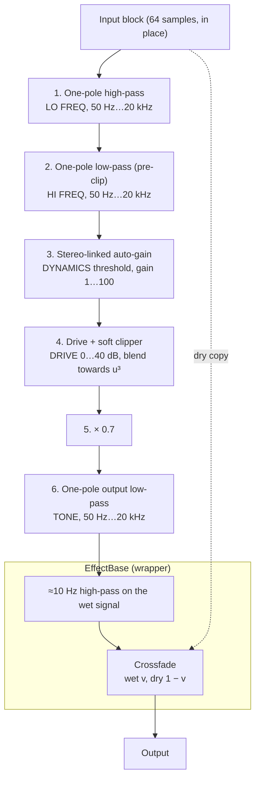

# Distortion (Insert index 6, Master/Send index 8)

Part of [Effects and mixer in firmware 1.60](README.md). Findings F054, F056,
F069–F074, F141, F149, F156, F159, F170 and F206 in the
[findings ledger](../../research-notes/F-effects/findings-ledger.md). Model:
[tools/fx/distortion.py](../../tools/fx/distortion.py).

## Summary

Distortion is **fully reconstructed**: signal chain, all six parameter formulas, the
filter and envelope coefficients, the object and kernel layout, reset and start-up. The
Python model is **bit-exact to the 1.60 routine run in a single-function emulator** in 53
of 53 runs (1,141,760 samples), plus 921,600 samples of independent review fuzz (F072).
Through the real shared `EffectBase` wrapper (slot 18) it is also bit-exact end to end
(F149). It has not been compared with audio recorded from an SP-16.

The effect is a fixed chain of six stages, all inside the DSP kernel `c_distortion`:
a one-pole high-pass, a one-pole pre-clip low-pass, a stereo-linked automatic gain
("DYNAMICS"), a drive stage with a cubic soft clipper, a fixed ×0.7 output gain and a
one-pole output low-pass (F072). There is no modulation: the kernel builds an oscillator
but never runs it (F054, F071). After the kernel, the shared wrapper adds its ≈10 Hz
high-pass post-stage and the dry/wet mix; for Distortion the mix is a **crossfade**
(F072, F141).

## Where it sits

- **Insert index 6** (effect ID 12), **Master and Send index 8** (F018, F019, F173).
- Each processor builds its own `Distortion` **inline** in its constructor: Insert at
  `0x119060`, Master at `0x115200`, Send at `0x11c22c`. The three 36-instruction blocks
  are instruction-identical, and objects from each give identical output (F056, F074).
- The processors switch the wrapper's 10 Hz post-stage high-pass **on** for Distortion
  (F141). Distortion gets **no tempo feed** and has no SYNC (F017, F156, F183).
- Default values are the same on Insert, Master and Send (F156).

## Signal flow



Slot 25 (`0x115d48`) calls the kernel's non-virtual process routine `0xfa78c(kernel, L, R,
L, R)` once per block and returns 0; the kernel's own return value is discarded (F071).
Each stage runs over the whole block before the next stage starts. All arithmetic is
scalar float32 (VFP), every multiply-add is **non-fused**, and each product and sum is
rounded to float32 on its own (F072).

## Parameters

Index = the `EffectBase` slot-14 index. Distortion overrides slot 14 (`0x1164d8`) and uses
**no** `LinearParameter` objects: every index is applied to the kernel **immediately**,
the raw value v is stored at `+0x1bc + 4·i`, and slot 14 returns 0. Indices ≥ 6 are
ignored (F069). Slot 15 (`0x115a78`) returns the stored copies.

| # | Parameter (screen name, F069/F170) | Formula (v = 0…1; float32 unless noted) | Range | Default (F069) | UI integer steps (F069, F162) |
|---|---|---|---|---|---|
| 0 | DRIVE | dB = 40·v; drive = powf(10, dB·0.05); blend = 0 if dB ≤ 0, else min(dB·0.05, 1) | 0…40 dB (drive ×1…×100); blend full from v = 0.5 | 0 (0 dB) | 0…80 (0.5 dB) |
| 1 | TONE (output low-pass) | f = (float)(20·pow(10.0, (double)F(3v))) in double; fc = clamp(f, 50, 20000) | 50 Hz…20 kHz | 1.0 (20 kHz) | 0…1000 |
| 2 | LO FREQ (high-pass) | as index 1 | 50 Hz…20 kHz | 0 (20 Hz → clamped to 50 Hz) | 0…1000 |
| 3 | HI FREQ (pre-clip low-pass) | as index 1 | 50 Hz…20 kHz | 1.0 (20 kHz) | 0…1000 |
| 4 | DYNAMICS (auto-gain threshold) | T = clamp(v, 0, 1); lower threshold = T·0.70794576 (−3 dB) | 0…1 | 0 (auto-gain off) | 0…100 |
| 5 | MIX RATIO | wet `+0x14` = v, dry `+0x10` = 1 − v (no clamp); also calls kernel slot 9 with 100.0 (unused) | 0…1 | 1 (fully wet) | 0…100 |

Notes:

- **Names.** The UI strings are DRIVE, LO FREQ, HI FREQ, DYNAMICS, TONE and MIX RATIO
  (`0x87faf0…`), and FxParamIndex 35…40 map to slot-14 indices 0…5 (F069, F159). The
  knob dispatch gives encoders 1…6 the indices 0, 2, 3, 4, 1, 5, so HI FREQ is the
  pre-clip low-pass (index 3) and TONE the output low-pass (index 1) (F170; this settles
  H042's index clause). The on-screen labels are skin images, and the pairing of the
  parameter box with this layout is *likely* (F170).
- **Frequency floor.** The setters clamp the cutoff to 50 Hz, so LO FREQ, HI FREQ and
  TONE give 50 Hz for every v below ≈0.133, although the formula starts at 20 Hz (F070).
- **UI steps.** The integer domains come from the slot-52 default code and the manager's
  range function s50: DRIVE 0…80, the three frequencies 0…1000, DYNAMICS and MIX RATIO
  0…100. A knob step gives v = i / (number of steps), by the shared step law (F185; see
  [parameters.md](parameters.md)). That the device knobs use exactly these domains is
  *likely* (F069, F162). The engine itself does not quantise v.
- **Change detection** is in the kernel setters, not in slot 14: each setter skips a
  value equal to its change copy (`+0x0c…+0x1c`, the raw unclamped value) (F069).
- **Slot-52 defaults** (Insert case 6, pairs (index, v)): (0, 0.0), (1, 1.0), (2, 0.0),
  (3, 1.0), (4, 0.0), (5, 1.0). That is drive 0 dB, blend 0, both low-passes at 20 kHz,
  the high-pass at 50 Hz, auto-gain off and fully wet (F069). Master and Send use the
  same values (F156).

## Processing stages (kernel `0xfa78c`)

With x the input sample of a stage and F() rounding to float32 (F070, F072):

### 1. High-pass (LO FREQ) and 2. pre-clip low-pass (HI FREQ)

One-pole filters with a = expf(F(F(fc·−2π)·F(1/fs))) and b = 1 − a, where −2π is the
float32 constant −6.2831855:

- high-pass: lp = F(F(b·x) + F(a·lp)); y = F(x − lp);
- low-pass: y = F(F(b·x) + F(a·y)).

The constructor's initial coefficients are computed from the precomputed products
1/fs·(−125663.71) (20 kHz) and 1/fs·(−314.159) (50 Hz). These round differently from
the setters' (fc·−2π)·(1/fs), so a re-set to the same cutoff can change the coefficient
by an ulp (F070).

### 3. Stereo-linked auto-gain (DYNAMICS)

One gain g (1…100) for both channels, per sample (F072):

1. L ·= g, R ·= g;
2. m = max(|L|, |R|) of the **post-gain** samples;
3. if m ≥ T: g ·= dec (not below 1), hold := reload;
   else if m ≥ T·0.70794576: hold := reload;
   else if hold > 0: hold −= 1;
   else: g ·= inc (not above 100).

Constants (init `0xfa36c`, F070): inc = expf(1/(0.1·fs)) (an e-fold rise per 100 ms),
dec = expf(−1/(0.003·fs)) (an e-fold fall per 3 ms), reload = fs/50 = 882 samples
(20 ms). With T = 0 the gain can never rise, so **DYNAMICS 0 means auto-gain off**. The
kernel's initial T is 0.1; the slot-52 default sets it to 0 (F069, F070).

### 4. Drive and soft clipper, 5. ×0.7

u = F(x·drive). If u > 1 the output is +1, if u < −1 it is −1 (and w = 0). Otherwise
(F072):

```math
s = 1.5\,u - 0.5\,u^{3},\qquad w = \text{blend}\cdot(1 - |s|)^{3},\qquad y = 0.7\left(w\,u^{3} + (1 - w)\,s\right)
```

The blend moves the curve towards the **raw cube** u³, not towards the hard clip. The
model evaluates c = u·(u·u), s = c·(−0.5) + u·1.5, and (1 − |s|) as 1 − s for s ≥ 0 and
s + 1 otherwise, each step rounded to float32. At 0 dB drive the small-signal gain is
1.5·0.7 = 1.05, and the output ceiling is ±0.7 (F072).

### 6. Output low-pass (TONE)

The same one-pole low-pass as stage 2, after the ×0.7 (F072).

## State and object layout

`Distortion` object, 0x1d8 bytes (F071):

| Offset | Contents |
|---|---|
| `+0x00…+0x1b7` | `EffectBase` (dry `+0x10`, wet `+0x14`) |
| `+0x1b8` | → `c_distortion` kernel |
| `+0x1bc…+0x1d0` | stored slot-14 values 0…5 (zeroed by the inline construction block) |

`c_distortion` kernel, 0x138 bytes, ctor `0xfa568(k, 64, 44100)` (F071):

| Offset | Contents |
|---|---|
| `+0x04` / `+0x08` | fs / block |
| `+0x0c` | drive-dB change copy |
| `+0x10` / `+0x14` / `+0x18` | output-LPF / HPF / pre-LPF cutoff change copies |
| `+0x1c` | threshold change copy |
| `+0x20` | slot-9 value (unused by process) |
| `+0x24` | never written (heap content) |
| `+0x28` | oscillator object (0x98 bytes; sine, 1 Hz; never run) |
| `+0xc0` | 1/fs |
| `+0xc4` / `+0xc8`, `+0xcc` / `+0xd0`, `+0xd4` | output LPF a / b, state L / R, clamped cutoff |
| `+0xd8` / `+0xdc`, `+0xe0` / `+0xe4`, `+0xe8` | HPF a / b, state L / R, clamped cutoff |
| `+0xec` / `+0xf0`, `+0xf4` / `+0xf8`, `+0xfc` | pre-LPF a / b, state L / R, clamped cutoff |
| `+0x100` | block (samples processed per call) |
| `+0x104` | drive (linear) |
| `+0x108` / `+0x10c` | upper / lower threshold |
| `+0x110` | auto-gain g |
| `+0x114` / `+0x118` | inc / dec |
| `+0x11c` / `+0x120` | hold reload / hold counter |
| `+0x124`, `+0x128`, `+0x12c` | slot-9 fraction, 0, 1/(0.01·fs) (unused by process) |
| `+0x130` | byte set/cleared by kernel slots 16/17 (unused by process) |
| `+0x134` | blend |

Initial state after `0xfa36c`: output LPF and pre-LPF at 20 kHz, HPF at 50 Hz, drive 1
(0 dB), blend 0, g = 1, hold = 882, T = 0.1, filter states 0 (F070, F071).

## 1.60 code map

| Address | What it is |
|---|---|
| `0x842898` | `Distortion` vtable (32 slots; overrides 0, 1, 10, 14, 15, 23–27) |
| `0x119060` / `0x115200` / `0x11c22c` | Inline construction in the Insert / Master / Send processor constructors (new 0x1d8) |
| `0x115d48` | Slot 25: audio entry → kernel process |
| `0x1164d8` | Slot 14: setParameter (applies immediately) |
| `0x115a78` | Slot 15: getParameter (stored values) |
| `0x115b0c` | Slot 27: reset (kernel re-init, then re-apply the six stored values) |
| `0x115bc8` | Slot 10: retrigger (returns 0, no effect) |
| `0x115bc4` | Slot 26: `bx lr` (the mix is set by slot 14 index 5) |
| `0x115d00` / `0x116670` | Destructors (slots 0/1) |
| `0x8418a0` | `c_distortion` vtable |
| `0xfa568` / `0xfa36c` / `0xfa4f4` | Kernel ctor / init / slot 2 re-init (block or fs ≤ 0 → drive := −1) |
| `0xfa78c` | Kernel process (non-virtual; only caller `0x115d5c`) |
| `0xfa614` | Set drive dB (non-virtual) |
| `0xfa2d0` / `0xfa234` / `0xfa198` | Kernel slots 5 / 6 / 7: output-LPF / HPF / pre-LPF cutoff |
| `0xfa07c` | Kernel slot 8: threshold |
| `0xfa0e8` | Kernel slot 9 (unused by process) |
| `0xfa154` / `0xfa174` | Kernel slots 16 / 17: set / clear byte `+0x130` |
| `0xfa694` / `0xfa70c` | Block helpers with no direct callers (*likely* dead code) |
| `0x118350` (table `0x117450`) | Insert slot 52, case 6: Distortion defaults |
| `0x87faf0…0x87fb50` | UI name strings |

## Lifecycle

- **Construction.** Each processor builds the object inline with (44100 Hz, 64 samples,
  gate mode 0) and switches the post-stage high-pass on at 10 Hz (F056, F141).
- **Activation and reset.** `EffectBase` slot 5 calls slot 27 once (F073, F149). Slot 27
  (`0x115b0c`) runs kernel slot 2 with (64, 44100), a **full re-init** (filter states 0,
  g = 1, hold 882, drive 1, initial cutoffs and threshold), and then calls slot 14 for
  i = 0…5 with the stored values. Because the kernel setters compare against their
  change copies, only a parameter equal to its init value is skipped, and that one
  already has its init value. So every activation clears the filter and envelope state
  and restores the stored settings (F073).
- **Start-up.** The kernel has no start-up mute, fade or gate of its own (the first block
  was 128 of 128 non-zero, F073). The wrapper's 147-sample activation crossfade still
  applies (see [effectbase.md](effectbase.md)).
- **Parameter changes** take effect at the next block and do not glide: the setters write
  the new coefficients directly (F069, F070). A MIX RATIO change writes dry/wet at once;
  the wrapper's mix stage then ramps the pair over 147 samples (F146).
- **Retrigger** (slot 10) returns 0 and changes nothing (F073).
- **Bypass, disable and type switching** are done by the processor (sequential 147-sample
  fade, 132-sample bypass crossfade): see [fx-processors.md](fx-processors.md).
- **Tempo and SYNC:** none (F017, F156, F183).
- **Failure path.** If kernel slot 2 fails (block or fs ≤ 0), drive := −1 and process
  returns without touching the buffers. Slot 27 always passes (64, 44100), so this does
  not occur on the device paths that were traced (F071, F073).

## Validation evidence

- **Coefficients** (F070): 385 emulated read-backs, 0 mismatches; the literals were
  checked in the code.
- **State** (F071): 62 model fields equal the emulated object after every block.
- **Audio** (F072): 53 runs, 1,141,760 samples: 9 settings × impulse, low and high sine,
  noise and silence × 160 blocks, with the gain limits 1 and 100 reached, mid-run changes
  of every index, resets, slots 10/16/17 and kernel slot 9. All bit-exact.
- **Independent review** (F072): 921,600 further samples bit-exact (random and
  out-of-range values, hard clip, NaN and infinity, random resets, a 0xA5-filled heap).
  8 of 8 planted model errors were caught. Recorded hashes: report `29a5598b…b95b`, JSON
  `7c0b94bc…4c00`, the sorted 53 output files `c2ad7973…82f0`, mutant run
  `85cf0b7c…1707`; worker and reviewer hashes identical.
- **Mix law** (F072): out = F(F((1 − v)·in) + F(v·y)) in 2,560 of 2,560 samples at
  v = 0, 0.3 and 1. The Chorus/Flanger law (dry stays 1) fails.
- **Through the real wrapper** (F149): bit-exact (25,600 of 25,600 samples) with the
  Insert-constructor wrapper state.
- **Master and Send** (F074, F154): the three construction blocks are identical and give
  identical output on 60 noise blocks; the Master and Send processors were driven with
  Distortion, bit-exact.
- **Maths library** (F070, F206): the 1.60 `pow(10, y)` is correctly rounded (0 of 2,000
  differ from a correctly rounded result; the host `math.pow` differs in 1 of 2,000),
  `powf` is fdlibm (0 of 2,000), and bit-exact coefficients need glibc 2.13's `expf`
  (0 of 3,000 and 0 of 20,000 with the re-implementation; a correctly rounded `expf`
  differs in about 1 of 3,000). See [numerics.md](numerics.md).
- **Refuted alternatives** (F072), each caught by the comparison: blend towards the hard
  clip, weight (1 − |s|)², ×0.7 after the output low-pass, detector on the pre-gain
  sample, per-channel gain, low-pass before high-pass, unclamped cutoffs, blend = dB/40.

## Known quirks

- **Dead zone at high drive.** From 20 dB drive (v ≥ 0.5) the blend is 1, so quiet signals
  follow 0.7·u³. That this is audible as gating or crossover distortion is *likely*. The
  auto-gain can lift quiet input back into the clipper (F072).
- **MIX RATIO is a crossfade** (dry 1 − v), unlike Chorus and Flanger, where the dry
  signal stays at 1 (F072, F149).
- The default is **fully wet** (MIX RATIO 1), unlike Chorus, Flanger and Insert Delay,
  whose default mix is 0 (F069, F075).
- The frequency controls cannot go below 50 Hz (F070).
- The kernel's initial threshold is 0.1, so a kernel that has not received the slot-52
  defaults runs the auto-gain (F070).
- The kernel's oscillator is built and never run (F054).

## Unknowns

- Whether the device knobs use exactly the integer domains above, and the coarse step
  size for these parameters (H042's domain clause, F185, H092).
- The on-screen labels and units (F170; labels are skin images).
- Device audibility of the dead zone (*likely*, F072).

## Model

[tools/fx/distortion.py](../../tools/fx/distortion.py): classes `Kernel` (`c_distortion`,
field names follow the 1.60 offsets) and `Distortion` (`set_param`, `get_param`,
`reset`, `process`). It models slot 25 and slot 27; the wrapper (post-stage high-pass,
dry/wet crossfade, activation fade) is in
[tools/fx/effectbase.py](../../tools/fx/effectbase.py).

Inputs and imports:

- It imports `osc.py` (for the never-run oscillator and the float32 helpers),
  `fdlibm_powf.py` and `glibc_expf.py`. The oscillator uses a sine, so the random table
  that `osc.py` needs for waveform 6 is not used here.
- **`glibc_expf.py`** is an own re-implementation of the glibc 2.13 `e_expf.c` algorithm
  and is distributed under the LGPL-2.1-or-later (see
  [LICENSE-LGPL-2.1](../../LICENSE-LGPL-2.1)). Its two accurate tables are **not**
  included: `glibc_expf.load_tables()` reads them at run time from your own 1.60
  `libm.so.6`. Without them, `expf` falls back to the correctly rounded `crmath.expf`,
  which differs from the device in about 1 of 3,000 arguments, so coefficients (and then
  output) are no longer guaranteed bit-exact.
- The double `pow(10, y)` is computed correctly rounded with Python's `decimal`, as the
  1.60 libm does.
