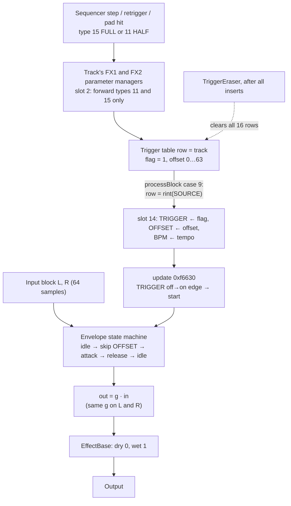

# Ducker (Insert index 9)

Part of [Effects and mixer in firmware 1.60](README.md). Findings F088–F094, F141,
F149, F159, F164–F171, F183–F186 and F192–F201 in the
[findings ledger](../../research-notes/F-effects/findings-ledger.md). Model:
[tools/fx/ducker.py](../../tools/fx/ducker.py).

## Summary

The Ducker is **fully reconstructed**: envelope algorithm, every parameter formula,
object layout, reset, and the whole trigger path from the sequencer to the effect. The
Python model is **bit-exact to the 1.60 routine run in a single-function emulator** at
slot 25 (57 worker runs and 40 review runs, about 2.4 million samples), through the real
Insert processor and trigger plumbing (16 + 9 + 8 runs), and on one real 16-row trigger
table driving six Duckers (69,120 samples) (F093, F197, F201). It has not been compared
with audio recorded from an SP-16.

**The Ducker has no audio key.** It does not measure any signal: not its own input,
not another track's audio. It is a **gain envelope started by sequencer triggers**: on
every FULL or HALF trigger of its source track, the gain falls from 1 to 1 − DEPTH over
the ATTACK time and then rises back to 1 over the RELEASE time, along curves set by
ATTACKCURVE and RELEASECURVE (F088, F091, F197). Self-keying, an external audio key and
a free-running tempo envelope were each refuted (F088).

The output is the ducked signal only: there is no Mixratio (F089). Class `Ducker`,
vtable `0x841098`, `new(0x598)`, constructor `0xf61a0`, slot 25 `0xf6ef4` (F092).

## Where it sits

- **Insert only:** FX1 or FX2 of any track, Insert array index 9, effect ID 20 (see
  [README](README.md#status)). The Master and Send arrays have no Ducker and their
  parameter managers ignore triggers (slot 2 is an empty return) (F019, F192). That
  their FX popup shows no Ducker row is *likely* (F173).
- The Insert processor's per-block code for index 9 feeds it the tempo, the trigger flag
  and the trigger offset before calling the shared slot-18 wrapper (F088;
  [below](#the-trigger-path)).
- Wrapper settings (F141): gate mode 0 (no input fade), skip/clamp flag cleared, and the
  10 Hz post-stage high-pass **not** switched on for the Ducker. (An earlier note, F093,
  said the post-stage *likely* still applies; F141 shows the processors only switch it on
  for Chorus, Flanger, MMF, LoFi, Distortion and Phaser.)

## Signal flow



Per block, slot 25 `0xf6ef4` (this, L, R, n) reads no buffer other than L and R. It runs
the parameter update `0xf6630`, then the state machine: idle, attack segment `0xf69e4`,
release segment `0xf6c6c`. Both channels get the same gain. Slot 26 `0xf6188` then sets
dry = 0, wet = 1 (F088, F089, F091).

## Parameters

Index = the `EffectBase` slot-14 index; parameter objects at `+0x1b8 + 0x5c·k` (F089).
Slot 14 (`0x105d24`) only stores. Everything is applied at the next slot 25 by the
update routine `0xf6630`, with the usual change detection: a value equal to the last
applied one does nothing (F089). All formulas matched 72 of 72 read-back probes (F090).
F = round to float32.

| # | Parameter | Kind | Formula (free mode) | Range | Insert default (F089) | Ctor value |
|---|---|---|---|---|---|---|
| 0 | ATTACK | linear 0…1 | A = F(fs · v) samples; Na = 1 if A < 1, else trunc(A) | 0…1 s | 0.03 (30 ms) | 0.5 |
| 1 | ATTACKCURVE | linear 0…1 | c_a = (float) pow(100.0, F(2v) − 1) | 0.01…100; 1 (linear) at v = 0.5 | 0.5 | 0.5 |
| 2 | RELEASE | linear 0…1 | Rl = F(F(fs · v) · 8) samples; phase step F(1 / max(F(fs · 0.001), Rl)) | 0…8 s (at least 1 ms) | 0.0374880 (≈ 0.3 s) | 0.5 |
| 3 | RELEASECURVE | linear 0…1 | c_r as ATTACKCURVE | 0.01…100 | 0.5 | 0.5 |
| 4 | NONE | linear 0…1 | never read | — | — | 0 |
| 5 | DEPTH | linear 0…1 | D = v, used as stored; the floor gain is 1 − D | 0…1 | 1.0 | 0 |
| 6 | SYNC | toggle (`+0x3e0`) | 0 free, 1 sync (see below) | off / on | 0 | off |
| 7 | BPM | linear 1…999 | tempo, **fed by the processor** every block | 1…999 | — | 120 |
| 8 | TRIGGER | toggle (`+0x464`) | **fed by the processor**; acts on an off → on edge | — | — | off |
| 9 | OFFSET | choice (`+0x48c`) | sample offset of the trigger in the block, **fed by the processor** | 0…64 | — | 0 |
| 10 | SOURCE | choice (`+0x4e8`) | which track's trigger row to follow; read by the **processor**, not the DSP | 0…16 (0…15 used) | own track | 0 |

Indices 11 and 12 return 3 (F089). The constructor leaves Na = 44 and both phase steps
at 1.0 until ATTACK, RELEASE, SYNC or BPM changes (F089).

**Sync mode** (SYNC on) (F090):

```math
q = F\!\left(\frac{F(F(f_s\cdot 0.25)\cdot 60)}{BPM}\right)\ \text{samples per 1/16 note},\qquad A = q\cdot T_A[\operatorname{rint}(127\,v_{att})],\qquad R_l = q\cdot T_R[\operatorname{rint}(127\,v_{rel})]
```

rint rounds half to even. T_A (`0x841118`) and T_R (`0x841318`) are two tables of 128
floats in units of sixteenth notes. The model writes them as decimal segments
(start, step, count) and the verifier asserts all 256 values against 1.60 (F090):

- T_A, 0…4 sixteenths: 0 step 0.01 (50 values), 0.5 step 0.02 (25), 1.0 step 0.05 (40),
  3.0 step 0.05 (5), 3.3 step 0.1 (8).
- T_R, 0.25…32 sixteenths: 0.25 step 0.05 (15), 1.0 step 0.1 (30), 4.0 step 0.2 (20),
  8.0 step 0.25 (32), 16 step 0.5 (29), then 31 and 32.

**Maths library** (F090): the 1.60 `pow` used for the curves is correctly rounded (2,498
arguments); the 1.60 `log10f` (used only on a retrigger) is the fdlibm float algorithm,
which the model ports. The host's `log10` rounded to float differs on 220 of 2,504
arguments.

### How the parameters reach the Ducker

- **FxParamIndex** rows 67–71 map to indices 2, 3, 0, 1, 5 (RELEASE, RELEASECURVE, ATTACK,
  ATTACKCURVE, DEPTH) of Insert index 9 (F159). The parameter manager passes the
  normalised value unchanged (F160).
- **Encoders** (F170): encoder 1 ATTACK, 2 ATTACKCURVE, 3 RELEASE, 4 RELEASECURVE, 6
  DEPTH; encoder 5 is unused. Index 4 (NONE) is never exposed (box-to-layout pairing
  *likely*). A SYNC button (`FxInsertDuckerViewController` Handler_1) calls the manager's
  SYNC toggle (F170).
- **SOURCE** is chosen by name, "SourceTrack1"…"SourceTrack16" → 0…15 (converter
  `0x11f3f4`; "SourceTrackNone" and anything else → 0) (F164, F171). The Insert
  processor's slot-52 defaults set SOURCE = the processor's own track index, so a new
  Ducker follows **its own track** (F089, F165).
- **UI step law** (F184, F185). Free mode: ATTACK steps on the integer range 0…10,000 in
  0.1 ms units, RELEASE on 1…80,000 in 0.1 ms units, normalised as
  v = (i − lo)/(hi − 1 − lo). The encoder alone moves on a coarse grid (ATTACK 49/50/100
  steps, RELEASE 99/100/1000); holding SHIFT gives single steps. Sync mode: both step
  through the 128 table entries one by one. The on-screen text is "%.1f" ms in free
  mode and "%.2f" sixteenths in sync mode (F186). The rules for SHIFT and for a held step
  are on [parameters.md](parameters.md).
- **SYNC toggle** (manager slot 34, F183). Pressing SYNC converts both ATTACK and RELEASE
  at the tempo of the press: sixteenths = ms · F(F(T · 0.004)/60) going to sync, and
  ms = (sixteenths · F(60000/T)) · 0.25 going back, with ms truncated to 0.1 ms. The
  nearest sync entry is the first k with T[k] + 1e−4 > x (binary search). Unlike the other
  effects, the Ducker's stored value is not clamped to [0, 1] before conversion. In sync
  mode the Ducker follows tempo changes itself; a free value made by switching SYNC off
  stays at the press-time tempo. Off → on → off returns to the start value only when it
  sat on a division; on → off → on is exact unless the free range clamps (at 20 BPM: 83 of
  128 attack and 77 of 128 release entries) (F183). Model: `tools/fx/sync_convert.py`.

## The envelope

State byte `+0x594`: 0 idle, 1 attack, 2 release (F091).

### Start and OFFSET

When the update sees TRIGGER go from off to on (F091):

- in idle or release: the pending offset := OFFSET, the trigger flag := 1, the control
  counter := 0;
- in every state: the attack sample counter := 0;
- then TRIGGER is written back to off (current value only), so it acts on an edge.

In idle with a pending trigger, slot 25 first skips OFFSET samples of the block
unchanged, then starts the attack. OFFSET 64 skips the whole block (the attack starts
with the next block); an OFFSET above the block length keeps the trigger pending; a
negative OFFSET starts at once (F091).

### Attack (`0xf69e4`)

The attack runs exactly Na samples. Every 11 samples (fewer at the end) a control point
moves the phase x ahead and sets a new target; the gain moves to it linearly, with a
per-sample increment (target − g)/count (F091):

```math
x \leftarrow \min(1,\ x + 11/N_a),\qquad g_{target} = (1 - D) + D\left(1 - \frac{c_a^{\,x} - 1}{c_a - 1}\right)
```

c^x − 1 is computed in double and the result rounded to float. If |c − 1| ≤ 2⁻²³ the
linear form (1 − D) + D(1 − x) is used. There is **no hold**: the release starts as soon
as the attack ends (F091).

### Release (`0xf6c6c`)

Per sample x −= 1/Rl. At each control point (F091):

```math
y = \min\!\left(1,\ 1 - x + \frac{11}{R_l}\right),\qquad g_{target} = (1 - D) + D\,\frac{c_r^{\,y} - 1}{c_r - 1}
```

(linear: (1 − D) + D·y), with count = clamp(trunc(x · Rl), 1, 11). When x ≤ 0: g = 1 and
the state returns to idle.

### Retrigger

- **During release**: the phase jumps to the attack phase whose curve value equals the
  current gain, x = log10f(((c − 1)(1 − g) + D)/D) / log10f(c) (linear: (1 − g)/D; x = 0
  if the argument is ≤ 0; x unchanged if D ≤ 2⁻²³). So a new duck starts from where the
  gain is, without a jump (F091).
- **During attack**: only the sample counter restarts; x continues and clamps at 1, so
  the floor 1 − D lasts longer (F091).

With D = 1 the gain can dip slightly below 0 (−1.8e−17) (F091).

## The trigger path

This is the rule a reimplementation needs to drive the envelope like the device does
(F192–F201).

**Who sends triggers.** The sequencer owns a per-track receiver table (at
`Sequencer+0x1d0`), filled when each track is built; for track t it holds the FX1 and
FX2 Insert parameter managers (F193). The only code that calls the receivers is the
dispatcher `0x199ae0`, called only from `Sequencer::processStep` `0x19412c`, which is
called from `Sequencer::processBlock` `0x191218` and from
`Sequencer::setRealTimeSequenceData` `0x1901b8` (F193).

**What is sent** (F194, F195):

- The event type is the step's trigger type (StepData `+8`) unchanged, with one
  exception: when the track is **muted**, both FX managers receive type **8** instead.
  MIDI tracks skip the FX managers entirely.
- Types kept by `prj::StepData::checkValidity` are {0, 8, 9, 10, 11, 12, 15}. **15 = FULL
  trigger, 11 = HALF trigger** (*likely*, from the LFO's trigger modes and the step-pad
  colours); 8 = parameter-lock-only step (*likely*); 0 = no trigger (*likely*); 9, 10 and
  12 have no producer (*guess*: unused).
- Producers: programmed pattern steps (with their stored type), pad and MIDI hits
  (`RealtimeTriggerHandler::triggerSoundInternal` `0x16b768`, type 15), and retrigger
  repeats (type 15). HALF steps do not start a retrigger (F194).
- The sample offset: offset = clamp(trunc(n · Δ / L), 0, n − 1), so 0…63 in a 64-sample
  block (Δ = step time − block start in pulses, L = block length in pulses; meaning
  *likely*). Realtime hits while stopped, and the pending realtime list, use offset 0.
  The value 64 is never produced (F195).

**What the Ducker receives** (F088, F198–F201):

1. The Insert manager's slot 2 `0x1263f4` forwards only types **11 and 15** to the
   processor's slot 54 `0x11684c`, which calls `TriggerTable_set` (`0x1310c4`):
   flag[row] = 1, offset[row] = offset, with row = the processor's track index. The
   Master/Send managers' slot 2 is an empty return (F192).
2. **One table of 16 rows, one per track**, created once (`TriggerTable_ctor` `0x130d54`
   with count 16, stored at `sys+0x57c`). FX1 and FX2 of a track share its row. There is
   no bounds check (F198, F199).
3. Each Insert processor's block code for index 9 (`0x116974`): slot 14(7, tempo clamped
   to 1…999); row = rint(SOURCE) (round half to even, unclamped); slot 14(8,
   (float) flag[row]); slot 14(9, (float) offset[row]); then slot 18 (F088, F198).
4. Order within one audio callback (F200): the Sequencer (pre-processing chain) → all 32
   Insert processors (inside the multitrack node, which waits for its workers) →
   `TriggerEraser` (post-processing chain), whose slot 5 `0x130cac` clears all 16 rows.

**Host rule** (F201): in callback k, row t holds (1, offset of the **last** FULL or HALF
event of track t dispatched in k), or (0, 0). Every Ducker whose SOURCE = t, in FX1 or
FX2 of any track, sees it in k. The eraser clears it after the inserts, so it is gone in
k+1. When several events of one track fall in the same block, the later dispatch wins,
not the larger offset (F196).

So a Ducker ducks on (F197):

- every programmed FULL or HALF step of its source track, at its sample position;
- every FULL retrigger repeat;
- every realtime pad or MIDI hit (at sample 0 of the next block while stopped).

It does **not** duck for parameter-lock-only steps, empty or type-0 steps, a muted
source track, MIDI tracks, or any audio level (F197).

## Object layout (0x598 bytes)

45 fields compared after every block, with zero-filled and 0xA5-filled heap; the
constructor initialises all of them (F092).

| Offset | Contents |
|---|---|
| `+0x10` / `+0x14` | EffectBase dry / wet (0 / 1 after slot 26) |
| `+0x90` | EffectBase fs |
| `+0x1b8` + 0x5c·k | parameter objects (toggles are 0x28 long; SYNC `+0x3e0`, TRIGGER `+0x464`, OFFSET `+0x48c`, SOURCE `+0x4e8`) |
| `+0x544` / `+0x548` | ATTACK value / RELEASE value |
| `+0x54c` / `+0x550` / `+0x554` | c_a / c_r / D |
| `+0x558` / `+0x55c` | sync byte / BPM |
| `+0x560` / `+0x564` | trigger byte / pending offset |
| `+0x568` / `+0x56c` | dirty byte / gain g |
| `+0x570` / `+0x574` | attack increment / release increment |
| `+0x578` | control-point counter |
| `+0x57c` / `+0x57d` | attack-done / release-done bytes |
| `+0x580` / `+0x584` / `+0x588` / `+0x58c` | phase x / attack phase step / release phase step / Na |
| `+0x590` | attack sample counter |
| `+0x594` | state (0 idle, 1 attack, 2 release) |

F092 names the offsets (`+0x544`, `+0x548`, `+0x560`,
`+0x564`, `+0x578`, `+0x57c`/`+0x57d`, `+0x590`, `+0x594`) and the order of the fields
between them. The other offsets here follow from that order with 4-byte fields; they fit
every named offset exactly (*likely*).

## 1.60 code map

| Address | What it is |
|---|---|
| `0x841098` | `Ducker` vtable |
| `0xf61a0` | Constructor; 11 parameters; Na 44, steps 1.0 |
| `0xf6ef4` | Slot 25: update → idle/offset skip → attack/release |
| `0xf6630` | Parameter update and TRIGGER edge (decompilers drop the trigger branch; see quirks) |
| `0xf69e4` / `0xf6c6c` | Attack segment / release segment (with the retrigger re-entry) |
| `0xf69a8` | Slot 27: reset = run the update only |
| `0xf6188` | Slot 26: dry 0, wet 1 |
| `0xf6178` / `0xf6180` | Slot 23 returns 4 / slot 24 returns 0 (roles unknown) |
| `0xf69b8` | Copy of the trigger code with no callers (*likely* dead) |
| `0xf7138` / `0xf7250` | Destructors (slots 0/1) |
| `0x841118` / `0x841318` | Sync tables T_A / T_R |
| `0x116974` | Insert processBlock, case 9: tempo, SOURCE row → TRIGGER/OFFSET, slot 18 |
| `0x11684c` | Insert processor slot 54: set the trigger row |
| `0x1263f4` | Insert parameter manager slot 2: forward types 11/15 |
| `0x1310c4` / `0x1310dc` / `0x1310e8` / `0x1310f4` | TriggerTable set / getFlag / getOffset / clear |
| `0x130d54` / `0x130d24` / `0x130cac` | TriggerTable ctor / TriggerEraser ctor / eraser slot 5 |
| `0x199ae0`, `0x19412c`, `0x191218`, `0x1901b8` | Sequencer dispatcher, processStep, processBlock, setRealTimeSequenceData |
| `0x11f3f4` | SOURCE name converter |
| `0x34cac8` / `0x34cbe8` | SYNC conversion: sixteenths → table index (attack / release) |

## Lifecycle

- **Start-up:** no mute or fade in slot 25. Without a trigger, a block passes unchanged
  (F094).
- **Reset (slot 27 `0xf69a8`)** only re-runs the parameter update. A reset or an
  activation (`EffectBase` slot 5 → slot 27 → slot 26) **does not stop a duck in
  progress** (F094).
- **Activation** through the wrapper: gate mode 0, no start delay. Because the Ducker is
  wet-only and an idle Ducker outputs its input, the activation crossfade changes the
  output by at most 1.7e−6 in the first three blocks (F093, F149).
- Slot 10 (retrigger) is the `EffectBase` default: returns 2, no change (F094).
- **Type switching, bypass, FX on/off** are processor functions, the same as for every
  insert (see [fx-processors.md](fx-processors.md)). Bypass is a 132-sample crossfade to
  the dry copy while the Ducker keeps running behind it (F157).
- **Tempo:** the processor sends BPM (index 7) every block, clamped to 1…999 (F088). It
  matters only in sync mode.
- **Sample-rate change** (`EffectBase` slot 3): the save buffer holds 10 values, the
  Ducker has 11 parameters; the 11th (SOURCE) overwrites a saved register half. SOURCE
  itself survives; whether it matters depends on the caller (*likely* harmless, H100).

## Validation evidence

- **Slot 25** (F093): worker 57 runs (1,344,000 samples): 10 settings × impulse, sine,
  noise, steps and silence; tempos 1, 87.5, 120, 133 and 999 BPM; "beat" and "dense"
  trigger patterns; 2 event runs with parameter, tempo, SYNC and reset changes; 3
  random-event runs. Review: 40 slot-25 fuzz runs (1,024,000 samples, 18 with 0xA5 heap,
  out-of-range curves and depth, offsets 0/1/63/64/65/100/−3, inf/NaN/denormal/3e38
  inputs) and 16 processor-level runs (307,200 samples through the real processBlock,
  slot 54, manager slot 2 and eraser). Maximum error 0; full state equal after every
  block. Recorded hashes: report `5f54333e…ca79`, json `f8656fcd…bbe5`, 57 output files
  `01334f1c…7b58`, regression `be46f3a1…3d2e`.
- **Read-backs** (F090): 72 probes, 0 mismatches. The 256 sync-table values are asserted
  against 1.60.
- **Refuted alternatives** (F091): curves ignored, a control point every sample or every
  22 samples, an exponential release, retrigger from x = 0, OFFSET ignored, a
  level-sensitive TRIGGER, an unlinked right channel, a hold after the attack. Also no
  audio key of any kind (F088): the gain trace is identical for DC, noise and level
  steps; a 4× louder own input does not duck; SYNC at any tempo without a trigger
  changes nothing.
- **Trigger senders** (F193, F197): the dispatcher emulated on 378 cases with 0
  mismatches; the real Insert processor and real Ducker against the model on 9 + 8 cases
  (81,920 samples), 0 differences.
- **Trigger host rule** (F201): 6 real Duckers on one real 16-row table, 32 managers,
  events through the real manager slot 2 and the real eraser once per callback: 0 of
  69,120 samples differ; a shuffled processor order is byte-identical. Review schedule
  (5 Duckers, offsets 62/63, back-to-back blocks, later-smaller wins, type 8 ignored): 0 of
  8,960 per Ducker. Dispatching after the inserts, or erasing before them, never ducks;
  without the eraser, flags stick.
- **Through the wrapper** (F149): bit-exact through the real slot 18 (25,600/25,600).

## Known quirks

- **No audio key** (F088). "Ducking" here means a trigger-driven envelope only.
- **One trigger per block per track** (F196, F201): two hits of the same track in one
  64-sample block give one duck, at the later dispatch's offset.
- **Edge-triggered.** A TRIGGER that stays on across blocks fires once (F091). Because the
  eraser clears the row every callback, this means *(likely, from F091 and F201)* that
  a trigger in the block right after a block that already fired is not seen; at least
  one block without a trigger is needed in between.
- **Muted source = no duck** (F194, F197): a muted track sends type 8.
- **SOURCE is not clamped** (F198). SOURCE ≥ 16 would read past the table; no writer
  produces it (only 0…15 found; *likely* unreachable, H099).
- **Retrigger during attack** extends the floor instead of restarting the curve (F091).
- **Reset does not stop a duck** (F094).
- A realtime FULL hit identical to the track's last stored FULL step can be dropped by
  the sequencer, and a HALF step during a running retrigger rewrites the retrigger count
  (F196; purpose *guess*, H096).
- **Tool caveat:** decompiler pseudocode of the update `0xf6630` drops the whole TRIGGER
  branch (`0xf6944…0xf6980`) as unreachable, because it misses an out-parameter write of
  the toggle getter `0xf0814`. Use the disassembly or emulation for this function (F088).

## Unknowns

- The labels the screen shows (they are skin images, F170).
- Whether the realtime dedupe and the HALF-during-retrigger rule change Ducker triggering
  in normal playback (*guess*: no, H096).
- Whether any code calls `setRealTimeSequenceData` on the audio thread between the
  inserts and the eraser, which would erase a trigger unseen (*guess*: never, H098).
- Whether SOURCE = 16 is reachable (*likely* not, H099).
- The 1.60 meaning of types 9, 10 and 12 (*guess*: unused, F194).
- What the sample-rate change does to the caller's register (H100).

## Model

[tools/fx/ducker.py](../../tools/fx/ducker.py), class `Ducker(fs)`:

- `set_param(idx, v)` = slot 14; `insert_defaults(own_track=k)` applies the Insert
  slot-52 values with SOURCE = k;
- `process(L, R)` = slot 25 (returns the new block); `reset()` = slot 27;
- `TA`, `TR` = the sync tables; `curve(v)` = the curve base.

The model is slot 25 to 27 only. To drive it like the device, your host code must apply
the trigger host rule above every block, before calling `process`:
`set_param(7, clamp(bpm, 1, 999))`, `set_param(8, flag[row])`, `set_param(9,
offset[row])` with row = rint(SOURCE), and clear all rows after all Duckers have run.
The activation gate and mix are in [tools/fx/effectbase.py](../../tools/fx/effectbase.py)
(dry 0, wet 1).

The model needs no user-supplied input. It contains its own port of the glibc 2.13
`e_log10f`/`e_logf` float algorithms (fdlibm), with Sun's notice kept (see
[NOTICE.md](../../NOTICE.md)), and a correctly rounded `pow` written with Python's
`decimal` module.
