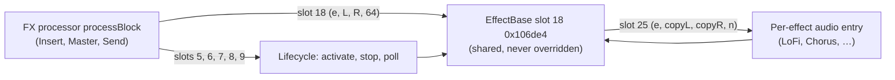
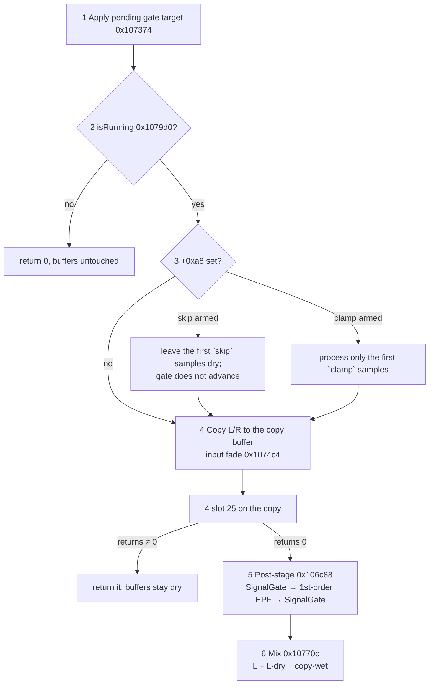

# EffectBase interface and the slot-18 wrapper

Part of [Effects and mixer in firmware 1.60](README.md). Findings F009–F011, F022–F024
and F138–F151 in the
[findings ledger](../../research-notes/F-effects/findings-ledger.md). Model:
[tools/fx/effectbase.py](../../tools/fx/effectbase.py).

## Summary

Every effect in 1.60 derives from one C++ base class, `EffectBase` (vtable `0x841fb8`,
32 slots). This page describes that interface and the shared code that runs around
every effect: the **slot-18 wrapper**. The wrapper adds the activation and stop fades,
an optional input fade, a sub-block skip/clamp, a 10 Hz high-pass post-stage (switched
on for six effects only, F141) and the dry/wet mix. None of this is inside the per-effect models. A reimplementation needs
both: the effect's own slot 25 (on its page) and this wrapper.

- **Fully reconstructed.** The slot roles, the object layout (0x1b8 bytes), the gate
  state machine, the gain-ramp arithmetic, the post-stage filter and the mix are known
  exactly (F138–F148).
- The model `effectbase.py` is **bit-exact to the 1.60 routine run in a single-function
  emulator**: 1.28 million samples with a stub effect, and all 13 effect models composed
  through the real slot 18 (F149, F151). Nothing was measured on an SP-16.
- **There is no factory and no registry.** Each FX processor builds one object of every
  effect type at start-up and selects by index. Adding a type means changing host code
  in at least five places (F141, F143).

## Where it sits



The processors call slot 18 once per 64-frame block on the bus or track buffers, in
place (F010, F154). Slot 18 is the **only** caller of slot 25 (F139). The processors
drive the lifecycle through slots 5–9 (activation, stop, poll) and set parameters
through slot 14. See [fx-processors.md](fx-processors.md) for the host side.

## Slot roles (32-slot vtable)

All 15 concrete effects (plus the base) share one 32-slot layout. Slots 0, 1 and 23–27
are overridden by every effect; slot 18 never (F009, F138). Floats travel in **core
registers** (soft-float calling convention, F011, F021; see [numerics.md](numerics.md)).
Labels as in F139: `confirmed` unless marked.

| Slot | Role | Signature | Notes and callers |
|---|---|---|---|
| 0 / 1 | Complete / deleting destructor | (this) | Slot 1 only from the FxProcessorBase destructor `0x1127a4` |
| 2 | isSampleRateSupported | int(this, fs) | 1 for 44,100, 48,000 and 96,000 Hz |
| 3 | setSampleRate | int(this, fs) | 0 ok, 3 unsupported; stores `+0x90`, calls slot 23(new, old), re-initialises if running. Called from processor prepare |
| 4 | setBlockSize | int(this, n) | 3 if n ≤ 0; stores `+0x94` and `+0x9c`, re-allocates the copy buffer, calls slot 24 |
| 5 | Activate | int(this, float dryTarget, int honourSkip) | Arms the skip (if `+0xa8`), resets the HPF and SignalGates, calls slots 27, 26, 31; gate → state 2 |
| 6 | Stop (fade out) | void(this, float dryTarget) | Arms the clamp (if `+0xa8`), slot 31, gate → state 0, slot 28. All 1.60 callers pass 1.0 (F148) |
| 7 / 8 | Start variants | (this, …) | Chosen by processor byte `+0x9d` (≠ 0 → 7, = 0 → 8); hooks 29 / 30; gate state 1 / 2 (F145, F177) |
| 9 | isRunning | int(this) | Body `0x1079d0`; the processors poll it once per block |
| 10 | Retrigger | int(this) | Base returns 2; overridden by Chorus, Distortion, Flanger, Phaser. Called by FxProcessorBase slot 49 |
| 11, 12 | (unknown) | — | Return 2; 11 overridden by `SendFxDelay` only. No caller found (*likely* unused) |
| 13 | getNumParameters | int(this) | Size of the parameter vector; no caller found (*likely* unused) |
| 14 | setParameter | int(this, idx, float v) | Shared `0x105d24`; 3 if idx out of range, else the Parameter object's setter. Overridden by Chorus, Distortion, Flanger |
| 15 | getParameter | int(this, idx, float* out) | No range check. Overridden by Chorus, Distortion, Flanger |
| 16 | getParameterInfo | 5-word sret | *likely*; no caller found |
| 17 | (Parameter `+0x14` accessor) | — | No caller found |
| 18 | **Dispatcher (the wrapper)** | int(this, L, R, n) | `0x106de4`, never overridden; called only from the three processBlock routines |
| 19 | getName | — | Returns "EFFECT BASE", never overridden, no caller found |
| 20 | getMix | sret {dry, wet} | Calls slot 26, then reads `+0x10` / `+0x14`; no caller found |
| 21 | setCopyMixPath | (this, flag) | Writes gate `+0xd0`; no caller found, so the copy path is always on (*likely*) |
| 22 | setSkipClampEnable | (this, flag) | Writes `+0xa8`. The processors call it with 0 for every effect except Insert index 7 (F141) |
| 23 / 24 | onSampleRateChanged(new, old) / onBlockSizeChanged(n) | int | Pure virtual; called by slots 3 / 4 |
| 25 | **process** | int(this, float* L, float* R, int n) | Pure virtual; the per-effect audio routine. n ≤ 64 |
| 26 | updateMix | void(this) | Pure virtual; writes dry `+0x10` and wet `+0x14` |
| 27 | reset | int(this) | Base returns 0; overridden by all 15; called from slot 5 on every activation |
| 28 / 29 / 30 | Stop / start-1 / start-2 hooks | int(this) | Return 0, never overridden; called by slots 6 / 7 / 8 |
| 31 | rebuildGateTargets | (this) | Builds the five gate records from the gate mode `+0x98` and dry/wet (F145) |

"No caller" for slots 11–13, 16, 17 and 19–21 is *likely*: a whole-binary scan of
virtual calls cannot type every object (F139). Some effects add slots past 31:
`InsertFxDelay` 32/33, `PerformanceFxLoFi` 32, `SendFxReverb` 32–35 (F138).

### What a new effect must implement

To run through the real host, an effect implements the destructor and slots 23, 24, 25
and 26, usually 27, and optionally 10, 14/15 and extra slots. It registers its
parameter objects in the vector at `+0x04` and chooses gate mode 0 or 1 in its
constructor. The host decides `+0xa8` and the post-stage HPF (F143). A stub effect
written this way ran bit-exactly through the real host (F142, F149).

### The slot-25 contract

`int process(this, float* L, float* R, int n)`, in place on planar float32 (F140):

- On the default copy path, L and R point into the EffectBase copy buffer (`+0xa4`; R =
  L + 4·`+0x9c` bytes), not the caller's buffers.
- n ≤ 64. After an activation skip n can be 45 (44.1 kHz) or 32 (48 kHz); at the end of
  a stop clamp it is the remaining clamp count (F140, F148).
- Return 0: slot 18 runs the post-stage and the dry/wet mix into the caller's buffers.
  Any other value: slot 18 returns that value, the caller's buffers stay dry, and the
  gate does not advance. processBlock ignores slot 18's return value (F140, F148).
- In gate modes 0 and 2 the input to slot 25 is the caller's block, bit for bit. In
  mode 1 it is ramped (see [input fade](#4-copy-input-fade-and-slot-25)).

## Object layout (sizeof 0x1b8)

Constructor `0x1067d8(this, fs, block, mode)`. Subclass data starts at `+0x1b8` (F140).

| Offset | Contents |
|---|---|
| `+0x00` | vptr |
| `+0x04…+0x0f` | `std::vector<Parameter*>`; subclass constructors register their parameters (slots 13–17) |
| `+0x10` / `+0x14` | dry (ctor 1.0) / wet (ctor 0.0), written by slot 26 |
| `+0x18…+0x8f` | 5 gate target records × 0x18 bytes, rebuilt by slot 31 |
| `+0x90` / `+0x94` / `+0x98` | fs / block size / gate mode (4th ctor argument) |
| `+0x9c` / `+0xa0` / `+0xa4` | copy-buffer length / channel count (2) / float[2·len], L then R |
| `+0xa8` | Skip/clamp enable byte (ctor 1; slot 22) |
| `+0xac` / `+0xb0` | Skip armed / skip count |
| `+0xb4` / `+0xb8` | Clamp armed / clamp count. Count = (int)(f32(3.3333333·0.001)·fs) = 147 at 44.1 kHz, 160 at 48 kHz |
| `+0xbc` / `+0xc0` / `+0xc4` | Second buffer length / channels / pointer (0 / 0 / null) |
| `+0xc8` | `EffectInOutGain*` (new 0xd4, ctor `0x10711c`, vtable `0x842078`) |
| `+0xcc` / `+0xcd` | Post-stage HPF requested / current |
| `+0xd0` | Post-stage cutoff (10.0; clamped ≥ 5 Hz when applied) |
| `+0xd8…+0x127` | `IirHpf1stOrder` (vtable `0x840db8`) |
| `+0x128` / `+0x170` | Two `SignalGate`s (vtable `0x840e40`, 0x48 bytes each) |

**Gate mode** (`+0x98`). All 19 EffectBase constructor calls in 1.60 pass mode 1 for
`InsertFxDelay`, `SendFxDelay` and `SendFxReverb`, and mode 0 for the other 16
(F140). Mode 2 behaves exactly like mode 0; modes ≥ 3 fade the wet in one block late.
No 1.60 effect uses modes 2 or 3+ (F145).

### EffectInOutGain (gate object, 0xd4 bytes)

| Offset | Contents (F144) |
|---|---|
| `+0x1c` / `+0x20` / `+0x24` | current state / transitioning flag / target state |
| `+0x28` / `+0x2c` | pending flag / pending state |
| `+0x30…+0x44` | pending record |
| `+0x48` / `+0x6c` / `+0x90` | `SmoothFloat` gains: input / dry / wet |
| `+0xc0` / `+0xc4` | dry / wet, copied from the effect's `+0x10` / `+0x14` every block |
| `+0xc8` | 1 only for ctor mode 1 |
| `+0xd0` | copy-path byte (ctor 1) |

The model's constructor state equals the emulated constructor field by field at 44.1
and 48 kHz (F144).

## The slot-18 wrapper step by step

`0x106de4(e, L, R, n)` on the caller's buffers (F142, F144–F148):



### 1–2. Gate: pending target and the running test

The gate is a small state machine with three `SmoothFloat` gains (input, dry, wet)
(F144).

- **start `0x107310`(gate, state, record)**: on the copy path it only stores the
  pending (state, record); the last call before slot 18 wins.
- **applyPending `0x107374`** (top of slot 18): drop it if it equals the current target.
  Otherwise, if a transition is running, current := old target and all three gains
  freeze where they are. Then transitioning = 1, target = new, and each gain in the
  record either snaps (record mode 0) or ramps (mode 1).
- **isRunning `0x1079d0`** (slot 9) returns: current if current = target; target if
  current is 0; current if target is 0 (so it stays non-zero until the stop fade
  ends); 1 for 1 ↔ 2; else 0.
- **End of a transition** (tail of the mix): when all three gains are idle, current :=
  target and transitioning = 0.
- **reset `0x1072bc`** (from slot 5): current = target = 0, gains snapped to record R0.

If the gate is not running, slot 18 returns 0 and leaves the buffers untouched (F022).

**SmoothFloat** (0x24 bytes) is the ramp used everywhere in the gate (F144):

- Length N = trunc(f32(f32(ms·0.001f)·f32(fs))) with ms = 3.3333333: **147 at 44.1 kHz,
  160 at 48 kHz, 320 at 96 kHz**.
- setTarget `0xf5668`: no-op if |target − old| < FLT_EPSILON; otherwise step =
  f32(f32(target − cur)·f32(1/N)), remaining = N.
- getBlock `0xf55a4`: emits cur, then cur = f32(cur + step) (an accumulated sum, so the
  first sample is the start value); snaps to the target when `remaining` runs out.
- For 0 → 1: g[1] = 0.00680272, g[146] = 0.99319804. An exact t/N ramp is refuted (max
  error 8.9e-7).

### Gate target records (slot 31)

Slot 31 `0x105d78` builds five records (input, dry, wet; each snap or ramp) (F145):

| Record | Used by | Mode 0 (most effects) | Mode 1 (delays, reverb) |
|---|---|---|---|
| R0 | reset | in 1, dry 1, wet 0 | in 0, dry 1, wet 0 |
| R1 | slot 5 → state 2 | in ramp → 1, dry snap := slot-5 arg, wet snap 0 | in snap 0, dry snap, wet ramp → wet |
| R2 | slot 6 → state 0 | dry ramp → slot-6 arg, wet ramp → 0 | also in ramp → 0 |
| R3 | slot 7 → state 1 | dry/wet ramp → `+0x10` / `+0x14` | also in ramp → 1 |
| R4 | slot 8 → state 2 | dry → 1, wet → 0 | in → 0, dry → 1, wet snap → wet |

The lifecycle slots in full (F145):

- **Slot 5**: slot 27, slot 26, slot 31, R1.dry := arg, reset(R0), start(2, R1); arms
  the skip if its third argument ≠ 0 and `+0xa8` ≠ 0.
- **Slot 6**: arm the clamp (if `+0xa8`), slot 31, R2.dry := arg, start(0, R2).
- **Slot 7**: slot 31, start(1, R3). **Slot 8**: slot 31, start(2, R4).

Slot 8 in mode 1 (input muted, dry → 1, wet follows `+0x14`, a tail ring-out) was shown
only through the gate state, never on audio with a stateful effect: *likely* (F145).

### 3. Skip and clamp (`+0xa8…+0xb8`)

Only active when `+0xa8` ≠ 0 (F148). The count is 147 / 160 samples.

- **Skip** (armed by slot 5 with honourSkip ≠ 0): while skip > n, the block stays
  untouched and the gate does not advance. Otherwise L, R and n are offset by the
  remaining skip (n = 45 at 44.1 kHz, 32 at 48 kHz).
- **Clamp** (armed by slot 6): while clamp > n, normal. Otherwise n := clamp (the first
  `clamp` samples are copied, processed and mixed; the rest stay dry) and the clamp is
  disarmed.

The processors call slot 22(e, 0) for every effect **except the Insert compressor
(Insert index 7)**, so only that effect keeps `+0xa8` = 1 (F141). Its consequence: the
Insert compressor outputs the input unchanged for samples 0…147 after every
activation; every other insert differs from sample 1. So Insert COMPRESSOR alone starts
147 samples (3.3 ms at 44.1 kHz) late (F148, H074 `confirmed` at code level; device
audibility *guess*). The stop clamp changes the output only when the slot-6 dry target
≠ 1, and all five 1.60 slot-6 call sites pass 1.0, so it is inaudible on the device
(F148). The skip/clamp aligns only activation start and stop end; it is not
parameter or tempo alignment (H012 refuted, F148).

### 4. Copy, input fade and slot 25

The input is copied into the EffectBase copy buffer. Then the input fade `0x1074c4`
runs on the copy (F146):

- Input gain idle at 1 → nothing. |g| < FLT_EPSILON → memset 0. Idle at another value →
  vector × scalar. Ramping → per-sample gains, vector × vector on both channels.
- **Mode 0/2:** the input gain stays at 1, so slot 25 sees the raw input.
- **Mode 1:** the input ramps 0 → 1 over 147 samples on activation and 1 → 0 on stop.

Then slot 25 runs on the copy (F140).

### 5. Post-stage `0x106c88`: SignalGate → first-order HPF → SignalGate

The wet copy passes SignalGate `+0x128` → `IirHpf1stOrder` `+0xd8` → SignalGate `+0x170`
(F147). The gates are SmoothFloat gates of 147 / 160 samples.

- `0x106c7c(e, on, fc)` only writes the request `+0xcc` and fc `+0xd0`. The switch takes
  effect at the next post-stage call or at slot 5 (which copies `+0xcc` → `+0xcd`).
- **On:** fc = max(5, min(`+0xd0`, fs/2)), coefficients computed, gates open. **Off:**
  gates close; the stage is skipped while off and both gates are idle-closed.
- On the device `0x106c7c(e, 1, 10.0f)` runs only in the processor constructors, for
  **Chorus, Flanger, MMF, LoFi, Distortion and Phaser** (Insert indices 0, 1, 3, 5, 6, 8;
  Master/Send 2, 3, 5, 6, 8, 9). Never for PEQ, the delays, the compressors, the Ducker
  or the Reverb (F141). So only the slot-5 path occurs on the device (*likely*, F147).
- Slot 5 zeroes the HPF state and snaps the gates open (HPF on) or closed (F147).

Coefficients `0xe1aa0`, computed in double (F147):

```math
w = \left(\tan\!\left(\frac{\pi f_c}{f_s}\right)\cdot\frac{1}{2\pi}\right)\cdot 2\pi,\qquad b_0 = \mathrm{f32}\!\left(\frac{1}{w+1}\right),\quad b_1 = -b_0,\quad a_1 = \mathrm{f32}\!\left(\frac{w-1}{w+1}\right)
```

At 10 Hz and 44.1 kHz: b0 = 0.999288142, a1 = −0.998576283. Twelve fc/fs pairs are
bit-equal to emulation. The version without the ·(1/2π)·2π round trip is refuted. The
process `0xe1490` is NEON with flush-to-zero: y = b0·x + b1·x[−1] − a1·y[−1] (F147).

### 6. Dry/wet mix `0x10770c`

`0x10770c(gate, L, R, cL, cR, n)` (F146):

- If no transition is running: in state 1, dry.setTarget(`+0xc0`) and
  wet.setTarget(`+0xc4`); in state 2 with `+0xc8` set (mode 1), wet only. So a slot-26
  dry/wet change **glides over 147 samples**, and waits while an activation or stop is
  running.
- Then L, R ·= dry; copy ·= wet; L += copy. Shortcuts: |g − 1| < ε skips the multiply;
  |g| < ε zero-fills.
- NEON (flush-to-zero) for groups of 4 samples, VFP for the n % 4 tail.

Per sample, with x the input, d and w the dry and wet gains and i the input-fade gain
(i ≡ 1 outside mode 1):

```math
\mathrm{out}_t = \mathrm{f32}\!\left(\mathrm{f32}(x_t\, d_t) + \mathrm{f32}\!\left(S_{25}\!\left(\mathrm{f32}(x_t\, i_t)\right)\cdot w_t\right)\right)
```

Two roundings; the single-rounding variant is refuted (F146). The activation and stop
crossfades are this mechanism with the R1/R3 and R2 targets.

## Lifecycle

### Activation and stop

- **Before activation** slot 18 is a pass-through (F022).
- **Activation** (processor: slot 5(e, 0, honourSkip), then slot 7 or 8). The output is
  a linear 147-sample dry → wet crossfade: in·(1 − t/147) + wet·t/147, then steady
  state f32(f32(dry·in) + f32(wet·y)) (F142). In mode 1 the effect's input also ramps
  in over 147 samples (F142, F146).
- **Stop** (slot 6(1.0)): the mirror image. When the fade ends, slot 9 returns 0 (F142).
- At 48 kHz every 147 becomes 160 (F144).

### Reset (slot 27)

Slot 5 calls the effect's slot 27 on **every** activation: each type switch back to an
effect, and each re-enable (F149, F150). The base slot 27 returns 0. Each effect's
reset is on its page; for LoFi, MMF and PEQ see [lofi.md](lofi.md),
[multimode-filter.md](multimode-filter.md) and [parametric-eq.md](parametric-eq.md)
(F150). Slot 5's third argument only arms the skip; it does not skip the reset (H063
refuted, F149).

### Type switch

A type change is **sequential, not an overlapping crossfade** (F142, F149). setFxType
calls the old effect's slot 6; it fades to dry over 147 samples; the swap happens at the
first block where slot 9 returns 0 (three blocks later); then the new effect gets slots
5 and 7 and fades in. From Off the new type takes effect at once. Details are in
[fx-processors.md](fx-processors.md).

### Slot-26 laws per effect

The wrapper reads dry/wet from `+0x10` / `+0x14`. Each effect's slot 26 sets them
(F149):

| Effect | dry | wet |
|---|---|---|
| Chorus, Flanger | 1 | Mixratio |
| LoFi, MMF, Phaser | 1 − v | v |
| PEQ, Ducker | 0 | 1 |
| Insert Delay | piecewise (F078, [insert-delay.md](insert-delay.md)) | piecewise |
| Send Delay | copies its stored `+0x6a4` / `+0x6a8` (1 / 0 until its first slot 25) | |
| Send Reverb | piecewise × 0.70795 (F122, [send-reverb.md](send-reverb.md)) | |
| Compressors | 1 − v | v · makeup |

"Dry stays 1.0" is specific to Chorus and Flanger (F149).

### Lifetime

Effects are built once, eagerly, at application start, and live until the processor is
destroyed (F141). The build chain runs from the application object through the audio
system's graph build (vtable slot 55, `0x1bc8d4`) to the three processor constructors.
Whether that graph build is ever re-invoked (a wholesale rebuild on project load or a
sample-rate change) is open (H073, *likely* not).

## No factory: where an effect type is compiled in

There is no factory and no run-time registry (H011 (b) refuted, F141, F143). All 19
EffectBase constructor calls and every concrete constructor call sit in the effect
constructors or the three processor constructors (Insert `0x118b0c`, Master `0x114bc0`,
Send `0x11bbe4`). Each processor constructor is straight-line code with 13 `new`
calls. Selecting a type (setFxType ×2 + 40 processBlock calls, emulated) makes 0 heap
allocations (F141).

An effect type is compiled into at least five places per processor and parameter
manager (F143; items 1–5 `confirmed`):

1. The processor constructor's build list (order = index), plus the slot-22 and
   `0x106c7c` steps. The list count `+0x88` bounds every lookup.
2. Processor slot 52 defaults: a 10-case jump table (Insert `0x117448`, Master
   `0x113408`, Send `0x11a378`), each case calling slot 14.
3. processBlock's per-index parameter feed (Insert table `0x11694c`; Master `0x112b44`,
   Send `0x119a38`); see [fx-processors.md](fx-processors.md).
4. The slot-45 load-estimate table (Insert `0x842be0`, Master `0x842a78` = Send
   `0x842d10`), bounded by `cmp #9`.
5. The parameter manager's slot-32 name/setFxType switch (Insert `0x128838`, Master
   `0x123818`, Send `0x12bcbc`) and the slot-53/54 effect-ID tables (F018, F019).
6. Further per-index manager switches. Their roles were later settled: s34 = SYNC
   toggle, s50 = UI integer range (F162, F163; see [parameters.md](parameters.md)).
7. Data and UI: the FxParamIndex tables, the popup items (F131), the view controllers.

So the audio side is a real extension point (a stub runs bit-exactly through the real
host), but adding a type needs host code and data in items 1–5 (H011 (c) "partly").

## 1.60 code map

| Address | What it is |
|---|---|
| `0x841fb8` | `EffectBase` vtable (32 slots) |
| `0x1067d8` | Constructor (this, fs, block, mode); sizeof 0x1b8 |
| `0x105f2c` / `0x1063c4` | Slot 3 setSampleRate / slot 4 setBlockSize |
| `0x10623c` | Slot 5 activate |
| `0x105c94` | Slot 6 stop |
| `0x105c58` / `0x105c20` | Slot 7 / slot 8 start variants |
| `0x1059bc` → `0x1079d0` | Slot 9 isRunning |
| `0x105d24` | Slot 14 setParameter (shared) |
| `0x106de4` | Slot 18 dispatcher (the wrapper) |
| `0x1059a8` / `0x1059b0` | Slot 21 setCopyMixPath / slot 22 setSkipClampEnable |
| `0x105d78` | Slot 31 rebuildGateTargets |
| `0x105a04` | Slot 16 getParameterInfo (*likely*) |
| `0x10711c` | `EffectInOutGain` constructor (vtable `0x842078`) |
| `0x107310` / `0x107374` / `0x1072bc` | Gate start / applyPending / reset |
| `0x1074c4` | Input fade |
| `0x10770c` | Dry/wet mix and end of transition |
| `0x106c7c` / `0x106c88` | Post-stage HPF request / post-stage |
| `0xe1aa0` / `0xe1490` | `IirHpf1stOrder` coefficients / process |
| `0xf54b8` / `0xf5a00` / `0xf5668` / `0xf55a4` / `0xf5584` | `SmoothFloat` ctor / setSmoothingTime / setTarget / getBlock / snap |
| `0x579018` / `0x579178` / `0x578a6c` / `0x578634` | Vector helpers: ×vector, ×scalar, +vector, fill (NEON ×4 + VFP tail) |
| `0x1127a4` | FxProcessorBase destructor (only destroyer of effects) |

## Quirks

- **Insert compressor starts 147 samples late** after every activation, because its
  processor never clears `+0xa8` (F141, F148). Audibility on the device *guess*.
- **One-time start-up dip.** Effects whose own gates are built closed (LoFi, PEQ) show an
  extra dip after the first activation only, because slot 27 leaves those gates open
  (F153; see [parametric-eq.md](parametric-eq.md) and [lofi.md](lofi.md)).
- **Dry/wet glides wait.** A mix change during an activation or stop fade is applied
  only after the fade ends (F146).
- **Two floating-point paths.** The mix and the HPF use NEON (flush-to-zero) for groups
  of four and VFP for the tail, so denormal behaviour depends on the sample position in
  the block (F146, F147; see [numerics.md](numerics.md)).
- A slot-25 return ≠ 0 stalls the gate: the transition does not advance while the
  effect keeps returning non-zero (F148).

## Validation evidence

- **Interface** (F138–F143): 20 checks passed; worker ×3 and an independent re-run
  identical (report hash `35597b73…`, slot matrix `b29fcb85…`). The review added its own
  scan of all 2.13 million `.text` instructions and its own emulation variants.
- **Stub effect** (F142, F149): a real EffectBase object with own slots 23–27 driven
  through the real slot 18 and the real Insert setFxType / processBlock. 50 cases × 200
  blocks (modes 0/1/2/3, HPF on/off/toggle, `+0xa8` 0/1, 44.1 and 48 kHz, activation at
  0 and mid-run, stop and re-activation, dry/wet changes, slot-25 return ≠ 0, in-place
  path, DC/impulse/sine/denormal noise): 1.28 million samples bit-exact, including
  returns, slot-25 inputs and internal state. Four of the cases are dry pass-throughs
  (state-only evidence).
- **Independent fuzz** (F144): 40 seeds × 220 blocks (44.1/48/96 kHz, modes 0/1/2/3/5,
  n 0…64, random events) plus 31 realistic seeds, all bit-exact with equal internal
  state after every block.
- **Real effects through the real slot 18** (F149, F151): every modelled effect composed
  with `effectbase.py`, 25,600 / 25,600 samples each, 13 / 13 bit-exact (after the
  slot-27 models of LoFi, MMF and PEQ were added). Plus 27 composition cases with three
  activations each (760,320 samples, max difference 0) and a 30-run fuzz at 44.1 and
  48 kHz.
- **Recorded hashes** (wrapper): c3 `b7f91882…`, c4 `47c85123…`, c4_ext `6909f55b…`, c5
  `526c2b9f…`; reset composition `11fe2c44…`. Reproduced by the independent review.
- Verifier scripts (reference only, need your own 1.60 files):
  `tools/fx/verify/H011_effect_interface.py`, `H044_effectbase_wrapper.py`,
  `H076_slot27_reset.py`.

## Unknowns

- Whether the graph build is ever re-run, so that effects lose their state (H073).
- Device audibility of the Insert compressor's late start (H074, *guess*).
- Slot 8 in mode 1 on audio with a stateful effect (*likely*, F145).
- Slots 11–13, 16, 17, 19–21 have no caller found (*likely* unused, F139).
- A slot-3 sample-rate change while running is not modelled (F149).
- See [open-questions.md](../open-questions.md#effects).

## Model

[tools/fx/effectbase.py](../../tools/fx/effectbase.py): pure Python, own code, no
firmware bytes. `EffectBase(fs, mode, slot25, slot26, slot27)` takes the effect's
slot 25/26/27 as functions. It models slots 5–9, 18, 21, 22, 31 and `0x106c7c`, at
44.1 and 48 kHz (96 kHz works). It also contains a minimal `InsertProcessor` (enabled,
not bypassed). The full processor shells are in
[tools/fx/fx_processors.py](../../tools/fx/fx_processors.py). Typical use, as the
Insert processor does it:

```python
eb = EffectBase(fs=44100, mode=0, slot25=fn25, slot26=fn26, slot27=fn27)
eb.slot22(0); eb.set_post_hpf(True, 10.0)      # Insert-processor ctor steps (F141)
# per block: if eb.slot9() == 0: eb.slot5(0.0, 1); eb.slot7()
eb.slot18(L, R, 64)
```

It imports `lofi.py` (shared float32 helpers and `SignalGate`) and `crmath.py` (a
correctly rounded `tan`, F206).
