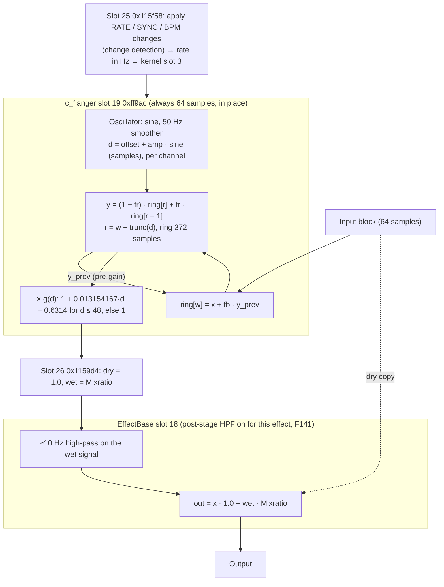

# Flanger (Insert index 1, Master/Send index 3)

Part of [Effects and mixer in firmware 1.60](README.md). Findings F054–F056 and
F063–F068, with F017, F139–F149, F156, F159, F183–F186 and F202–F205 for the
surroundings, in the
[findings ledger](../../research-notes/F-effects/findings-ledger.md). Model:
[tools/fx/flanger.py](../../tools/fx/flanger.py) (uses
[tools/fx/osc.py](../../tools/fx/osc.py) and [tools/fx/chorus.py](../../tools/fx/chorus.py)).

## Summary

Flanger is **fully reconstructed**: signal chain, every parameter formula, the object
and kernel layouts, reset and retrigger. The Python model is **bit-exact to the 1.60
routine run in a single-function emulator** in 41 worker runs of 160 blocks (839,680
samples) and about 0.9 million more samples from independent review, with every object
field equal (F066). Through the shared `EffectBase` wrapper it is also bit-exact end to
end (F149, F151). It has not been compared with audio recorded from an SP-16.

Flanger has the same structure as [Chorus](chorus.md): the shared oscillator's smoothed
sine sets a **delay time in samples**. The differences: a short 372-sample ring,
**feedback** of the previous pre-gain output into the line, a **delay-dependent output
gain** below 48 samples of delay, a rate range ten times slower, and **no start-up mute**
(F055, F064, F066). Slot 25 outputs the wet signal only; the wrapper adds the dry
signal at unity, so the effect output is dry + Mixratio × wet (F067).

All three FX processors build the same Flanger with identical code (F068). The Insert,
Master and Send defaults are identical, including **Mixratio 0** (F063, F156).

## Where it sits

| Context | Array index | Effect ID (Insert) | Built by | Tempo feed |
|---|---|---|---|---|
| Insert FX1/FX2 | 1 | 6 | inline in `InsertFxProcessor` ctor `0x118cd8–0x118ddc` (F056) | yes, parameter 7 every block (F017) |
| Master FX | 3 | — | inline in `MasterFxProcessor` ctor `0x114e78–0x114f80` (F068) | yes (F156) |
| Send FX | 3 | — | inline in `SendFxProcessor` ctor `0x11bea4–0x11bfac` (F068) | yes (F156) |

The three construction blocks (66 instructions) are instruction-identical with
literals resolved. Insert-, Master- and Send-built objects give identical output,
bit-exact to the model (F068). Array positions: F019, F173.

## Signal flow



Slot 25 (`0x115f58`) has the same structure as Chorus slot 25: consume RATE, SYNC and
BPM changes, recompute the rate if any changed, run the kernel, update the dry/wet pair,
return 0 (F063, F066).

## Parameters

Slot 14 is Flanger's own `0x1163f0`; it always returns 0 (F063). Every formula uses the
same quantiser as Chorus, i = rint(F(lo + F(v·(hi − 1 − lo)))) with round half to even
([chorus.md](chorus.md#parameters), F058, F064).

| # | Parameter | Formula (v = 0…1; float32) | Range | Insert default (slot 52, F063) | When applied |
|---|---|---|---|---|---|
| 0 | RATE, SYNC off | Hz = 0.01 · rint(1 + 99v) ({1, 101}, `0x349e30`/`0x349e50`) | **0.01…1.00 Hz** in 0.01 Hz steps | 19/99 (→ 0.20 Hz) | next slot 25 |
| 0 | RATE, SYNC on | i = rint(6v) ({0, 7}); Hz = F(F(F(b·BPM)/a)·F(1/60)) | one cycle per 64 … 1 beats | — | next slot 25 |
| 1 | DEPTH | d = rint(100v), clamped 0…100 | 0…100 | 1.0 (d = 100) | at once (kernel slot 5 `0xfffd4`) |
| 2 | PHASE | deg = rint(180v), R offset deg/380 cycles (same code as Chorus) | 0…170.5° | 0 | at once (kernel slot 6 `0xffe68`) |
| 3 | DEPTH SCALE | s = 0.1 · rint(1 + 69v) ({1, 71}), clamped 0.1…7.0 | 0.1…7.0 | 0 (s = 0.1) | at once (kernel slot 7 `0x100104`) |
| 4 | FEEDBACK | i = rint(99v) ({0, 100}); fb = F(i·0.01); i > 99 → 0.98999995; i < 0 → 0 | **0…0.99, positive only** | 0 | at once (kernel slot 8 `0xff694`) |
| 5 | MIXRATIO | plain float `+0x29c`, no clamp (ctor 0) | 0…1 | 0 | at once |
| 6 | SYNC | toggle (v ≥ 1 on, v ≤ 0 off) | 0/1 | 0 | next slot 25 |
| 7 | BPM | fed by the processor, clamped 1…999 | 1…999 | fed (120 in the ctor) | next slot 25 |

Sync divisions, index i = 0…6 (table `0xf61f78`, `.bss`, filled by the same static
initialiser as Chorus's, `0x6cbe0–0x6ce8c`) (F064):

| i | 0 | 1 | 2 | 3 | 4 | 5 | 6 |
|---|---|---|---|---|---|---|---|
| beats per cycle | 64 | 32 | 16 | 8 | 4 | 2 | 1 |

The range check is unsigned (`cmp #6; bls`), so i > 6 or i < 0 logs an assertion and
uses index 4. That path is reachable only for v outside about −0.083…1.083 and is
modelled from the disassembly only (F064).

**Depth to delay** (F064). t = F(F(d·s)·0.01), negative t → 0 (no upper check);
amp = F(F(F(fs·t)·0.001)·0.5), offset = amp + 0.2. The delay sweeps 0.2 … 2·amp + 0.2
samples. Maximum (d 100, s 7): 308.87 samples = 7.0 ms. At the Insert defaults (d 100,
s 0.1) amp = 2.205 and the delay is only 0.2…4.61 samples (F063).

**FEEDBACK** writes `+0x10c` only if 0 ≤ fb < 1; the index goes to `+0x1c`. There is no
negative feedback (F064). This corrects an earlier function-table entry: FEEDBACK goes
to kernel **slot 8**, not slot 4. Kernel slot 4 (`0xfff50`) is setPeriodMs (100…10,000
ms, stored in the rate field) and no Flanger method calls it (F063).

**Rate clamp.** Kernel slot 3 (`0xffdc4`) clamps |Hz| to 0.00026041671…128 Hz (Chorus:
0.00104…64) (F064). The oscillator floors frequencies at 0.0044100005 Hz (F051).

**Change detection** for RATE, SYNC and BPM works as in Chorus (copies `+0x2a0`/`+0x2a4`/
`+0x2a8`, dirty `+0x2ac`) (F063, F026).

**UI side** (F159, F170, F184–F186). FxParamIndex rows 5–10 map to Flanger slot-14
indices 0–5. The RATE knob steps on the "flanger" time family: free mode 1…100 (0.01 Hz
steps), sync mode 0…6; coarse grid with the encoder alone in free mode, single steps
with SHIFT or in sync mode (F185). The screen shows free rates as "%.2f" Hz and sync
rates as "%d/%d" (F186). The SYNC button converts between Hz and beats at the tempo of
the press (F183, `tools/fx/sync_convert.py`). The Flanger knob layout was not tabulated
(F170). See [parameters.md](parameters.md).

## Processing (kernel slot 19 `0xff9ac`)

Per block of 64 samples (F066):

1. **Reset flag** `+0xf2` (set by the ctor, so only on the first block): write index and
   last read indices 0, rings zeroed, y_prev 0, flag cleared. The oscillator is **not**
   restarted.
2. **Retrigger flag** `+0xf0`: oscillator resetPhase(0), flag cleared.
3. The oscillator fills 64 delay values per channel; the gain g(d) is computed for each.
4. Per sample, per channel:
   - r = w − trunc(d), +372 if negative;
   - ring[w] = F(x + F(y_prev·fb)); w += 1 (wrapping at 372);
   - fr = d − trunc(d); y = F(F((1 − fr)·ring[r]) + F(fr·ring[r − 1])), with r − 1
     wrapping to 371;
   - y_prev = y (**the pre-gain output** feeds back).
5. After the sample loop, each output sample is multiplied by its g(d):

```math
g(d) = \begin{cases} \mathrm{F}\big(\mathrm{F}(1 + \mathrm{F}(0.013154167\,d)) - 0.6314\big) & d \le 48 \\ 1 & d > 48 \end{cases}
```

The knee is strict (47.999996 → slope, 48.000126 → 1). g is continuous at the knee and
0.3686 at d = 0 (F066).

There is **no start-up mute or fade**: block 0 already has output, unlike Chorus. The
constructor computes Chorus-style fade constants (`+0xe8`/`+0xec`/`+0x110`) that slot 19
never reads (F065, F066). There is **no limiter**: at feedback 0.99 the wet peak is
about 6 (F066).

The ring is fs·7/1000 + block = 372 samples. That length is a read-back fact; it cannot
be heard, because the largest delay (308.9) is shorter (F065).

## Object layout

`Flanger` (0x2b0 bytes) has the same layout as Chorus (RATE `+0x1bc`, SYNC `+0x218`, BPM
`+0x240`, Mixratio `+0x29c`, copies `+0x2a0…+0x2a8`, dirty `+0x2ac`, kernel `+0x1b8`), except
that Mixratio is 0 in the ctor (F065).

`c_flanger` kernel (0x118 bytes, ctor `0x100234(k, 64, 44100)`) (F054, F065):

| Offset | Contents |
|---|---|
| `+0x04` / `+0x08` | fs / block |
| `+0x0c` / `+0x10` / `+0x14` / `+0x18` | rate Hz (ctor 0.1) / depth (100) / phase degrees / depth scale (2.0) |
| `+0x1c` | feedback index |
| `+0x20` / `+0xfc` | kernel slot 9 value / fraction (unused) |
| `+0x28` | oscillator (0x98 bytes): sine, ctor amp 0.001·fs = 44.1, offset 44.3, no phase offset, smoother 50 Hz |
| `+0xc0` | ring length (372) |
| `+0xc4` / `+0xc8` | → rings L / R |
| `+0xcc` | write index |
| `+0xd0` / `+0xd4` | last read index L / R |
| `+0xd8` / `+0xdc` | → delay buffers L / R |
| `+0xe0` / `+0xe4` | → per-sample gain buffers L / R |
| `+0xe8` / `+0xec` / `+0x110` | fade constants (never read by slot 19) |
| `+0xf0` / `+0xf1` / `+0xf2` | retrigger byte / byte set by slots 16/17 (no effect on the output) / reset byte (ctor 1) |
| `+0xf4` / `+0xf8` | previous pre-gain output L / R |
| `+0x10c` | feedback |

## 1.60 code map

| Address | What it is |
|---|---|
| `0x8429a8` | `Flanger` vtable |
| `0x841c10` | `c_flanger` vtable |
| `0x118cd8–0x118ddc` | inline construction in the Insert processor ctor (`new(0x2b0)`, kernel `new(0x118)`) |
| `0x100234` | `c_flanger` ctor `(k, block, fs)` |
| `0x115f58` | Slot 25: audio entry |
| `0x1163f0` / `0x1162f0` | Slot 14 setParameter / slot 15 getParameter (*likely*, not emulated) |
| `0x1159d4` | Slot 26: dry 1.0, wet Mixratio |
| `0x1159b0` | Slot 27: reset → kernel slot 2 (64, 44100) |
| `0x1159e8` | Slot 10: retrigger → kernel slot 18 `0xff3a8` |
| `0x115a04` / `0x115a0c` | Slots 23 / 24 (return 0) |
| `0x115c70` / `0x1166c0` | Destructors (slots 0 / 1) |
| `0xff9ac` | Kernel slot 19: process |
| `0xffdc4` | Kernel slot 3: set rate |
| `0xfff50` | Kernel slot 4: setPeriodMs (not called by Flanger) |
| `0xfffd4` / `0xffe68` / `0x100104` / `0xff694` | Kernel slots 5 / 6 / 7 / 8: depth / phase / depth scale / feedback |
| `0xff990` → `0xff798` | Kernel slot 2: re-allocate and zero rings and buffers |
| `0xff598` | Kernel slot 9 (unused by slot 19) |
| `0xff370` / `0xff38c` | Kernel slots 16 / 17: set / clear `+0xf1` |
| `0xff548`…`0xff3b8` | Kernel slots 10–15: getters (*likely*) |
| `0x349e30`, `0x349e50`, `0x349e9c`, `0x349eb8` | rate range / index → Hz / sync range / index → fraction |
| `0x34a254`, `0x34a2a0`, `0x34a2f0`, `0x34a310`, `0x34a358`, `0x34a3a8` | depth / phase / scale range / scale value / feedback / slot-9 spec helpers |
| `0xf61f78` | sync fraction table (`.bss`) |

## Lifecycle

- **Activation.** Gate mode 0 and the 10 Hz post-stage high-pass, as Chorus (F140,
  F141). Each activation runs the 147-sample activation fade (160 at 48 kHz) and calls
  slot 27 (F144, F149). See [effectbase.md](effectbase.md).
- **Reset (slot 27 `0x1159b0`).** Re-allocates and zeroes the rings and buffers, but
  keeps the write index, y_prev and the feedback value (F066).
- **Retrigger (slot 10 `0x1159e8`).** Sets `+0xf0`; the oscillator restarts at phase 0 on
  the next block (F066). The device-side caller is open (H032).
- **Bypass and type switching** are processor features (F149, F154, F157); see
  [fx-processors.md](fx-processors.md).
- **Tempo feed** every block as index 7, clamped to 1…999, in all three contexts (F017,
  F156). It matters only with SYNC on.
- **SYNC** toggling converts the rate at the tempo of the press (F183, F184).
- **Project load.** The Master/Send reload sends SYNC as index 6 to Flanger as well (a
  correction of F161 by F166). See [parameters.md](parameters.md).

## Validation evidence

- **End to end** (F066): 41 worker runs × 160 blocks (839,680 samples): 11 settings ×
  impulse/sine/noise including feedback 0.99 at maximum delay, Sync at 1/87.5/120/999
  BPM, feedback v −0.5 and 1.5, and 4 event runs × 2 with mid-run changes, retrigger,
  reset and tempo changes. Review: about 0.9 million more samples (knee straddling, a
  1,500-block knee run, 5 random storms × 400 blocks, a 1,000-block feedback-0.99 run,
  BPM changed every block). Max error 0; state equal.
- **Read-backs** (F064): 289 worker read-backs plus the review's direct and boundary
  checks, 0 mismatches.
- **Planted errors** (F063–F068): 8 of 8 deliberate model errors caught.
- **Refuted alternatives** (F066): feedback after the gain, linear 0.99v feedback, knee
  scaling with depth, the Chorus rate law, integer delay, reversed sync table,
  unquantised depth scale.
- **Recorded hashes** (F063–F068): report `a9713642…c019`, result JSON `861a3234…913b`,
  sorted concatenated outputs (41 files) `b00781e5…be46`, mutant report
  `45647c8f…2de4`; all reproduced byte-identically by the review.
- **Output law** (F067): at slot-18 level, out == F(in + F(mix·wet)) in 2,560 of 2,560
  samples for mix 0, 0.25 and 1; a crossfade law is off by up to 0.25/1.
- **Wrapper and processors** (F149, F151, F154): bit-exact through the real slot 18 and
  in the Master/Send type matrix.

## Known quirks

- **Mixratio default 0** in all three contexts: at the processor defaults Flanger
  outputs the dry signal only (F063, F156). Whether the UI or a project overrides it on
  the device is a *guess* (F063).
- At the Insert defaults (depth scale 0.1) the delay is only 0.2…4.61 samples (F063).
- The dry signal is never reduced; Mixratio adds the wet signal on top (F067).
- No limiter: feedback 0.99 gives peaks of about 6 (F066).
- Gain below 48 samples of delay drops to 0.3686 at d = 0 (F066).
- Phase tops out at 170.5° (F064, F058).

## Unknowns

- What calls the retrigger on the device (H032); generic external callers of kernel
  slot 4 are not excluded (F063).
- **Heap contents.** Bit-exactness assumes a zero-filled heap for the oscillator
  counters (`+0x80` and the resync counter `+0x68`). Unlike Chorus, Flanger never resets
  the oscillator phase on its first block (F051, F066, H036).
- **Denormals.** With flush-to-zero on, the feedback-0.99 silence tail would diverge
  once |y| < about 1.8e-37 (F066). The device runs its audio threads with flush-to-zero
  off, as the model assumes (F202–F205); see [numerics.md](numerics.md).
- The knob layout on screen (F170, H019), LFO modulation and step locks (H068,
  H003/H070).
- See [open-questions.md → Effects](../open-questions.md#effects).

## Model

[tools/fx/flanger.py](../../tools/fx/flanger.py): own code, no firmware bytes. Classes
`Flanger` (`set_param(idx, v)`, `process(L, R)` in place on 64-sample lists,
`retrigger()`, `reset()`, `dry`/`wet`) and `Kernel` (`c_flanger`). It imports `osc.py`
and reuses `LinParam`, `Toggle` and `rint_idx` from `chorus.py`. It uses only the sine
waveform and does **not** need the user-supplied random table. The model is slot 25
only: feed BPM as index 7 every block and use `tools/fx/effectbase.py` for the wrapper.
