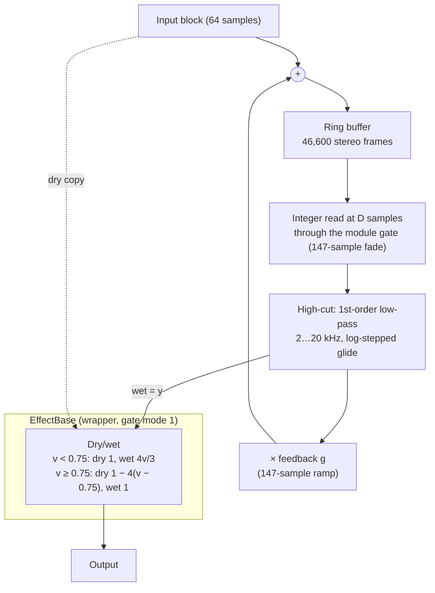

# Insert Delay (Insert index 4)

Part of [Effects and mixer in firmware 1.60](README.md). Findings F017, F075–F080,
F140–F149, F159, F170 and F183–F186 in the
[findings ledger](../../research-notes/F-effects/findings-ledger.md). Model:
[tools/fx/insert_delay.py](../../tools/fx/insert_delay.py).

## Summary

The Insert Delay is **fully reconstructed**: signal chain, every parameter formula
(free and tempo-synced time, feedback, high-cut, mix), the object, delay-module and ring
layout, start-up, reset and the SYNC conversion. The Python model is **bit-exact to the
1.60 routine run in a single-function emulator** in 55 of 55 runs (5,373,440 samples),
plus 16 independent fuzz runs of 2,000 blocks each (F078). Through the real shared
`EffectBase` wrapper (slot 18) it is also bit-exact end to end (F149). It has not been
compared with audio recorded from an SP-16.

It is a single stereo delay line with an **integer** delay of 10…1000 ms, a first-order
high-cut low-pass inside the feedback loop and a piecewise dry/wet law (F076, F078).
A delay-time change does not glide: the output fades out, the read point jumps and the
output fades back in (F078). LowCut and Spread exist as parameters but are **never read**
(F075).

It is a different class and a different algorithm from the Master/Send delay
(`SendFxDelay`, see [send-delay.md](send-delay.md)): the two share the ring buffer,
stepped filter and smoothing helpers, but not the delay module (F080).

## Where it sits

- **Insert index 4** (effect ID 1) only. The Master and Send "Delay" (index 0) is
  `SendFxDelay` (F018, F019, F080).
- Class `InsertFxDelay` (new 0x5d0, ctor `0x103488(obj, 44100, 64)`, called at
  `0x118f50` in the Insert processor constructor). A second base,
  `DelayEchoBaseSingleDelay`, sits at `+0x1b8` (F077).
- The `EffectBase` is built with **gate mode 1**: on activation the wrapper also fades
  the effect's **input** in over 147 samples, and out on stop (F140, F142, F146). The
  processors do **not** switch the 10 Hz post-stage high-pass on for the delays (F141).
- The Insert processor feeds the tempo as parameter 7 every block (F017).

## Signal flow



Per block, slot 25 (`0x102cc0`) first runs slot 26 (the mix law), then slot 33
(`0x102d3c`). Slot 33 calls slot 32 (`0x102f30`, apply pending parameter changes) and
then processes the block in chunks (F075, F078):

1. y = gate(ring[w − D]) — the module gate is a 147-sample `SignalGate`;
2. y = HiCut(y);
3. out = y (**wet only**; the dry/wet sum is done by the wrapper);
4. ring[w] = in + g·y — **the feedback is taken after the high-cut filter**.

The high-cut filter, the feedback multiply and the add are NEON vector code with
flush-to-zero; the vector helpers finish a block's last n mod 4 samples in VFP (F078;
functions `0xe1490`, `0xf5b9c`, `0x578a6c`). Because D ≥ 441 samples, a chunk is normally
the whole 64-sample block; it is split only to end a fade at a chunk boundary (F078).

## Parameters

Index = the `EffectBase` slot-14 index. The constructor registers eight parameter
objects at `+0x30c + 0x5c·i` (F075). Slot 14 is the shared store-only `0x105d24`: it
returns 0 for indices 0–5 and 7 and 3 for index ≥ 8. **Nothing is applied in slot 14.**
At the next block, slot 32 consumes changes in the order SYNC → BPM → DelayTime →
Feedback → HiCut, using the shared change detection (F026, F075).

| # | Parameter | Formula (v = 0…1; float32 unless noted) | Range | Ctor "last" value | Insert default (F075) |
|---|---|---|---|---|---|
| 0 | DelayTime, free (SYNC 0) | ms = rint_even(F(10 + F(v·990))); D = trunc(F(F(ms·0.001)·fs)) samples | 10…1000 ms in 1 ms steps (441…44,100 samples) | 0.75 | 49/99 (500 ms, D = 22,050) |
| 0 | DelayTime, synced (SYNC 1) | i = rint(5v) → beats 1/8, 1/4, 1/2, 3/4, 1, 2; ms = F(F(F(F(num/den)·1000)·60)/BPM), clamped to [10, 1000] | 6 divisions | — | — |
| 1 | Feedback | g = F(rint(100v)·0.01), reached by a 147-sample linear ramp | 0…1.00 in 0.01 steps (not clamped above 1) | 0 | 0.7 |
| 2 | HiCut | step = trunc_u32(F(999v)) + 1, clamped 1…1000; target 2000·m^(step−1) Hz, m = 10^(1/999) (double) | 2…20 kHz, 1000 log steps | 1.0 | 1.0 (20 kHz) |
| 3 | LowCut | stored, **never read** | — | 0 | — |
| 4 | Spread | stored, **never read** | — | 0 | — |
| 5 | Mixratio | v < 0.75: wet = F(v·1.3333334), dry = 1; v ≥ 0.75 (and NaN): wet = 1, dry = F(1 + F((v − 0.75)·−4)) | 0…1 | 0 | 0 (wet 0, inaudible) |
| 6 | SYNC | `ToggleParameter`: only v ≥ 1 or v ≤ 0 accepted, otherwise slot 14 returns 3 | 0 / 1 | 0 | 0 (free) |
| 7 | BPM | fed by the processor every block, clamped to 1…999 (F017) | 1…999 | 120 | tempo |

Notes:

- **Time.** The value above 1000 ms clamps inside the module's setDelay (`0xec9bc`). The
  delay is an integer number of samples; the ring's interpolating read always sees a
  fraction of 0 (F076). The sync table (`.bss` `0xf61fb4`, filled by `.init_array`
  `0x6cb20`) has a seventh entry, 64/1, used only as an out-of-range fallback (F076).
- **High-cut glide.** The cutoff moves one step (×m or ÷m, accumulated in double) every
  1/3 ms towards the target. The coefficients are recomputed every block from
  fc = max(5, min(cut, 22,050)) by a bilinear first-order low-pass in double precision,
  stored as float32 (F076):

  ```math
  t = \tan\!\left(\frac{\pi f_c}{f_s}\right),\quad d = \left(t\cdot\tfrac{1}{2\pi}\right)\cdot 2\pi,\quad b_0 = b_1 = \frac{d}{d+1},\quad a_1 = \frac{d-1}{d+1},\quad y[n] = b_0 x[n] + b_1 x[n-1] - a_1 y[n-1]
  ```

- **Mix.** With the wrapper's post-stage high-pass out of the way, out =
  F(F(dry·in) + F(wet·y)). This law is piecewise: a plain crossfade and "dry stays 1"
  both fail. It differs from Chorus and Flanger (dry stays 1) and from Distortion (a
  crossfade) (F076, F149).
- **UI** (F075, F159, F170): the strings DELAY TIME, DELAY FEEDBACK, DELAY HI CUT and
  DELAY MIX RATIO (`0x87fab4`) and FxParamIndex 46–49 are the only entries for this
  effect; they map to slot-14 indices 0, 1, 2 and 5 (`confirmed` static; label → index
  by table order *likely*). The knobs are encoder 1 Time, 2 Feedback, 3 HiCut and
  6 Mix; encoders 4 and 5 have nothing (F170). LowCut, Spread and SYNC have no
  FxParamIndex row. SYNC is a separate button (`FxInsertDelayViewController`
  handler → `0x229180` → the Insert manager's SYNC toggle s34) (F170; settles H046's
  mechanism clause).
- **UI step law** (F184, F185): free time is the integer family 10…1000 ms, so
  v = (i − 10)/990 (the default 49/99 is i = 500 ms); synced time is 0…5, v = i/5. In
  sync mode one detent is one division. In free mode the encoder alone moves on a coarse
  grid (10 or 50 ms) and SHIFT gives 1 ms steps (see [parameters.md](parameters.md)).
  The formatter shows free time as an integer of ms (*likely* `juce::String(int)`) and
  synced time as "num/den" (F186).
- **Tempo.** BPM is applied only through the dirty flag; it matters only with SYNC on
  (F075, F017).

## SYNC on/off conversion

Pressing SYNC runs the manager's s34 (Insert `0x126c90`), which converts the current
time to the nearest step of the other mode at the tempo of the press (F183, F184):

- free → sync: beats = (ms·F(T/60))·0.001, snapped to the nearest division by linear
  midpoints of neighbouring divisions;
- sync → free: ms = (beats·F(60/T))·1000, rounded to the nearest 1 ms step by JUCE
  `roundToInt` (round half to even);
- the new v is written to the project's `EffectData` and to slot 14 index 0, then SYNC to
  index 6. T = max(tempo, 0.5).

In sync mode the delay follows tempo changes itself. A free time produced by switching
SYNC off is frozen at the press-time tempo. At 120 BPM an off → on → off round trip
returns the start value for only 6 of 991 free values (those on a division); at 20 BPM
on → off → on is exact for only 2 of 6 divisions, because the free range clamps (F183).
The model is `tools/fx/sync_convert.py`.

## State and object layout

`InsertFxDelay`, new 0x5d0 (F077):

| Offset | Contents |
|---|---|
| `+0x00…+0x1b7` | `EffectBase` (dry `+0x10`, wet `+0x14`) |
| `+0x1b8` | `DelayEchoBaseSingleDelay` (secondary vtable `0x841d10`) |
| `+0x1bc` / `+0x1c4` | block / → 7×block scratch floats |
| `+0x1c8` / `+0x1d0` | fs / 1/fs |
| `+0x1e4` / `+0x240` | the base's own DelayTime (1…1000) and FeedbackGain (0…1) parameter objects; slot 14 cannot reach them and the Insert path never reads them (F075) |
| `+0x29c` | → `DelayModuleStereo` |
| `+0x2a0` | feedback `SmoothFloat` (N = 147) |
| `+0x2c4` / `+0x2e8` | two `SmoothFloat`s unused on the Insert path |
| `+0x30c…+0x5b8` | the eight parameter objects (0x5c bytes each) |
| `+0x5b8` | → high-cut container |
| `+0x5bc` / `+0x5c0` / `+0x5c4` | SYNC copy / BPM copy / time copy (ctor 0.5) |
| `+0x5c8` | dirty flag (recompute the delay time) |

`DelayModuleStereo` (vtable `0x840010`, new 0x8c, ctor `0xec734(m, fs, block, maxms
1000)`) (F077):

| Offset | Contents |
|---|---|
| `+0x20` / `+0x24` | delay ms (ctor 50) / delay D in samples |
| `+0x28` / `+0x2c` / `+0x30` | pending flag / pending ms / pending D |
| `+0x34` | `SignalGate` (vtable `0x840e40`, N = 147, starts closed) |
| `+0x7c` / `+0x7d` | warm / full flags |
| `+0x80` | warm-up counter |
| `+0x84` | maxms |
| `+0x88` | 1 (use the interpolating read) |

`RingBuffer` (vtable `0x83e5c0`, ctor `0xea2a4`): interleaved stereo float frames,
trunc(maxms·0.001·fs) + 2500 = **46,600 frames** at 44.1 kHz (it depends on fs, not on
the block size). Buffer `+0x18`, write index `+0x1c`, read position (double) `+0x28`
(F077).

High-cut container (stepped filter, new 0x48, ctor `0xf3ce4(c, low-pass, 1st order, fs,
1000 steps, 1/3 ms, 2000, 20000)`), holding an `IirLpf1stOrder` (vtable `0x840dd8`)
(F077).

## 1.60 code map

| Address | What it is |
|---|---|
| `0x841c80` / `0x841d10` | `InsertFxDelay` vtable (34 slots) / secondary vtable of `DelayEchoBaseSingleDelay` |
| `0x103488` | Constructor `(obj, fs, block)`; device site `0x118f50` (44100, 64) |
| `0x102cc0` | Slot 25: audio entry (slot 26, then slot 33) |
| `0x102d3c` | Slot 33: process core (slot 32, gated ring read → HiCut → out; ring = in + g·y) |
| `0x102f30` | Slot 32: apply parameters (SYNC → BPM → DelayTime → Feedback → HiCut) |
| `0x102ebc` | Slot 26: mix law |
| `0x102d04` | Slot 27: reset (slot 32, then `0x103d20`) |
| `0x103d20` | `DelayEchoBaseSingleDelay` reset (secondary slot 4): module reset, ramps snapped |
| `0x102d34` / `0x102f28` | Thunks (secondary slots 5 / 8) → slots 33 / 32 |
| `0x1032ac` / `0x103204` | Slots 23 / 24: set fs / set block size (*likely*) |
| `0x10333c` / `0x10346c` | Destructors |
| `0x104774` | `DelayEchoBaseSingleDelay` constructor |
| `0xec734` / `0xec9bc` | `DelayModuleStereo` constructor / setDelay (clamp, D, pending, gate close) |
| `0xecacc` / `0xecaf4` / `0xecd2c` | Module chunk size / gated read / write |
| `0xec94c` | Module reset (commit pending, rewind, close gate, zero counter; ring kept) |
| `0xea2a4` / `0xea670` | `RingBuffer` constructor / set read delay |
| `0xeaa84` / `0xea77c` / `0xe9fe0` / `0xe9fb8` | Ring interpolating read / read / write / rewind |
| `0xf3ce4` / `0xf41ac` / `0xf4218` / `0xf438c` | Stepped filter constructor / set step / step / process |
| `0xe1b30` / `0xe1490` | `IirLpf1stOrder` coefficients / first-order process (NEON) |
| `0xf5b9c` / `0xf5668` | `SmoothFloat` apply gain / set target |
| `0x578a6c` | Vector add (NEON ×4 + VFP tail) |
| `0x105d24` / `0x10594c` | `EffectBase` slot 14 (store only) / slot 10 (returns 2) |
| `0xf61fb4` | Sync beat table (`.bss`, filled by `.init_array` `0x6cb20`) |
| `0x87fab4` | UI name strings |

## Lifecycle

- **Activation.** `EffectBase` slot 5 runs slot 27 (F079, F149). The wrapper (gate
  mode 1) fades the effect's input in over 147 samples and crossfades dry → wet over
  147 samples (F142, F146).
- **Warm-up gate** (F079). After construction or a reset, the module gate stays closed
  until the warm-up counter reaches D, and then opens with a 147-sample fade-in. The
  counter adds the whole request length once per inner chunk (`0xecb78`), so it
  over-counts in blocks that are split for a fade. Because the gated signal is also the
  feedback source, **anything that enters during the muted window never echoes**. With
  the Insert defaults an impulse at t = 0 gives 0 non-zero samples in 1,100 blocks; an
  impulse at t = 192 echoes at sample 22,242.
- **Reset** (slot 27 `0x102d04`, F079). It runs slot 32, then `0x103d20`: the module reset
  commits a pending delay, rewinds the ring indices (write 0, read −D), closes the gate
  at once and zeroes the warm-up counter and flags; the feedback ramps snap to their
  targets. **The ring samples are kept** (46,600 non-zero frames before and after), and
  the high-cut state is kept. So stale audio from before the reset can leak out after a
  reset combined with a delay change (a zeroing-reset model differs in 1,611 samples).
- **Delay-time change** (F078): setDelay marks the new time pending and closes the module
  gate (147-sample fade-out). The read is split so that the fade ends at a chunk
  boundary, the read pointer jumps to the new delay, and the gate fades back in. There is
  no glide, no pitch effect and no buffer clear.
- **Feedback and HiCut changes** ramp (147 samples) and glide (1/3 ms per step) (F076).
- **Retrigger** (slot 10) is the `EffectBase` default `0x10594c`: it returns 2 and changes
  nothing (F079).
- **Bypass, disable and type switching** are done by the processor: see
  [fx-processors.md](fx-processors.md).
- **Tempo and SYNC**: the tempo arrives every block as parameter 7 (F017); see
  [SYNC on/off conversion](#sync-onoff-conversion).

## Validation evidence

- **Formulas** (F076): emulated read-back sweeps, 0 mismatches; constants checked in
  `0x102f30` and `0x102ebc`.
- **State** (F077): 47 model fields equal the emulated object after every block (worker
  and reviewer fuzz).
- **Audio** (F078): 55 runs, 5,373,440 samples: 10 settings × impulse, sine, noise and
  silence; 10…1000 ms; feedback 0…1.0; sync at 60, 87.5, 120, 133.37 and 999 BPM;
  5 event runs. All bit-exact; maximum error 0; state and ring equal.
- **Independent review** (F078): 16 random fuzz runs × 2,000 blocks (4,096,000 samples,
  2,431 mid-run events including resets), plus edge cases: feedback 1.0, 1.2 and 3.0
  until overflow (including NaN bit patterns), denormal tails, time and SYNC changes on
  every block. All bit-exact. Recorded hashes: report `bde7d958…43ca`, JSON
  `dc699809…893c`, the 55 output files `cba3fdab…4632`.
- **Mix law** (F076): checked at the wrapper level at 9 values of v.
- **Through the real wrapper** (F149): bit-exact (25,600 of 25,600 samples) in gate
  mode 1.
- **Maths library** (F076): bit-exactness needs correctly rounded `tan` and `pow`. The
  model's own routines equal the emulated 1.60 libm on 1,504 `tan` and 1,000 `pow`
  arguments; the host's `math.tan` differed in 559 (see [numerics.md](numerics.md)).
- **Refuted alternatives** (F078), each caught: feedback before the high-cut, jump without
  a fade, a chunk-based warm-up counter, unquantised time, a zeroing reset, high-cut
  without glide, a crossfade mix, a fractional delay, LowCut or Spread affecting audio.

## Known quirks

- **Warm-up silence.** Audio entering in the first D samples after construction or reset
  never echoes (F079). Whether this is audible on the device depends on when activation
  happens (H045).
- **Stale ring after reset.** The reset keeps the ring contents, so old audio can come
  out after a reset plus delay change (F079, H045).
- **LowCut and Spread do nothing** in the Insert delay (F075). In the Master/Send delay
  they are real controls (see [send-delay.md](send-delay.md)).
- **Default mix 0.** At the Insert defaults the delay is inaudible until MIX is raised
  (F075).
- **Ctor time quirk.** If DelayTime is never changed from its constructor value, the
  module keeps its constructor time of 50 ms; a later BPM change then sets the dirty flag
  and recomputes from the stored copy 0.5, giving 505 ms (emulated, F075).
- **Feedback above 1** is not clamped (v slightly over 1 gives g > 1) (F076).
- **Possible hang** (*likely*, static only): DelayTime v below about −0.0096 gives D = 0,
  and the chunk loop would not advance. This is unreachable from the 0…1 UI range (F079).
- The base class's own DelayTime and FeedbackGain parameters are unused (F075).

## Unknowns

- When the device activates or resets the delay, and so whether the warm-up silence and
  the stale-ring leak are audible (H045).
- The UI integer domains of Feedback, HiCut and Mix, and the on-screen labels (F170).
- The roles of the secondary vtable's slots 2 and 3 (`0x103920`, `0x103890`) (F077).

## Model

[tools/fx/insert_delay.py](../../tools/fx/insert_delay.py): classes `RingBuffer`,
`DelayModuleStereo`, `HiCut` and `InsertDelay` (`set_param`, `insert_defaults`,
`process`, `reset`). `process` models slot 25 and returns the **wet** block; the dry/wet
sum, the activation fade and the gate-mode-1 input fade are in
[tools/fx/effectbase.py](../../tools/fx/effectbase.py). The SYNC on/off conversion is in
[tools/fx/sync_convert.py](../../tools/fx/sync_convert.py).

It needs **no input from your 1.60 files**. It imports `lofi.py` (float32 and NEON
helpers, `SmoothFloat`, `SignalGate`) and `chorus.py` (parameter objects, `rint_idx`),
and computes `tan` and `pow` itself with correctly rounded `decimal` arithmetic.
