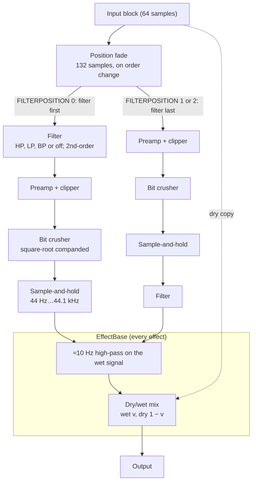

# LoFi (Insert index 5, Master/Send index 6)

Part of [Effects in firmware 1.60](README.md). Findings F025–F031 in the
[findings ledger](../../research-notes/F-effects/findings-ledger.md). Model:
[tools/fx/lofi.py](../../tools/fx/lofi.py).

## Summary

LoFi is **fully reconstructed**: signal chain, all eight parameter formulas, filter
coefficients, object layout and start-up behaviour. The Python model is **bit-exact to
the 1.60 routine run in a single-function emulator** in 52 of 52 runs, plus more than
30 edge cases from independent review (F030). It has not been compared with audio
recorded from an SP-16.

LoFi is four stages in series: a preamp with clipper, a bit crusher, a sample-and-hold
rate reducer, and a resonant filter (high-pass, low-pass, band-pass or off). A position
setting puts the filter first or last. Like every effect, LoFi's output then passes
through the shared `EffectBase` stages: a ≈10 Hz high-pass on the wet signal and the
dry/wet mix (see [README](README.md#the-effectbase-interface)).

All Insert, Master and Send processors build the same `LoFi` class (F016, F019). Only
the Insert context was exercised.

## Signal flow



Per block, slot 25 (`0xfc0f4`) applies changed parameters (`0xfb20c`), handles the
position fade, runs the chain (`0xfbf64`), and updates the dry/wet pair (slot 26) if
MIXRATIO changed. It returns 0. LoFi has no other gain or clip stage (F027).

## Parameters

Index = the `EffectBase` slot-14 index the 1.60 code uses, not necessarily the knob
order on screen. All eight formulas matched the stored values bit for bit in 79 of 79
readbacks at v ∈ {0, 0.1, 0.3, 0.5, 0.7, 0.9, 1} (F028).

| # | Parameter | Formula (v = 0…1; float32 unless noted) | Range | Insert default (F025) |
|---|---|---|---|---|
| 0 | PREAMP | g = 10^((42·v)·0.05), reached by a 44-sample linear ramp | g = 1…125.89 | 0 |
| 1 | REDUCTION | rate = round((float)(1000.0000610351562^v · 44.1)) Hz; hold step = fs / rate (1.0 if rate > fs) | 44 Hz…44.1 kHz | 1 |
| 2 | BITDEPTH | bits = [1, 2, …, 16, 24, 100][round(17·v)] (table at `0x841988`); bits ≥ 32 skips the crusher | 1…16, 24, off | 1 (off) |
| 3 | CUTOFF | fc = 20 · 1000^v Hz, clamped to [5 Hz, fs/2] in the filter | 20 Hz…20 kHz | 0.566 (≈998 Hz) |
| 4 | RESONANCE | Q = 0.2 + 9.8·v; stored only if it changes by at least FLT_EPSILON | 0.2…10 | 0.0510204 (Q 0.7) |
| 5 | MIXRATIO | wet = v, dry = 1 − v (slot 26 `0xfaef4`) | 0…1 | 1 |
| 6 | FILTERTYPE | t = (int)v, ignored unless 0 ≤ t ≤ 3: 0 high-pass, 1 low-pass, 2 band-pass, 3 off | 0…3 | 3 (off) |
| 7 | FILTERPOSITION | p = (int)v: 0 filter first; 1 and 2 filter last (identical output) | 0…2 | 1 |

PREAMP's range is the internal drive g. What you hear is lower, because the clipper
and output scaling follow it. The small-signal gain is (1 + 0.2g)/1.2 (0 to +26.8 dB),
while the clipping ceiling (1 + 0.2g)/(1.2g) falls from 1.0 to 0.173 (F027).

The constructor's "last" values are 0.5 for every continuous parameter, 0 for
FILTERTYPE and 2 for FILTERPOSITION. Setting exactly those values before the first
block does nothing (F026).

## Processing stages

### Preamp and clipper (`0xfb6e4`)

y = clip(x, ±1/g) · (1 + 0.2g) · 0.8333333, all in float32. When PREAMP changes, g
moves to its target linearly over 44 samples (F027).

### Bit crusher (`0xfaf28`)

```math
y = s\cdot\left(2^{-b}\,\operatorname{trunc}\!\left(2^{b}\sqrt{|x|}\right)\right)^{2},\qquad s = \begin{cases} +1 & x > 0 \\ -1 & \text{otherwise} \end{cases}
```

The truncation is done in double precision via libm. The steps are even in the
square-root domain, so quiet signals keep finer steps. The result is odd-symmetric.
Plain rounding and plain truncation of x were both refuted on a −1…+1 ramp (F027).

### Sample-and-hold (inline, `0xfbfc4–0xfc010`)

Phase φ, step s = fs/rate. If φ < 1: φ += s, the input becomes the held value and is
output. Otherwise the held value is output. Then φ −= 1. No interpolation (F027).

### Filter (container `0xfbb70`, ctor `0xfc5e4`)

The container holds four sub-filters, in this order: `IirHpf2ndOrder`,
`IirLpf2ndOrder`, `IirBpf2ndOrder` and `IirOff` (which does nothing). It applies its
own 132-sample gate after the active sub-filter. The biquad (`0xe16dc`) is direct
form I with left and right in two NEON lanes (F027):

```math
y[n] = b_0 v[n] + b_1 v[n-1] + b_2 v[n-2] - a_1 y[n-1] - a_2 y[n-2],\qquad v = x + k\,y_{prev}\ (k = 0\ \text{in LoFi})
```

Coefficients are computed in double precision and stored as float32. With
w = tan(π·fc/fs) and D = 1 + w/Q + w² (F028):

| Type (routine) | b0 | b1 | b2 | a1 | a2 |
|---|---|---|---|---|---|
| High-pass (`0xe1bb8`) | 1/D | −2/D | 1/D | 2(w² − 1)/D | (1 − w/Q + w²)/D |
| Low-pass (`0xe1ca0`) | w²/D | 2w²/D | w²/D | 2(w² − 1)/D | (1 − w/Q + w²)/D |
| Band-pass (`0xe1d88`) | B/E | 0 | −B/E | 2(W² − 1)/E | (1 − B + W²)/E |

For the band-pass, with f = w/2π:

```math
f_{lo} = \frac{f}{2}\left(\sqrt{4 + \frac{1}{Q^2}} - \frac{1}{Q}\right),\quad f_{hi} = f_{lo} + \frac{f}{Q},\quad B = 2\pi(f_{hi} - f_{lo}),\quad W^2 = 4\pi^2 f_{hi} f_{lo},\quad E = 1 + B + W^2
```

If Q ≤ 0.01, the band-pass routine sets Q = 0.01 and logs the message "Q > 0.01". This
is reachable only for RESONANCE below about −0.019.

**Smoothing** (`0xfb994`). Cutoff and Q move in multiplicative steps, one step every
44.1 samples: ×1000^(1/250) per step for the cutoff, ×50^(1/100) for Q. The multipliers
are computed by the static initialiser `0x137cc`. Steps =
round(|log10(target/current)/log10(multiplier)|) + 1. A cutoff jump that needs more
than 38 steps fades the filter gate out, jumps, and fades back in. A type switch
crossfades through the same gate, and the new filter re-filters the last four inputs
to prime its state (`0xe1844`) (F028).

### Start-up and switching fades

The position gate and the filter gate are both built closed and open linearly over 132
samples (3 ms) on the first block. So the first 132 output samples are x·(n/132)². On a
1 kHz sine the first four blocks come out at 0.1084, 0.6116, 0.999 and 1.0 of full
level (F031). Changing FILTERPOSITION fades out through the position gate, swaps the
order, and fades back in. When the filter is off, the swap is immediate (F027).

## Object layout (0x4b8 bytes)

From emulated memory dumps, with the writers taken from the disassembly (F029).

| Offset | Size | Contents |
|---|---|---|
| `+0x10` / `+0x14` | 4 + 4 | EffectBase dry / wet |
| `+0x1b8` + 0x5c·k | 8 × 0x5c | `LinearParameter` objects, in the order PREAMP, BITDEPTH, REDUCTION, CUTOFF, RESONANCE, MIXRATIO, FILTERTYPE, FILTERPOSITION |
| `+0x498` | → 0x14 | Preamp: N = 44, target g, current g, increment, steps left |
| `+0x49c` | → 0xc | Crusher: bits (ctor 32), 2^b, 2^−b |
| `+0x4a0` | → 0x18 | Sample-and-hold: fs, fs, phase (ctor 1.0), step, held L, held R |
| `+0x4a4` | → 0x44 | Filter container: sub-filter vector (data/cap/count = 4), SignalGate `+0xc`, pending/current type `+0x10`/`+0x14` (ctor 3/3), cutoff target/current `+0x18`/`+0x1c` (ctor 1000), multiplier `+0x20`, steps `+0x24`, Q target/current `+0x28`/`+0x2c` (ctor 0.7), multiplier `+0x30`, steps `+0x34`, samples to next step `+0x38`, max steps `+0x3c`, recompute/dirty bytes `+0x40`/`+0x41` |
| `+0x4a8` | → 0x48 | Position SignalGate |
| `+0x4ac` / `+0x4b0` | 4 + 4 | FILTERPOSITION pending / current (ctor 1/1) |

The `IirFilter` sub-object (0x50 bytes, ctor `0xe1edc`) holds: Nyquist `+4`, fs `+8`,
fc `+0xc`, four taps of {vL, vR, yL, yR} at `+0x10…+0x1c`, y_prev `+0x20`, k `+0x24`,
b0 b1 b2 a1 a2 at `+0x28…+0x38`, Q (double) `+0x40`, and the re-seed flag byte `+0x48`.
`SignalGate` (vtable `0x840e40`) keeps its ramp at `+0x1c…+0x3c` and off/on levels at
`+0x40`/`+0x44` (F029).

## 1.60 code map

| Address | What it is |
|---|---|
| `0x841a68` | `LoFi` vtable |
| `0xfd640` | Constructor `(obj, fs, block)`; `new(0x4b8)` |
| `0x137cc` | Static initialiser (smoothing multipliers); must run before the constructor |
| `0xfc0f4` | Slot 25: audio entry |
| `0xfb20c` | Applies changed parameters |
| `0xfbf64` | Four-stage chain, filter-first or filter-last |
| `0xfb6e4` / `0xfaf28` | Preamp + clipper / bit crusher |
| `0xfbb70` / `0xfc5e4` / `0xfb994` | Filter container process / ctor / smoothing setup |
| `0xe16dc` / `0xe1844` | Biquad process / re-seed after a type switch |
| `0xe1bb8`, `0xe1ca0`, `0xe1d88` | High-, low-, band-pass coefficient routines |
| `0xfaef4` | Slot 26: dry/wet pair |
| `0xfb5a4` | Slot 27: reset (*likely*: clears the filter taps and the held samples; read in decompiled code only, not emulated, H025) |

## Validation evidence

- **Emulation comparison** (F030): 13 settings × 4 signals (impulse, late impulse,
  1 kHz sine, seeded noise) × 16 blocks × 64 stereo samples. 52 of 52 runs bit-exact.
  The settings cover every filter type and position, intermediate bit depths and
  rates, preamp drive, and mid-run changes.
- **Readbacks** (F028): 79 of 79 stored values equal to the formulas. The three biquad
  types match on 7 type/cutoff/resonance combinations.
- **Independent review** (F030): identical output hashes on re-run. Added inputs
  clipped at ±10,000, denormals, odd block sizes, 48-block random parameter walks,
  out-of-range values, and NaN/infinity: all bit-exact. Four planted model errors
  were each caught.
- **Second host:** the comparison was reproduced on Linux as well as macOS.
- **Refuted along the way:** "filter types 0 and 3 sound the same" and "0.5 on
  BITDEPTH or REDUCTION changes nothing". Both were artefacts of change detection
  (F025, F026). Once actually applied, type 0 is a high-pass, BITDEPTH 0.5 gives 9 bits
  and REDUCTION 0.5 gives 1,395 Hz.

## Known quirks

- FILTERPOSITION has three values, but 1 and 2 behave identically (F027).
- BITDEPTH above ≈1.03 makes the firmware index past its bit-depth table. The model
  raises an error rather than imitate that (F030).
- The two closed start-up gates mean the first 3 ms after construction are faded in
  even before the `EffectBase` activation fade (F031).

## Unknowns

- The labels the screen shows for filter types 0–3 and positions 0–2 (*guess* only).
- Reset (slot 27) is not modelled (H025).
- Whether the device runs its scalar float code without flush-to-zero (*likely*, F020).
- The host-libm residual: the model uses the host's `pow`/`tan`/`log10`/`trunc` (F030,
  H029).
- The shape and length of the shared activation fade (H018).
