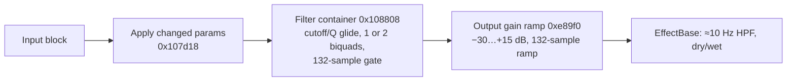

# Multi-mode filter (Insert index 3, Master/Send index 5)

Part of [Effects in firmware 1.60](README.md). Findings F032–F037 in the
[findings ledger](../../research-notes/F-effects/findings-ledger.md). Model:
[tools/fx/mmf.py](../../tools/fx/mmf.py).

## Summary

`MultiModeFilter` is **fully reconstructed**. It is a resonant 12 dB/oct or 24 dB/oct
low-, high- or band-pass filter with an optional glide on cutoff changes, followed by
an output gain of −30…+15 dB. It has no drive, saturation, LFO or envelope (F033). The
Python model is **bit-exact to the 1.60 routine run in a single-function emulator** in
48 of 48 runs, plus 17 review cases (F036).

It reuses LoFi's parameter objects, gate and biquads with identical layouts and
formulas. But it has **its own filter container**, with seven kinds, glide and two-stage
cascades, and it adds a GainRamp output stage (F037).

## Signal flow

Slot 25 (`0x108ee4`), per block (F033):

1. Apply changed parameters (`0x107d18`), in the order CUTOFF, Q, GAIN, GLIDE, then
   FILTERTYPE + FILTERDB (via `0x107c24`).
2. Filter container `[+0x498]` (`0x108808`) on L, R.
3. GainRamp `[+0x49c]` in place. The gain-before-filter order was refuted: only 7 of
   2,048 samples matched.
4. Slot 26 (`0x107b30`) if MIXRATIO changed: wet = v at `+0x14`, dry = 1 − v at
   `+0x10`. Returns 0.

## Filter kinds

The container (`0x10913c`) builds seven stages (F033):

| Kind | Filter |
|---|---|
| 0 / 1 / 2 | one `IirLpf` / `IirHpf` / `IirBpf2ndOrder` biquad (12 dB/oct), Q as set |
| 3 / 4 / 5 | two identical cascaded biquads of the same type (24 dB/oct), each with Q′ = √Q |
| 6 | no filter (no object; smoothing skipped) |

The kind comes from `0x107c24` (F033). With t = FILTERTYPE and d = FILTERDB, both
already truncated to integers: if t ∈ {0, 1, 2}, kind = t when d = 1, otherwise
t + 3. Any other t gives kind 6. So FILTERTYPE 0 LPF / 1 HPF / 2 BPF / anything else
off; FILTERDB 1 = 12 dB, while 0, 2 and any other value give 24 dB (0 and 2 give
identical output). The on-screen labels for these values are a *guess*.

The biquads are the shared direct-form-I NEON process `0xe16dc` with the LoFi
coefficient routines (`0xe1ca0`/`0xe1bb8`/`0xe1d88`). The cutoff is clamped to
[5 Hz, Nyquist] per stage. See [lofi.md](lofi.md#filter-container-0xfbb70-ctor-0xfc5e4)
for the formulas.

## Parameters

118 of 118 readbacks matched at v ∈ {0, 0.1, 0.3, 0.5, 0.7, 0.9, 1} (F034).

| # | Parameter | Formula (float32 unless noted) | Insert default (F032) |
|---|---|---|---|
| 0 | CUTOFF | fc = (float)pow(1000, v) · 20 → 20 Hz…20 kHz | 0.566 (997.77 Hz) |
| 1 | GAIN | dB = 45·v − 30 (0 dB at v = 2/3); g = (float)10^(dB·0.05), reached by a 132-sample linear ramp | 2/3 (0 dB) |
| 2 | Q | Q = 0.2 + 9.8·v (0.2…10); 24 dB stages use √Q. No change threshold (unlike LoFi) | 5/98 (Q 0.7) |
| 3 | GLIDE | G = (1 + 8·v) · 64 = 64…576; glide on when \|G − 64\| ≥ FLT_EPSILON; cutoff step multiplier m = 10^(log10f(1000)/G) | 0 |
| 4 | NONE | registered but never read by the processing code | 0 |
| 5 | MIXRATIO | wet = v, dry = 1 − v | 1 |
| 6 | FILTERTYPE | see [Filter kinds](#filter-kinds) | 0 (LPF) |
| 7 | FILTERDB | see [Filter kinds](#filter-kinds) | 1 (12 dB) |

Note the index order differs from LoFi: here 1 = GAIN and 2 = Q. Slot-14 index 8
changes nothing and returns 3 (F032).

Readback examples (F034): GAIN 0 → 0.0316228 and 1 → 5.623413; GLIDE 0.5 → G = 320,
m = 1.0218214; Q 1 → 10; a 24 dB stage at Q 7.06 → 2.657066.

**Change-detection trap** (F032). The container is built as kind 0 (LPF 12 dB), but
FILTERTYPE's "last" value is 6. So FILTERTYPE 6 set before the first block is never
applied, and an LPF keeps running.

## Glide and smoothing

From the ramp setup `0x108608` and the step loop in `0x108808` (F033, F034):

- Cutoff and Q move in multiplicative steps, one step every 44.1 samples. The cutoff
  multiplier is 1000^(1/G) (its inverse is stored too). The Q multiplier is 50^(1/100)
  (globals `0xf52ef4`/`0xf52ef8`, from the static initialiser `0x13a28`). Step counts
  are round(|log10(ratio)/log10(multiplier)|) + 1.
- Glide time is about G/3 ms per decade: 21.3 ms at GLIDE 0, 107 ms at 0.5, 192 ms at 1.
- A **gated jump** (gate fades out over 132 samples, the cutoff jumps, the gate
  reopens) happens only when GLIDE = 0 (G = 64) and the jump needs more than G·152/1000
  steps, i.e. 10 or more steps (a ratio of about 2.5 or more). A kind switch crossfades
  through the same gate.

## Output gain (GainRamp)

GainRamp is built with N = 132 and an initial gain of 1.0 (`0xe8900`). On a GAIN
change, it ramps linearly from the current gain to the target over 132 samples, with a
float32 increment of (new − current)/132 (`0xe895c`). Otherwise it multiplies by the
current gain using `0x5792c8` (NEON ×4 with flush-to-zero, VFP tail) (F033).

## Start-up

Only the filter gate is involved. It is built closed and opens linearly over 132
samples on block 0. On a 1 kHz sine at the defaults, the first four blocks come out at
0.183, 0.491, 0.700 and 0.714 rms gain. 0.714 is the steady gain of the 997.8 Hz, Q 0.7
low-pass (F033).

## Object layout (0x4a0 bytes)

| Offset | Contents (F035) |
|---|---|
| `+0x1b8` + 0x5c·k | 8 `LinearParameter` objects, in index order (CUTOFF at `+0x1b8` … FILTERDB at `+0x43c`) |
| `+0x498` | → filter container (0x50): stage vector `+0/+4/+8` (data, cap 8, count 7); SignalGate `+0xc` (132 samples); pending/current kind `+0x10`/`+0x14`; cutoff target/current `+0x18`/`+0x1c` (ctor 1000); cutoff multiplier `+0x20`; cutoff steps `+0x24`; Q target/current `+0x28`/`+0x2c` (ctor 0.7); Q multiplier `+0x30`; Q steps `+0x34`; samples to next step `+0x38`; max steps `+0x3c`; bytes recompute `+0x40`, dirty `+0x41`, glide-on `+0x42`; G `+0x44` (ctor 64); step multipliers `+0x48`/`+0x4c` (ctor 1.113974 / 0.897687) |
| `+0x49c` | → GainRamp (0x24): increment `+0`, target `+4`, current `+8` (ctor 1.0), samples left `+0xc`, N `+0x10` = 132, 1/N `+0x14`, delay `+0x18`, idle/accept byte `+0x1c`, state `+0x20` (0 hold, 1 ramp, 2 delayed start) |

A stage (0xc bytes, ctor `0x1080a0`) holds its kind, biquad 1, and biquad 2 (or 0).
Biquads use the `IirFilter` layout described in [lofi.md](lofi.md#object-layout-0x4b8-bytes).
Container fields `+0x00…+0x41` are in the same order as LoFi's container (F035).

## 1.60 code map

| Address | What it is |
|---|---|
| `0x8420b8` | `MultiModeFilter` vtable |
| `0x109e8c` | Constructor `(obj, fs, block)`; `new(0x4a0)` |
| `0x13a28` | Static initialiser (Q step multipliers) |
| `0x108ee4` | Slot 25 |
| `0x107d18` / `0x107c24` | Apply changed parameters / type + dB → kind |
| `0x107b30` | Slot 26 (dry/wet) |
| `0x107fa8` | Slot 27 reset (*likely*: re-applies parameters, clears the current kind's taps; decompiled code only) |
| `0x10913c` / `0x108808` / `0x108608` | Container ctor / process / ramp setup |
| `0x1080a0` / `0x107b64` | Stage ctor / 24 dB configuration (Q′ = √Q, fc clamp) |
| `0xe8900` / `0xe895c` / `0xe89f0` | GainRamp ctor / set target / process |
| `0x5792c8` | Vector × scalar (NEON) |

## Validation evidence

- **Emulation comparison** (F036): 12 settings × 4 signals (impulses, 1 kHz sine,
  seeded noise) × 16 blocks × 64 stereo samples. 48 of 48 bit-exact, covering all
  seven kinds, intermediate CUTOFF/Q/GAIN/GLIDE, and mid-run changes.
- **Readbacks** (F034): 118 of 118. The literals 9.8, 0.2, 45, 0.05, 64, FLT_EPSILON,
  152/1000 and 44.1 were re-read in the code by the review pass.
- **Independent review** (F036): 17 more bit-exact cases. These included 8 random
  walks of 48 blocks changing every parameter, a GAIN retarget every block, a type/dB
  switch every block, GLIDE edges (0, 1e-9, 1e-7, 1e-6), ±10,000 and denormal inputs,
  and finite out-of-range values. Planted errors were caught: wrong GAIN span,
  FILTERDB 2 = 12 dB, FILTERTYPE 3 = LPF 24, Q′ = Q, and gain before filter.

## Known quirks

- The NONE parameter (index 4) is registered but unused. Only the constructor and
  destructor touch it (F032).
- FILTERDB 0 and 2 are identical (F033).
- The block size passed to `process` must not exceed the constructor's block size. With
  a larger n the output diverges. Rebuilt for 256 samples, the model is bit-exact for
  n = 1…256 (F036).

## Unknowns

- On-screen labels for FILTERTYPE ≥ 3 and FILTERDB 0/2 (*guess*).
- Slots 23, 24 and 27 not emulated; container `+0x20` before the first setup
  (uninitialised; *likely* never read first); the GainRamp idle byte when force = 0
  (F035).
- Negative Q could not be tested: the emulator lacks `__errno_location` (F036).
- The Master context (index 5) is *likely* the same class with different defaults only
  (H027).
- The host-libm residual (F044, H029).
