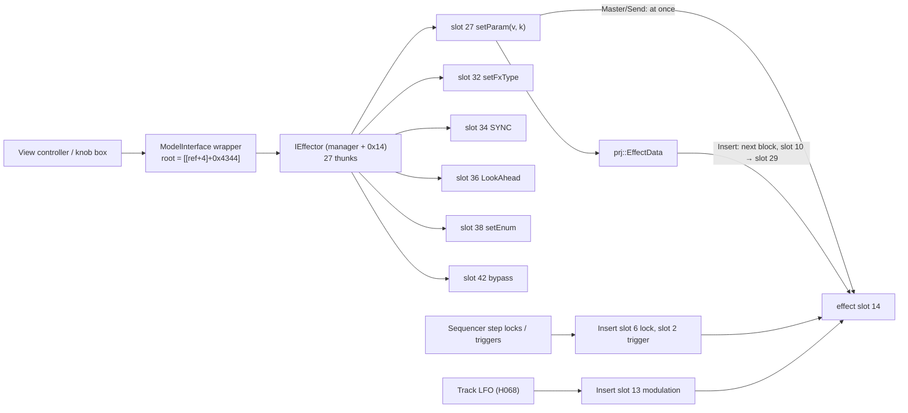

# Parameter plumbing in firmware 1.60

Part of [Effects and mixer in firmware 1.60](README.md). This page follows an effect
parameter from the device UI, the project data and the sequencer to the effect's
`setParameter` (EffectBase slot 14). Findings F159–F172, F179–F186 and, for the Ducker
trigger path, F192–F201 in the
[findings ledger](../../research-notes/F-effects/findings-ledger.md). Model:
[tools/fx/sync_convert.py](../../tools/fx/sync_convert.py) (SYNC toggle and the time
parameter families). All addresses are 1.60 virtual addresses.

## Summary

- Every effect parameter reaches the effect through **EffectBase slot 14**
  `setParameter(index, value)`. Each **parameter manager** passes the normalised value
  0…1 to slot 14 **unchanged** (bit for bit). So the formulas on each effect page
  already give "normalised value → internal value" for every path (F160, F163).
- There are three managers: `InsertFxParameterManager` (one per insert slot, 32 in
  all), `MasterFxParameterManager` and `SendFxParameterManager` (F159, F199).
- The **Insert** manager stores values in `prj::EffectData` and sends them to the
  effect **once per audio block** (manager slot 10). The **Master/Send** managers send
  each value **immediately** (F160, F161).
- **FxParamIndex** (0–71) is an Insert-only flat list. Its 55 valid rows map onto
  (effect, slot-14 index 0–5). It is used by step locks, the LFO modulation table and a
  float-parameter builder. Master and Send have no FxParamIndex tables (F159).
- Slot-14 indices 6 and up (SYNC, enums, LookAhead) are generated by the manager from
  bytes and names in `prj::EffectData`. The tempo (index 7) and the Ducker trigger
  inputs (8, 9) come from the processor, not the manager (F162).
- `prj::EffectData` holds one FX slot's type, six parameters, two bytes (SYNC or
  LookAhead; bypass) and two enum names. Its constructor default is type "Off"
  (F165).
- The UI reaches the managers through one interface (`IEffector`). It can reach every
  continuous parameter of every effect, the enums, SYNC, the Master/Send compressor
  look-ahead and the Insert bypass. It **cannot** reach the Insert compressor
  look-ahead or the processor's "FX ON/OFF" start mode (F168–F172, F178).
- **Insert bypass** is the project property `bBypass`, one per scene per insert slot.
  The track menu's F5/F6 buttons toggle it live, and every scene change re-applies it
  (F179–F182).
- The **SYNC** toggle converts the time value between free units and beat divisions at
  the tempo of the press (F183, F184). The knob step law and the SHIFT fine step are
  in F185; the on-screen formatter in F186. The model `sync_convert.py` is bit-exact
  to the 1.60 routine run in a single-function emulator on every emulated case (F183).

## From the UI to slot 14

The route from a view controller (F168): view controllers, their button handlers and
the `ParameterBox*WidgetController` knobs call static `ModelInterface::*` wrappers.
These take the audio root at `[[ref+4]+0x4344]` (`0x32b664`); `[ref+4]+0x54` is the
current track and `+0x74` the FX slot (1 = FX1, 2 = FX2, 0 = Send/Master).

- **Insert:** root (`HexaTrackAudioSystem`) → track's `TrackUnit` → insert slot →
  `TrackUnit+0xe8[i] + 0x14`, the manager's `IEffector` sub-object (`0x1c7890`).
- **Send/Master:** root slots lead to the `SendFxUnit` manager (`0x1b9510`) or the
  `MasterFxUnit` manager (`0x1b94f0`). A third root slot (`0x1b94c0`) picks Send
  unless the `CompositeFxUnit` FX mode is 1. So every "SendMaster" UI write goes to
  the **Send** manager unless the composite FX mode is 1.

The `IEffector` sub-vtables (Insert `0x844270`, Master `0x8439e0`, Send `0x8448c8`) are
27 thunks of the form "subtract 0x14, branch to the primary slot" (F168):

| `IEffector` offset | Manager slot | Role |
|---|---|---|
| +0x10 | 27 | setParam(v, k) |
| +0x24 | 32 | setFxType (apply an effect type) |
| +0x2c | 34 | SYNC toggle |
| +0x34 | 42 | bypass |
| +0x3c | 36 | LookAhead |
| +0x44 | 38 | setEnum(Identifier, which) |
| +0x0c, +0x18, +0x28, +0x30, +0x40, +0x4c, +0x50 | 50, 29, 33, 35, 37, 39, 41 | getters |
| +0x60 / +0x64 | 46 / 47 | FX ON/OFF setter / getter (never called from the UI, F172) |

**Manager slot 51 (reload) is not in `IEffector`**, so the UI cannot call it directly
(F168). The sweep behind this covered 762 root-fetch sites in 509 functions, 82
`IEffector` calls and 186 call sites of the wrappers. Paths of the form UI → unit or
track method → manager primary slot were not excluded exhaustively; the sequencer,
MIDI and LFO writers are separate paths (F168).

Manager slots 36, 38 and 42 return at once when the manager byte `+0x24` is 0
(F172). That byte means "attached / data valid" (F181).

## Slot-14 indices per effect

Index = the EffectBase slot-14 index. "k" in the manager tables below is the same as
the slot-14 index for k = 0…5. Indices 6 and up are sent by the manager or the
processor as noted. The full formulas are on each effect page.

### Insert (InsertFxProcessor array)

| Insert index | Effect | 0 | 1 | 2 | 3 | 4 | 5 | 6 and up |
|---|---|---|---|---|---|---|---|---|
| 0 | [Chorus](chorus.md) | RATE | DEPTH | PHASE | DEPTH SCALE | (ignored) | MIXRATIO | 6 SYNC, 7 BPM |
| 1 | [Flanger](flanger.md) | RATE | DEPTH | PHASE | DEPTH SCALE | FEEDBACK | MIXRATIO | 6 SYNC, 7 BPM |
| 2 | [2-band EQ](parametric-eq.md) | B1FREQUENCY | B1GAIN | B1Q | B2FREQUENCY | B2GAIN | B2Q | 6 BAND1TYPE, 7 BAND2TYPE |
| 3 | [Multi-mode filter](multimode-filter.md) | CUTOFF | GAIN | Q | GLIDE | NONE (never read) | MIXRATIO | 6 FILTERTYPE, 7 FILTERDB |
| 4 | [Delay](insert-delay.md) | DelayTime | Feedback | HiCut | LowCut (never read) | Spread (never read) | Mixratio | 6 SYNC, 7 BPM |
| 5 | [LoFi](lofi.md) | PREAMP | REDUCTION | BITDEPTH | CUTOFF | RESONANCE | MIXRATIO | 6 FILTERTYPE, 7 FILTERPOSITION |
| 6 | [Distortion](distortion.md) | drive | output LPF | HPF | pre-clip LPF | dynamics threshold | mix | — |
| 7 | [Compressor](compressor.md) | Threshold | Ratio | Attack | Release | Gain | Mixratio | 6 LookAhead, 7 Knee, 8 LevelDetect |
| 8 | [Phaser](phaser.md) | Rate | Width | Phase | Frequency | Feedback | Mixratio | 6 Sync, 7 Bpm |
| 9 | [Ducker](ducker.md) | ATTACK | ATTACKCURVE | RELEASE | RELEASECURVE | NONE (never read) | DEPTH | 6 SYNC, 7 BPM, 8 TRIGGER, 9 OFFSET, 10 SOURCE |

Sources: F025 (LoFi), F032 (MMF), F038 (PEQ), F045 (Phaser), F057 (Chorus), F063
(Flanger), F069 (Distortion), F075 (Insert Delay), F081 (Compressor), F089 (Ducker).
Insert Chorus index 4 has no case in its setter (F057). The processor feeds BPM
(index 7) every block to Insert Chorus, Flanger, Delay, Phaser and Ducker, and the
Ducker's TRIGGER (8) and OFFSET (9) from the trigger table (F017, F088; see
[Ducker trigger path](#ducker-trigger-path)).

### Master and Send (MasterFxProcessor / SendFxProcessor array)

| M/S index | Effect | 0 | 1 | 2 | 3 | 4 | 5 | 6 and up |
|---|---|---|---|---|---|---|---|---|
| 0 | [Delay](send-delay.md) (`SendFxDelay`) | DelayTime | Feedback | HiCut | LowCut | Spread | Mixratio | 6 SYNC, 7 BPM |
| 1 | [Reverb](send-reverb.md) (`SendFxReverb`) | PRE DELAY | ROOM SIZE | REVERB TIME | COMB FILTER LPF | LR SWAP SPREAD | MIX RATIO | — (6, 7 return 3) |
| 2 | [Chorus](chorus.md) | as Insert | | | | | | 6 SYNC, 7 BPM |
| 3 | [Flanger](flanger.md) | as Insert | | | | | | 6 SYNC, 7 BPM |
| 4 | [2-band EQ](parametric-eq.md) | as Insert | | | | | | 6, 7 band types |
| 5 | [Multi-mode filter](multimode-filter.md) | as Insert | | | | | | 6 FILTERTYPE, 7 FILTERDB |
| 6 | [LoFi](lofi.md) | as Insert | | | | | | 6 FILTERTYPE, 7 FILTERPOSITION |
| 7 | [Compressor](compressor.md) (`SendFxCompressor`) | as Insert | | | | | | 6 LookAhead, 7 Knee, 8 LevelDetect |
| 8 | [Distortion](distortion.md) | as Insert | | | | | | — |
| 9 | [Phaser](phaser.md) | as Insert | | | | | | 6 Sync, 7 Bpm |

Sources: F115 (Send Delay), F123 (Reverb), F087 (Send compressor), F019 and F173 (same
classes and order in Master and Send). The Master and Send processors feed BPM to
indices {0, 2, 3, 9} only (F115, F156). Unlike the Insert delay, the Send/Master
delay's LowCut and Spread are live (F115).

## FxParamIndex (Insert only)

`InsertFxParameterManager` (vtable `0x84407c`) slot 55 `0x1262e8` maps FxParamIndex
f ≤ 71 to an Insert effect index, and slot 56 `0x126304` maps it to the slot-14 index,
from two signed-byte tables at `0x843d98 + 0x78` and `+ 0xc0` (F159). 55 rows are valid
and map one to one onto 55 distinct (effect, index) pairs. No row maps to an index of
6 or more.

| FxParamIndex | Insert effect | Slot-14 indices (in row order) | Modulation ids | UI integer range [lo, hi) (slot 50) |
|---|---|---|---|---|
| 0–4 | 0 Chorus | 0, 1, 2, 3, 5 | 100–104 | 1:101, 0:101, 0:181, 10:101, 0:101 |
| 5–10 | 1 Flanger | 0–5 | 105–110 | 1:101, 0:101, 0:181, 1:71, 0:100, 0:101 |
| 11–13, 16 | none | 0, 1, 2 / 5 (a lock still lands on the current effect) | — | — |
| 14, 15, 17–22 | none | none | — | — |
| 23–28 | 5 LoFi | 0–5 | 126–131 | 0:43, 0:128, 0:18, 0:1001, 2:101, 0:101 |
| 29–34 | 2 2-band EQ | 0–5 | 112, 113, 111, 115, 116, 114 | 0:1001, −30:16, 1:101, 0:1001, −30:16, 1:101 |
| 35–40 | 6 Distortion | 0–5 | 138–143 | 0:81, 0:1001, 0:1001, 0:1001, 0:101, 0:101 |
| 41–45 | 3 Multi-mode filter | 0, 1, 2, 3, 5 | 117–121 | 0:1001, −30:16, 2:101, 0:101, 0:101 |
| 46–49 | 4 Delay | 0, 1, 2, 5 | 122–125 | 10:1001 (SYNC off), 0:101, 0:101, 0:101 |
| 50–55 | 7 Compressor | 0–5 | 132–137 | −52:1, 10:301, 1:1020, 10:4001, 0:51, 0:101 |
| 56–60 | none | none | — | — |
| 61–66 | 8 Phaser | 0–5 | 144–149 | 1:1001, 0:101, 0:181, 0:257, 0:100, 0:101 |
| 67–71 | 9 Ducker | 2, 3, 0, 1, 5 (RELEASE, RELEASECURVE, ATTACK, ATTACKCURVE, DEPTH) | 152, 153, 150, 151, 155 | 1:80001, −100:101, 0:10001, −100:101, 0:101 |

Notes (F159, F162):

- [lo, hi) is the constant integer pair that manager slot 50 `0x126458` returns for
  (current type, k ≤ 5); (0, 100) otherwise. Its role as the UI integer range is
  *likely*; the pairs match the known UI domains. The quantisation
  v = (i − lo)/(hi − 1 − lo) is confirmed for the knob step routines (F185).
- The **modulation** tables (manager slots 57/58, F135) cover the same 55 pairs (only
  id 154 is a gap), in a different order: modulation id ≠ 100 + FxParamIndex. Ids
  200–255 are an exact copy of 100–155 and address FX2 (F135).
- LookAhead, Knee and LevelDetect of the compressor, and LowCut, Spread and SYNC of the
  delays, have no FxParamIndex row (F075, F081). Manager paths still write them (F163).
- The Master and Send managers have no FxParamIndex tables: their slots 55–58 return 0
  (not −1), and slots 6 and 10 do nothing. That FxParamIndex is Insert-only is
  *likely* at manager level (F159).
- Other users (roles *likely*): a 72-case switch at `0x1de6dc` builds a
  `UserModeFloatParameter` for exactly the 55 valid rows. `0x351c70` and `0x3535dc`
  carry the [1.50] 49-case lock set and read step words through the byte table
  `0x8ab198`, which equals the slot-14 table on all 55 valid rows. This is the lead
  for the 1.60 step-lock reader (H003) (F159).

## Insert manager value paths

The Insert manager sends nothing to the effect when a value is written. It sets flags,
and its per-block update (slot 10 `0x129b34`, called by `TrackUnit` slot 5 every block
for each insert slot) sends the values through processor slot 29. Processor slot 29
`0x1126dc` sends to the **pending** effect (`proc+0x90`) slot 14; `0x112924` sends to
array[eff] slot 14 with a bounds check. Both pass the value unchanged (F160).

| Path | Entry | What happens | Evidence |
|---|---|---|---|
| Edit | slot 27 `0x126c0c(this, v, k)` | EffectData[k] = v plus an edit flag; the next slot 10 sends slot 29(k, ED[k]) once. k is not bounds-checked (static). | 480/480 emulated (F160) |
| Step lock | slot 6 `0x1263c0(this, _, f, v)` | sub = slot 56(f); lock[sub] = v (`+0x68`), flag (`+0x80`). No effect-type check and no float operation. Applied only after a trigger: the next slot 10 sends, for k = 0…5, slot 29(k, locked ? lock : ED[k]) and clears the flags. **Unlocked parameters snap back to EffectData at each trigger.** | 576/576 runs (72 rows × 8 values) bit-exact; a lock for another effect's row lands on the current effect's sub, 11/11 (F160) |
| Trigger | slot 2 `0x1263f4` | Sets `+0x86` for every event type; types 11 and 15 also go to processor slot 54 (the Ducker) | F160, F192 |
| Modulation | slot 13 `0x126434` | Stores id and amount. At the end of every slot 10: if the id's slot equals this manager's slot and slot 57(id) is the pending type, send slot 29(slot 58(id), clamp01(f32(ED value + amount))). **The only clamp on the Insert path.** | 330/330 (F160, F135) |
| Reload | slot 51 `0x126394` | Sets `+0x25`. Next slot 10: setFxType(slot 52(type name)), slot 29(k, ED[k]) for k = 0…5, then the per-type extras below, then the bypass (F179). | F160, F166 |

Two edge cases (F160):

- Pending edit flags survive the trigger branch. So an edit made before a trigger
  overwrites that trigger's lock one block later (emulated, review).
- A step lock for a row whose slot-14 index is −1 writes `+0x64` and the byte `+0x7f`
  (index −1). That corrupts the top byte of the sub-5 lock: lock sub 5 = 1.0, then a
  −1 row gives slot 14(5) = bits `0x01800000` (4.7e−38). Reachability from the
  sequencer is unknown (*guess*: not reachable).

Whether the sequencer filters step locks by effect type before slot 6 is open (F160,
H003).

## Master and Send manager value paths

- **Edit** (slot 27 `0x11ce58(this, v, k)`): ED[k] = v and **immediately** slot 29(k, v).
  No flag and no per-block update. Identity, including out-of-range 1.25 and −0.5
  (240/240 emulated in each context) (F161).
- **Reload** (slot 51, Master `0x121174`, Send `0x12de8c`): ED[k] → slot-14 index k for
  k = 0…5 (Chorus and MMF skip k = 4), then the extras below (F161, corrected by F166).
- Slot 2 (triggers) is an empty function: **Master and Send FX never receive
  sequencer triggers** (F192).

### Extras sent on reload (index 6 and up)

| Effect | Insert reload | Master/Send reload |
|---|---|---|
| Chorus, Flanger, Phaser | 6 = float(SYNC byte ED+0x28) | 6 = SYNC byte |
| Delay | 6 = SYNC byte | 6 = SYNC byte |
| Ducker | 6 = SYNC byte, 10 = SOURCE enum | — (Insert only) |
| 2-band EQ | 6, 7 = band-type enums | 6, 7 = band-type enums |
| Multi-mode filter | 6 FILTERTYPE, 7 FILTERDB enums | 6, 7 enums |
| LoFi | 6 FILTERTYPE, 7 FILTERPOSITION enums | 6, 7 enums |
| Compressor | 7 Knee, 8 LevelDetect enums (**no index 6**) | 6 = LookAhead byte ED+0x28, 7 Knee, 8 LevelDetect |

Sources: F162, F166 (the corrected Master/Send list; sites Master `0x1223c4`,
`0x1225d8`, `0x122864`, Send `0x12f0c8`, `0x12f2dc`, `0x12f568`). Enum values are
float(int name-converter(Identifier)) (F162, F164). The Insert compressor's index 6
(LookAhead) is sent only by manager slot 36 `0x126b68`, and only when the pending type
is 7 (F162).

A reload with a non-zero argument first resets every effect to its slot-52 defaults
(Master/Send processor slot 52, Insert slot 53 per effect), then does the same
EffectData reload; the final values equal EffectData (F166, emulated). On that path
the Insert compressor's index 6 is re-defaulted.

## Enum converters

Manager slots 59–74 are the same functions in the base (`0x8430cc`), Insert, Master
and Send vtables (F164). Even slots map a `juce::Identifier` to an int by comparing
pointers with function-static pooled Identifiers. Odd slots map the int back to a name.
Matching is exact and case-sensitive. Identifiers built from a C string or a
`juce::String` give the same pooled pointer.

| Slot | Address | Target (EffectData field) | Name → value | Unknown name → |
|---|---|---|---|---|
| 60 | `0x11e138` | 2-band EQ index 6 (`+0x2c`) and 7 (`+0x30`) | LowShelving 0, HighShelving 1, Peaking 2, LowPass 3, HighPass 4 | 0 |
| 62 | `0x11e9ac` | MMF 6 FILTERTYPE (`+0x2c`) | LowPass 0, HighPass 1, BandPass 2, LowPass24 3, HighPass24 4, BandPass24 5 | 6 |
| 64 | `0x11d038` | MMF 7 FILTERDB (`+0x30`) | FilterOrder1 0, FilterOrder2 1, FilterOrder4 2 | 0 |
| 66 | `0x11df88` | LoFi 6 FILTERTYPE (`+0x2c`) | HighPass 0, LowPass 1, BandPass 2 | 3 (off) |
| 68 | `0x11d940` | LoFi 7 FILTERPOSITION (`+0x30`) | FilterPositionPre 0, FilterPositionPost 1 | 2 |
| 70 | `0x11d818` | Compressor 8 LevelDetect (`+0x30`) | LevelDetectPeak 0, LevelDetectRMS 1 | 0 |
| 72 | `0x11d6f0` | Compressor 7 Knee (`+0x2c`) | CompressorKneeHard 0, CompressorKneeSoft 1 | 0 |
| 74 | `0x11f3f4` | Ducker 10 SOURCE (`+0x2c`, Insert only) | SourceTrack1…SourceTrack16 → 0…15 | 0 (also "SourceTrackNone") |

The filter names are "FilterType…" strings ("FilterTypeLowPass", and so on). The odd
slots return "FilterTypeOff", "FilterOrder2", "LevelDetectPeak", "CompressorKneeHard"
or "SourceTrackNone" for out-of-range ints. For every int a converter can produce,
name(int) → int is the identity (F164).

Consequences (F164, code level):

- The name path never yields 2-band EQ type 5, the type with no filter stage
  ([parametric-eq.md](parametric-eq.md)).
- Knee is only 0 or 1: hard knee, or K = 18 dB ([compressor.md](compressor.md)).
- The MMF "…24" names give FILTERTYPE 3, 4 or 5, which the real MMF turns into filter
  kind 6 = **no filter** (emulated). A 24 dB slope comes only from FILTERDB
  ([multimode-filter.md](multimode-filter.md)). Whether the UI ever stores the "…24"
  names: *guess* no. F171 shows that the UI does not send them.
- Ducker SOURCE is lossy outside 0…15: 16.0 → "SourceTrackNone" → 0.0 (F166).

## `prj::EffectData`: defaults, type selection and reload

One `prj::EffectData` per FX slot holds what a project stores for that slot. Constructor
`0x359d1c(this, nodeName, config)`, size 0x64, vtable `0x8ac720`. Its three callers
build "InsertFx" + n, "SendFx" and "MasterFx" nodes. The config argument is never read
(F165).

| Offset | Contents | Constructor default |
|---|---|---|
| `+0x08` | node Identifier | the node name |
| `+0x0c` | array of 6 property binders (setup `0x371d2c`) | — |
| `+0x24` | effect type name | "Off" |
| `+0x28` | byte: SYNC (time effects) or LookAhead (compressor) | 0 |
| `+0x29` | byte: bypass, project property `bBypass` (F180) | 0 |
| `+0x2c` | enum name 1 (PEQ band 1, MMF/LoFi filter type, compressor Knee, Ducker SOURCE) | "FilterTypeOff" |
| `+0x30` | enum name 2 (PEQ band 2, MMF FILTERDB, LoFi position, compressor LevelDetect) | "FilterTypeOff" |
| `+0x34 + 8k`, k = 0…5 | (Identifier, float) pairs: the six parameters | ("None", 0.0) |

The defaults are the same for every name and context (F165). Reloading them gives
type "Off" → setFxType(−1) with no slot-14 call: the FX slot is off (F165). Whether
"new project" loads a template file instead of these defaults is open (*likely* not,
H085).

**Selecting a type** (manager slot 32 applyFxType: Insert `0x1287d4`, Master
`0x1237cc`, Send `0x12bc84`) writes the type name to `+0x24` and calls setFxType. It
does not reset parameters. It then **reads the newly selected effect's live values
back** into EffectData through processor slot 21 → effect slot 15 (F165):

- k = 0…5 → `+0x38 + 8k`;
- the SYNC/LookAhead byte = (get(6) ≥ 0.5) → `+0x28`;
- enums = odd converter(roundToInt(get(idx))) → `+0x2c` / `+0x30`. JUCE `roundToInt`
  rounds half to even, so a Knee of 0.5 becomes Hard.

It makes no slot-14 call. So the values EffectData gets are whatever the effect object
currently holds, not a fixed per-type table (20 edited-value runs) (F165). The Ducker's
SOURCE default is its own track (processor slot 52 sets SOURCE = float(proc+0xa0)), so
slot 32 stores "SourceTrack(n+1)" (F165, F089).

**Reload round trip** (F166): a fresh EffectData → real slot 32(effectId) → real slot
51 gives, for all 30 (type, context) pairs, every index that processor slot 52 sets,
bit-exactly equal to its slot-52 default (216-row table). This shows that the
converters, the byte and the rounding are lossless at the defaults. A few extra sends
without a slot-52 value (Insert Chorus 4, MMF 4, Insert Delay 3/4, Ducker 4) re-send
the effect's own, unused value.

### The `+0x28` carry-over (F167)

Byte `+0x28` is SYNC for the Delay, Chorus, Flanger, Phaser and Ducker and LookAhead for
the compressor. Slot 32(Compressor) does not refresh it, and the Master/Send
compressor's LookAhead is not read back by slot 32. So on **Master or Send**, an
effect with SYNC on followed by selecting the Compressor makes the next reload send
Compressor index 6 = 1.0 (look-ahead on), although the live compressor had 0. The
Insert is unaffected (confirmed at code level, emulated in all three contexts). Both UI
steps exist (F171); whether a reload follows depends on the callers of slot 51, which
are not UI and were not traced (H088).

On a fresh project (*likely*, conditional on H085): Compressor 6/7/8 = 0/0/0
(look-ahead off, hard knee, peak) and Send/Master Delay 3/4/6 = 0/0/0 (5 Hz low cut
floor, no spread, free time) (F167).

## What the UI can reach

### Knobs (F170)

The `ParameterBox` base `didChangeEncoderValue` (`0x2c004c`, jump table `0x2c00f4`)
sends encoder n = 1…6 to box vtable slot 17 + n, but only if widget n − 1 exists, is
visible and is enabled. Each slot checks the current effect type and then calls the
step routine (Insert `0x316a10`, Send/Master `0x313ecc`), which writes through manager
slot 27 (see [step law](#ui-step-law-and-shift)). Labels are PNG skin images, not
strings; the names below are widget class names.

| Box | Encoder 1 | 2 | 3 | 4 | 5 | 6 |
|---|---|---|---|---|---|---|
| Master/Send Delay (vtable `0x896914`, type 0) | k0 Time | k1 Feedback | k2 HiCut | **k3 LoCut** | **k4 Spread** | k5 mix |
| Master/Send Reverb (vtable `0x891954`, type 2) | **k0 PreDelay** | k1 RoomSize | k2 RevTime | **k3 "Damping"** (comb LPF) | **k4 Spread** (LR swap) | k5 mix |
| Insert Delay | k0 Time | k1 Feedback | k2 HiCut | — | — | k5 mix |
| Insert and Master/Send Compressor | k1 | k2 | k3 | k0 | k4 | k5 |
| Multi-mode filter (Insert and M/S) | k0 | k1 | k2 | k3 | — | k5 |
| LoFi | k0 | k1 | k2 | k3 | k4 | k5 |
| Distortion | k0 | k2 | k3 | k4 | k1 | k5 |
| Master/Send 2-band EQ | k2 | k0 | k1 | k5 | k3 | k4 |
| Insert Ducker | k0 | k1 | k2 | k3 | — | k5 |

Box ↔ layout pairing is *likely* for the rows after the two Master/Send boxes. The
Insert 2-band EQ, Chorus, Flanger and Phaser layouts were not tabulated (F170). For the
Distortion, HI FREQ is index 3 (pre-clip LPF) and TONE is index 1 (output LPF) (H042,
confirmed; see [distortion.md](distortion.md)).

**SYNC buttons** (F170): `FxMaster{Delay,Chorus,Flanger,Phaser}ViewController::Handler_0`
→ `0x23e9bc` → manager slot 34 with !current; Insert
`FxInsert{Delay,Chorus,Flanger,Phaser}VC::Handler_0`, `FxInsertDuckerVC::Handler_1` and
`FxLimiterVC::Handler_1` → `0x229180` → Insert slot 34 toggle.

### Compressor buttons (F169)

| Control | Insert | Master/Send |
|---|---|---|
| Knee (hard/soft) | Handler_2 → slot 38("CompressorKneeHard"/"…Soft", which 0) → index 7 | Handler_3 |
| LevelDetect (peak/RMS) | Handler_0/_1 → slot 38("LevelDetectPeak"/"…RMS", which 1) → index 8 | Handler_1/_2 |
| LookAhead | **no UI writer** | Handler_0 → slot 36 toggle (Master `0x120808`: writes ED+0x28 and sends index 6 when the current effect is the compressor) |

The only Insert `IEffector +0x3c` (LookAhead) call is in `0x30225c`, and nothing
references that function: no branch, no pointer word in any form, no jump-table word
and no cross-reference. Its getter `0x3022ac` is also unreferenced. The Insert
compressor view has 4 handler classes; the Master view has 5 (F169). The handlers are
bound by their controller constructors. Whether the buttons are visible at run time was
not read (*likely* visible).

### Enum values the UI sends (F171)

| Control | Values sent |
|---|---|
| MMF FILTERTYPE | LowPass / HighPass / BandPass / Off only |
| MMF FILTERDB | FilterOrder2 / FilterOrder4 only |
| LoFi FILTERTYPE | LowPass / HighPass / BandPass / Off |
| LoFi FILTERPOSITION | FilterPositionPre / FilterPositionPost |
| 2-band EQ band type (Insert and M/S, which = band) | selector 0 HighPass, 1 LowPass, 2 Peaking, 3 HighShelving, 4 LowShelving; 5 → no call |
| Ducker SOURCE | n → "SourceTrack(n+1)" for 0…15, else "SourceTrackNone" |

The "…24" filter names and "FilterOrder1" are referenced only by the converters and the
EffectData constructor (F171). EQ type 5 is unreachable from the UI (F171, F038).

### FX type popup (F171)

The `FxSelectPopupWidgetController` handlers call manager slot 32 for: Off, Chorus,
Flanger, Phaser, Distortion, LoFi, Delay, Reverb (Send/Master only), 2-band EQ, Filter,
Compressor and Ducker. Insert has 20 handlers; Send/Master 19, beyond the Master/Send
table, so *likely* Off. The other handlers call no type setter. The pairing of handler
and item text by list order is *likely*. Which items each context shows and their
on-screen names are open (H066, H019).

### What the UI cannot reach

- The Insert compressor's LookAhead (F169; open whether project load can set it, H090).
- The processor's FX ON/OFF start mode (`+0x9d`): the `IEffector` thunks +0x60/+0x64
  have no calls on the UI route (F172). The UI "FX ON/OFF" button only logs a string
  (F178; see [fx-processors.md](fx-processors.md)).
- Manager slot 51 (reload), which is not in `IEffector` (F168).

## Insert bypass: sources and timing

A user "FX bypass" on an insert is the processor's 132-sample (44.1 kHz) linear
crossfade to the dry copy, with the effect still running behind it (F157; see
[fx-processors.md](fx-processors.md)). The processor's bypass setter `0x1129b4` has
exactly two callers, both in Insert manager code (F179):

1. **Manager slot 42** `0x11cfc8(mgr, v)` (UI, through `IEffector +0x34`): if `+0x24`
   = 0, return; else set the processor's bypass to v, then write v to
   EffectData[scene] `+0x29`. The same function is slot 42 of all seven manager vtable
   groups.
2. **Manager slot 10** at `0x129e58`: every reload ends by applying EffectData `+0x29`
   of the current scene to the processor. Every reload path reaches this call,
   including type Off.

Slot 43 `0x11cf58` (the getter) returns the stored `+0x29`, not the processor's
`+0x9c` (F179).

**Storage** (F180): `+0x29` is the project property `bBypass` (binder load key
"bBypass"). The holder `SwitchableObject<prj::EffectData,17>` keeps **17 EffectData
objects per insert slot: 16 scenes and one dummy**. The holder index is the current
scene index. Writers of `+0x29`: slot 42 (UI), the constructor (:= 0), the property
binder load, reset and copyFrom. Save and print only read it. That this writer list is
complete is *likely*. A function `setToReferToDummy` `0x186cc8` can redirect a scene to
the dummy; its callers are not traced (H091).

**When the stored bypass reaches the processor** (F181): manager byte `+0x25` requests
a reload; slot 51 sets it, slot 10 clears it. Slot 51 is reached only from the
scene-edit listener slots and from the scene/pattern switch listener.
`ScenePatternSwitcher::switchSync` `0x18bbb8` calls the "scene changed" listener only
when the scene index changes, which reloads. A pattern change within the same scene
calls a listener that does nothing. So the stored bypass (with the type and the
parameter values) is applied **on a scene change, not on a pattern change within a
scene**, and at the end of scene-editor edits, at the start of the next audio block.
The project-load sequence was not traced (*likely* through these routes).

**The device control** (F182): `TrackMenuViewController::onFunction5Button` `0x29bd94`
and `onFunction6Button` `0x29bb0c` call `ModelInterface::setEffectBypassMode`
`0x2f8114` with slot 0 or 1 and (current state XOR 1). That toggles the FX1 (F5) or FX2
(F6) bypass of the current track. This works only for track types 0/1 (*likely* Sample
and Thru) and only while a per-track mode byte is set; otherwise the buttons open a
view. On MIDI tracks (types 2/3, *likely*) F5 toggles the MIDI CC bypass and F6 does
nothing. The per-track byte is toggled by a track-menu widget handler drawn with a
"bypass" skin part, so it is *likely* a "BYPASS" mode button (device not inspected).

**Master and Send** (F182): only Insert managers are reachable from `IEffector +0x34`.
A real slot 42(1) on Master or Send writes `+0x9c` and `bBypass`, but the Master/Send
processors never read `+0x9c`: the output is bit-identical, so the bypass is
**inaudible** there (F157).

Emulated (F181): the real InsertFxProcessor and Insert manager with the real EffectData
constructor and the real `IEffector`/slot 42/32/27/listener/51/10/processBlock code, 14
of 14 cases bit-exact against `fx_processors.py` (243,200 samples, 6 types plus Off),
and 14 of 14 hand-derived bypass expectations met. Two alternatives were refuted
(F181).

## SYNC conversion

Manager slot 34 (Insert `0x126c90`, Master `0x1208ac`, Send `0x12b3b4`) is the SYNC
toggle (F183). It handles Insert types {0, 1, 4, 8, 9} and Master/Send types
{0, 2, 3, 9}; other types return with no call.

1. If `+0x24` = 0, return. Store the new SYNC byte in EffectData `+0x28` first (the UI
   passes !current; the old byte is never read).
2. Read the tempo T = max(f32(tempo provider), 0.5) (`0x112a48`). The Insert manager
   also has a dead `T < 0.1 → 0.1` test.
3. Turn the stored value v into the integer step of the mode being **left**:
   i = roundToInt(f32(lo) + f32(v·f32(hi − 1 − lo))). The stored v is clamped to [0, 1]
   first, except for the Ducker.
4. Convert step i to Hz, ms or beats at tempo T, and pick the nearest step j of the
   mode being **entered**.
5. Output v' = f32(f32(j − lo′)/f32(hi′ − 1 − lo′)), clamped to [0, 1]. Write v′ to
   EffectData `+0x38` (the Ducker's RELEASE also to `+0x48`) and to slot 14 index 0
   (Ducker: 0 and 2), then slot 14 index 6 := f32(sync).

All arithmetic is float32 and not fused (F183):

| Family | Free → sync | Sync → free |
|---|---|---|
| Rate (Chorus, Flanger, Phaser) | y = f32(T/60)·f32(1/Hz) beats per cycle | Hz = f32(T/60)·f32(1/beats) |
| Delay (Insert, Send/Master) | beats = (ms·f32(T/60))·0.001 | ms = (beats·f32(60/T))·1000 |
| Ducker | sixteenths = ms·f32(f32(T·0.004)/60) | ms = (sixteenths·f32(60000/T))·0.25 |

- Free steps are found with JUCE `roundToInt` (round half to even; exact halves
  emulated: 62.5 → 62, 187.5 → 188). The Ducker truncates (`vcvt.s32.f32`) to 0.1 ms.
- The nearest sync division uses linear midpoints f32(f32(f_k + f_k+1)·0.5)
  (ascending chains test `x < mid`, descending `x > mid`). The Ducker uses a binary
  search: the first k with T[k] + 1e−4 > x.
- A double-precision tempo factor was refuted in 20 discriminating cases at 0.1-BPM
  tempos.

### Time-parameter families (F184)

| Family (used by) | Free range [lo, hi) → value | Sync range | Sync divisions (index 0…n−1) |
|---|---|---|---|
| chorus (Insert 0, M/S 2) | 1:101, i·0.1 Hz | 0:10 | beats per cycle 16, 8, 4, 2, 1, 3/4, 1/2, 1/4, 1/8, 1/16 |
| flanger (Insert 1, M/S 3) | 1:101, i·0.01 Hz | 0:7 | 64, 32, 16, 8, 4, 2, 1 |
| phaser (Insert 8, M/S 9) | 1:1001, i·0.01 Hz | 0:12 | 64, 32, 16, 8, 4, 2, 1, 3/4, 1/2, 1/4, 1/8, 1/16 |
| insert_delay (Insert 4) | 10:1001, i ms | 0:6 | beats 1/8, 1/4, 1/2, 3/4, 1, 2 |
| send_delay (M/S 0) | 10:4001, i ms | 0:8 | 1/8, 1/4, 1/2, 3/4, 1, 2, 4, 8 |
| ducker_attack (Insert 9, index 0) | 0:10001, i·0.1 ms | 0:128 | sixteenths table `0x8a9b20` |
| ducker_release (Insert 9, index 2) | 1:80001, i·0.1 ms | 0:128 | sixteenths table `0x8a9d20` |

The fraction tables are in `.bss` as 16-bit numerator/denominator pairs at
`0xf61f18 + 4·idx` (chorus `0xf61f50`, flanger `0xf61f78`, phaser `0xf61fcc`, insert
delay `0xf61fb4`, send delay `0xf61f94`), filled by `.init_array` code
`0x6cbe0…0x6ce8c`. After a toggle, the real slot 50 returns the range of the mode just
entered (28/28); it tests the effect's live SYNC > 0.5. The effect quantity of every
free step equals the existing slot-14 models (F184).

Behaviour that follows (F183):

- In sync mode the effect follows tempo changes itself. A free value produced by
  turning SYNC off is frozen at the tempo of the press.
- Off → on → off returns to the start value only when it sat on a division (at 120 BPM:
  Chorus 8 of 100 steps, Insert Delay 6 of 991). On → off → on is exact unless the free
  range clamps (at 20 BPM: Insert Delay 2/6, Send Delay 5/8, Ducker 83/128 and 77/128).

The model is [tools/fx/sync_convert.py](../../tools/fx/sync_convert.py):
`s34(ctx, case, ed0, ed2, sync, bpm)` for the whole toggle and
`convert(fam, v, sync, T)` for one conversion. It is bit-exact on all emulated cases.
Out-of-range Ducker inputs (*likely* not reachable from the UI) are not modelled
(F183). It imports the Ducker sixteenth tables from `ducker.py`.

## UI step law and SHIFT

The knob step routines (Insert `0x316a10`, Send/Master `0x313ecc`) (F185):

1. i = roundToInt(lo + v·(hi − 1 − lo)) on the family range of the current mode;
2. i′ = clamp(i + m·delta, lo, hi − 1), with the clamp bounds from manager slot 50;
3. v = (i′ − lo)/(hi − 1 − lo) → manager slot 27.

The family range is used for i and the output; the slot-50 range only as the clamp
bound (F185). The step multiplier m:

- **Sync mode:** m = 1.
- **Free mode, Send/Master:** m = 1 if SHIFT is held, else coarse.
- **Free mode, Insert:** m = 1 if (a step sub-controller is active and a step is held ?
  the per-step SHIFT toggle : SHIFT is held), else coarse.
- **Coarse:** m = `0x311aa0(kind, i, delta)`, a per-kind step multiplier (values seen:
  1, 3, 4, 5, 6, 10, 36, 49, 50, 99, 100). For example 4–5 steps for the Chorus,
  Flanger and Phaser rates; 10 or 50 ms for the Insert Delay; 10, 50 or 100 ms for the
  Send Delay; 49, 50 or 100 for Ducker attack and 99, 100 or 1000 for release.

The state comes from `ControllerDataManager` (one instance, `new(0x4350)` at
`0x56f8b0`): `+0x60` = active step sub-controller (0 = sequence mode), `+0x64` = held
step index (−1 on release), `+0x68` = toggled by each SHIFT press while a step is held,
cleared on step release. SHIFT is hardware button id 6 of 37 in the `UIInputManager`
singleton; its held state is written only from the panel input routine `0x55767c`. No
preference, project field or file load writes these fields (F185).

Reachable values (F185): every integer step of the current mode's range, in sync mode
with the encoder alone, and in free mode while holding SHIFT or with a step held after
one SHIFT press. In free mode the encoder alone moves on the coarse grid. Two premises
are *likely*, not traced: the panel delivers SHIFT as id 6, and one detent gives
|delta| = 1 with no acceleration (H092).

Emulated: 1,920 + 720 + 1,176 cases (F185).

## On-screen value formatter

`0x314d4c` (Insert) and `0x31235c` (Send/Master) return the current step i and build
the display text (F186):

| Value | Format |
|---|---|
| Free rate | "%.1f" Hz (Chorus), "%.2f" Hz (Flanger, Phaser) |
| Sync rate, sync delay | "%d/%d" (fraction numerator/denominator) |
| Ducker | "%.1f" ms free, "%.2f" sixteenths sync |
| Free delay | integer ms via `0x62d868` (*likely* `juce::String(int)`) |

There are about 280 (Insert) and 300 (Send/Master) view-controller call sites, plus one
in each step routine. The per-caller roles are *likely*. Unit suffixes were not traced
(*guess*: skin images, F170) (F186).

## Ducker trigger path

The Ducker has no audio key: the sequencer's note triggers drive it. In short (details
on [ducker.md](ducker.md)):

- The **Sequencer** keeps a per-track receiver table at `Sequencer+0x1d0`, with the FX1
  and FX2 Insert managers of each track. One dispatcher `0x199ae0`, called only from
  `Sequencer::processStep`, sends (offset, type) to each manager's slot 2 (F193).
- The type is the step's trigger type, except that a **muted** track sends 8. Types
  15 = FULL trigger and 11 = HALF trigger (*likely* labels) reach the Ducker through
  processor slot 54 (F194, F160).
- The sample offset is clamp(trunc(n·Δ/L), 0, n − 1) = 0…63 for pattern steps; 0 for
  realtime hits while stopped (F195). At most one (flag, offset) per track survives a
  block: the later dispatch wins (F196).
- The trigger table has **16 rows, one per track**; FX1 and FX2 of a track share a row.
  A Ducker reads the row of its SOURCE track (F198, F199).
- Order per callback: Sequencer (pre chain) → all 32 Insert processors → TriggerEraser
  (post chain), which clears all rows (F200, F201).
- A Ducker ducks on every FULL or HALF trigger of its SOURCE track: programmed steps,
  FULL retrigger repeats and realtime hits. It does not duck for lock-only steps, empty
  or type-0 steps, a muted source track, MIDI tracks or any audio level (F197).
- Master and Send managers ignore triggers (F192).

## 1.60 code map

| Address | What it is |
|---|---|
| `0x84407c` / `0x8437ec` / `0x8446d4` / `0x8430cc` | Insert / Master / Send / base manager vtables |
| `0x844270` / `0x8439e0` / `0x8448c8` / `0x8432c0` | `IEffector` sub-vtables (Insert / Master / Send / base) |
| `0x12864c` | Insert manager ctor (this, slot, track, cfg, proc) |
| `0x1262e8` / `0x126304` | Insert slot 55 / 56: FxParamIndex → effect / slot-14 index (tables `0x843d98+0x78` / `+0xc0`) |
| `0x126320` / `0x12633c` | Insert slot 57 / 58: modulation id → effect / slot-14 index |
| `0x1263f4` | Insert slot 2: trigger receiver |
| `0x1263c0` | Insert slot 6: step lock |
| `0x129b34` | Insert slot 10: per-block update (locks, edits, modulation, reload, bypass) |
| `0x126434` | Insert slot 13: modulation id and amount |
| `0x126c0c` / `0x11ce58` | slot 27 setParam: Insert / Master and Send |
| `0x1287d4` / `0x1237cc` / `0x12bc84` | slot 32 applyFxType: Insert / Master / Send |
| `0x126c90` / `0x1208ac` / `0x12b3b4` | slot 34 SYNC toggle: Insert / Master / Send |
| `0x126b68` / `0x120808` | slot 36 LookAhead: Insert / Master |
| `0x127928` | Insert slot 38 setEnum |
| `0x11cfc8` / `0x11cf58` | slot 42 bypass setter / slot 43 getter (all managers) |
| `0x126458` | Insert slot 50: UI integer range per (type, k) |
| `0x126394` / `0x121174` / `0x12de8c` | slot 51 reload: Insert / Master / Send |
| `0x11e138`, `0x11e9ac`, `0x11d038`, `0x11df88`, `0x11d940`, `0x11d818`, `0x11d6f0`, `0x11f3f4` | enum converters, slots 60…74 (even) |
| `0x1126dc` / `0x112924` | processor slot 29 (to pending effect) / to array[eff] |
| `0x1129b4` | processor bypass setter (`+0x9c`) |
| `0x112a48` | processor tempo getter (max(tempo, 0.5)) |
| `0x359d1c` | `prj::EffectData` ctor (size 0x64) |
| `0x186cc8` | `SwitchableObject<prj::EffectData,17>::setToReferToDummy` |
| `0x18bbb8` | `ScenePatternSwitcher::switchSync` |
| `0x32b664` | audio root fetch for `ModelInterface` |
| `0x2f8114` | `ModelInterface::setEffectBypassMode` |
| `0x29bd94` / `0x29bb0c` | `TrackMenuViewController::onFunction5Button` / `onFunction6Button` |
| `0x2c004c` | `ParameterBox` `didChangeEncoderValue` |
| `0x316a10` / `0x313ecc` | knob step routine: Insert / Send and Master |
| `0x311aa0` | coarse step multiplier |
| `0x314d4c` / `0x31235c` | on-screen value formatter: Insert / Send and Master |
| `0x56f8b0` | `ControllerDataManager` allocation |
| `0xf61f18…` | `.bss` sync fraction tables (filled by `0x6cbe0…0x6ce8c`) |
| `0x8a9b20` / `0x8a9d20` | Ducker attack / release sixteenth tables |

## Validation evidence

- **FxParamIndex and the value paths** (F159–F163): 39 checks passed (output hashes
  `f3a052aa…cd72`, map `aa16baa2…1bff`, reproduced by the review). Locks 576/576, edits
  480/480, modulation 330/330, Master/Send edits 240/240 in each context, all bit-exact
  in emulation with the real Insert manager constructor and the real InsertFxProcessor.
- **Enums and EffectData** (F164–F167): 31 checks passed (hashes `617db292…39cd`,
  report `3e0d3247…d3b4`, round-trip table `5fad1a63…7304`), static decoding equal to
  emulation on 41 names per converter slot, the reload round trip on all 30
  (type, context) pairs.
- **UI reach** (F168–F172): 41 cases, 0 failed; the review reproduced the four output
  hashes and re-decoded the load-bearing addresses with its own scripts.
- **Bypass sources** (F179–F182): 39 checks passed, two worker runs and a review run
  byte-identical (report `ec41f530…4980`); 14/14 bit-exact processor cases (243,200
  samples).
- **SYNC, step law, formatter** (F183–F186): 23 checks passed (report
  `50d669ad…12c3`, cases `74787aed…2e7a2f`), 9,233 worker and 9,100 review SYNC cases,
  1,920 + 720 + 1,176 step cases, 0 mismatches.
- **Ducker trigger path** (F192–F201): see [ducker.md](ducker.md).

All "bit-exact" results are bit-exact to the 1.60 routine run in a single-function
emulator, with stand-ins for the UI handlers, `ModelInterface` and the scene switcher
where noted. Nothing was measured on a physical SP-16.

## Unknowns

- **LFO → FX modulation** (H068): the Insert manager's modulation path is modelled
  (F160), but which code writes the destination id and amount is not traced.
- **Step locks** (H003, H070): the 1.60 step-lock reader has a *likely* lead (F159);
  whether the sequencer filters locks by effect type is open (F160).
- **Popup items per context and on-screen names** (H066, H019).
- **New-project defaults** (H085): whether a template file replaces the EffectData
  constructor defaults.
- **Reload callers** (H088): who calls manager slot 51 (project load, pattern or scene
  change), and so when the `+0x28` carry-over reaches the Master/Send compressor.
- **Insert compressor LookAhead** (H090): only project-load binders could set it.
- **Project-load binders** (H087): which EffectData fields a saved project restores.
- **Dummy scene redirect** (H091): callers of `setToReferToDummy`.
- **SHIFT and encoder premises** (H092): SHIFT as button id 6, one detent = 1 step.
- **Ducker edge cases** (H096, H098, H099): realtime FULL dedupe, direct realtime
  dispatch, SOURCE = 16.

See [open-questions.md → Effects](../open-questions.md#effects).

## Model

[tools/fx/sync_convert.py](../../tools/fx/sync_convert.py) models the SYNC toggle
(manager slot 34), the seven time-parameter families, the step quantisation
(`roundToInt`, half to even) and the reachable values. It imports the Ducker's sixteenth
tables from [tools/fx/ducker.py](../../tools/fx/ducker.py). It needs no user-supplied
input. The other paths on this page (identity to slot 14, locks, modulation clamp,
reload) need no model beyond the effect models: the value reaching slot 14 is the
normalised value itself, except for the clamp01 of modulation (F163).
