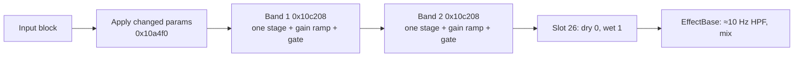

# 2-band EQ — `ParametricEqualizer` (Insert index 2, Master/Send index 4)

Part of [Effects in firmware 1.60](README.md). Findings F038–F044 in the
[findings ledger](../../research-notes/F-effects/findings-ledger.md). Models:
[tools/fx/peq.py](../../tools/fx/peq.py) and
[tools/fx/fdlibm_powf.py](../../tools/fx/fdlibm_powf.py).

## Summary

The 2-band EQ is **fully reconstructed**. It is two bands **in series**. Each band runs
exactly one selectable stage: low shelf, high shelf, peak, or a 12 dB/oct low- or
high-pass with output gain. Frequency, Q and gain glide in small steps (F039). The
shelf and peak filters are a separate filter family (`IirFilter2`) using Zölzer's
*boost* formulas, also for cuts (F040). The Python model is **bit-exact to the 1.60
routine run in a single-function emulator** in 48 of 48 runs plus 47 review cases
(F043). Reproducing it bit for bit requires the device's non-correctly-rounded
`powf`/`log10f` (F044).

The EQ has **no dry/wet parameter**: slot 26 forces dry 0 and wet 1 every block (F038).

## Signal flow

Slot 25 (`0x10ae70`) applies changed parameters (in the order B1F, B1G, B1Q, B2F, B2G,
B2Q, TYPE1, TYPE2), runs band 1 on `[+0x498]`, then band 2 on `[+0x49c]`, then slot 26.
It returns 0. A parallel-band variant was refuted: only 2 of 2,048 samples matched
(F039).

### Band stages

Each band (0x64 bytes, ctor `0x10afd4`) holds five stages. It runs the one selected by
its type (F039):

| Type | Filter | Output gain after the filter |
|---|---|---|
| 0 | `LowShelvingFilter`, +gain dB | 1.0 |
| 1 | `LowShelvingFilter` with **−gain** dB | 10^(gain/20) → net **high shelf** (algebraically Zölzer's high-frequency shelf boost form) |
| 2 | `PeakingFilter`, +gain dB | 1.0 |
| 3 | `IirLpf2ndOrder`, 12 dB/oct | 10^(gain/20) |
| 4 | `IirHpf2ndOrder`, 12 dB/oct | 10^(gain/20) |

Band process `0x10c208`: the ramp setup runs first (`0x10abdc`). Then it depends on
the band gate's state:

- **Fading out:** the old stage runs, with its GainRamp, on the remaining fade
  samples, then the gate, then the swap (`0x10c070`), then the new stage on the rest.
- **Closed:** this happens only right after construction. The swap runs, then the gate
  alone: **the block is not filtered and gets no output gain**.
- **Open or fading in:** a chunk loop with one glide step per 44.1 samples; the stage
  filter, then the band's GainRamp (N = 44), per chunk.

After that, the band's own 132-sample SignalGate runs over the whole block.

## Filter formulas

### Shelf and peak (`IirFilter2`, F040)

Coefficients are computed in double precision and stored as float32. The code forms
K as (tan(fc·π/fs) · (1/2π)) · 2π. That equals tan(π·fc/fs) up to rounding, but the
extra steps matter for bit-exactness. With V = 10^(g/20) and D = (K/Q + 1) + K²:

| Filter | b0 | b1 | b2 | a1 | a2 |
|---|---|---|---|---|---|
| Low shelf (`0xe2540`) | ((√V·K/Q + 1) + V·K²)/D | (2K²·V − 2)/D | (V·K² + (1 − √V·K/Q))/D | (2K² − 2)/D | ((1 − K/Q) + K²)/D |
| Peak (`0xe2440`) | ((V·K/Q + 1) + K²)/D | (2K² − 2)/D | ((1 − V·K/Q) + K²)/D | (2K² − 2)/D | ((1 − K/Q) + K²)/D |

The low shelf has gain V at DC and 1 at Nyquist. The peak has gain V at fc. Both are
Zölzer's boost forms with 1/Q in place of √2, used unchanged for cuts. The RBJ cookbook
forms were refuted (coefficients differ by 0.012–0.152), and so was a Zölzer cut form.

**Consequence** (derived from the formula): a cut is narrower than a boost at the same
Q. For half-gain bandwidth at 1 kHz, ±12 dB, boost vs cut: Q 0.7 gives 3.30 vs 1.01
octaves, Q 2 gives 1.38 vs 0.36, Q 7 gives 0.41 vs 0.10.

`IirFilter2` stores fc, Q and gain **only if within limits**: fc 1 Hz…Nyquist, Q
0.01…20, gain −80…+40 dB. Out-of-range or NaN values keep the old value. A clamping
variant was refuted. The filter is direct form I in two NEON lanes, with no k·y_prev
term. On a coefficient change it re-filters the last four inputs if its flag is set
and Q > 0 (F040).

### Low- and high-pass stages

These are the shared bilinear biquads described in
[lofi.md](lofi.md#filter-container-0xfbb70-ctor-0xfc5e4), with fc clamped to [5 Hz,
Nyquist]. The output gain for types 1/3/4 is (float)pow(10, g·0.05) (F041).

## Parameters

70 of 70 readbacks at v ∈ {0, 0.1, 0.3, 0.5, 0.7, 0.9, 1}, and 10 of 10 settled
coefficient sets, matched (F041).

| # | Parameter | Formula (float32) | Insert default (F038) |
|---|---|---|---|
| 0 / 3 | B1FREQUENCY / B2FREQUENCY | f = powf(1000, v) · 20 (libm `powf`, see below): 20 Hz…20 kHz | 0.566 (997.77 Hz) |
| 1 / 4 | B1GAIN / B2GAIN | dB = 45·v − 30 (−30…+15; 0 dB at 2/3) | 2/3 |
| 2 / 5 | B1Q / B2Q | Q = 0.1 + 9.9·v (0.1…10; 0.7 at 6/99) | 6/99 |
| 6 / 7 | BAND1TYPE / BAND2TYPE | t = (int)v; gate fade + swap if t ≠ current | 0 (low shelf) / 1 (high shelf) |

The constructor's "last" values are 0.5 for the continuous parameters and **5** for
both types (F038).

**Type 5 is invalid.** It is the constructor's "last" value and the registered
maximum, but no stage exists for it. Neither is there one for negative types. The swap
indexes the stage vector only if type < 5; otherwise it reads through a null pointer.
The emulator faults at `0x10c0c8`. A device crash is *likely*. Whether the UI can send
5 is a *guess* (H030). The on-screen labels for types 0–4 are a *guess* as well: low
shelf, high shelf, peak, LPF, HPF.

## Glide

From `0x10abdc` and `0x10c208` (F041). One step every 44.1 samples:

- Frequency ×powf(10, 0.012) = 1000^(1/250) per step, or its inverse.
- Q ×powf(10, 0.02) per step, or its inverse. The multipliers are globals
  `0xf52f00…0xf52f0c`, computed by the static initialiser `0x13aa8`.
- Gain ±0.04 dB per step.
- Step counts = **trunc**(|log10f(target/current)/log10f(multiplier)|) + 1. For gain,
  trunc(|Δ dB|·25) + 1. A rounding variant was refuted.
- **Gated jump** (gate out, all targets set, gate in) when the frequency needs more
  than 38 steps, Q more than 70, or gain more than 250.
- Each glide step re-targets the band's 44-sample GainRamp. At a type swap, types
  1/3/4 set the output gain at once (`0xe9358`), while types 0/2 ramp to 1.0.

## Start-up

Both band gates are built closed, so block 0 = x·(n/132)² (two gates in series, as in
LoFi). On a 1 kHz sine at the defaults: 0.1084, 0.6116, 0.999, 1.0 rms gain. Because a
closed gate skips the filter (see above), **the first block after construction is not
equalised at all**. This happens once per object lifetime: *likely*, because reset
(slot 27) does not touch the gates. Whether the `EffectBase` activation fade hides it
on the device is untested (F039, H030).

## Math library

The 1.60 libm is glibc 2.13. Its single-precision `powf` and `log10f` are the classic
fdlibm algorithms and are **not** correctly rounded. Measured against the emulated
1.60 libm (F044):

- `powf`: the model `fdlibm_powf.py` matched in 4,503 of 4,503 cases (first pass) and
  16,000 of 16,000 (review). Only 13,718 of those 16,000 results are correctly rounded
  (max 6 ulp off).
- `log10f`: 3,002 / 3,002 and 9,000 / 9,000. Correctly rounded in 7,838 of 9,000.
- A PEQ variant using the host's `powf` matched only 284 of 2,048 samples.

The double routines differ from macOS's by 1 ulp in some cases: `tan` in 1,958 of
6,000 PEQ arguments, `pow(10, x)` in 27 of 20,000. None of 6,000 random (fc, Q, gain)
sets gave a different float32 coefficient. So `lofi.py`, `mmf.py` and `peq.py` carry a
small residual risk from the host double libm (*likely* below 1e-4 per coefficient
set; H029).

## Object layout (0x4a0 bytes)

| Offset | Contents (F042) |
|---|---|
| `+0x1b8` + 0x5c·k | 8 `LinearParameter` objects, in index order |
| `+0x498` / `+0x49c` | → band 1 / band 2 |
| band `+0/+4/+8` | stage vector (data, cap 8, count 5) |
| band `+0xc` / `+0x10` | → SignalGate (132, built closed) / → GainRamp (N 44) |
| band `+0x14` / `+0x18` | pending / current type (ctor 0/0) |
| band `+0x1c` `+0x20` `+0x24` `+0x2c` | frequency target / current (ctor 1000) / multiplier / steps |
| band `+0x30` `+0x34` `+0x38` `+0x40` | Q target / current (ctor 0.7) / multiplier / steps |
| band `+0x44` `+0x48` `+0x4c` `+0x54` | gain dB target / current (ctor 0) / step ±0.04 / steps |
| band `+0x58` / `+0x5c` | samples to next step / max steps |
| band `+0x60` `+0x61` `+0x62` | bytes: recompute, step-now, dirty |

`+0x28`, `+0x3c` and `+0x50` have no access found (*likely* padding). A stage (0x10
bytes) holds an `IirFilter` (types 3/4), an `IirFilter2` (types 0–2), the band's
GainRamp and its type. `IirFilter2` (0x90 bytes, vtable `0x83bc60`) stores fs `+4`, fc
`+8`, Q double `+0x18`, V − 1 double `+0x38`, gain dB double `+0x58`, the re-seed byte
`+0x78`, taps `+0x7c…+0x88`, and coefficients from `+0x8c` (F040).

## 1.60 code map

| Address | What it is |
|---|---|
| `0x842198` | `ParametricEqualizer` vtable |
| `0x10baec` | Constructor `(obj, fs, block)`; `new(0x4a0)` |
| `0x13aa8` | Static initialiser (glide multipliers) |
| `0x10ae70` | Slot 25 |
| `0x10a4f0` | Apply changed parameters |
| `0x10a4d8` | Slot 26: dry 0, wet 1 |
| `0x10a7ec` | Slot 27 reset (static reading only) |
| `0x10afd4` / `0x10c208` / `0x10abdc` / `0x10c070` | Band ctor / process / ramp setup / type swap |
| `0x10a928` | Stage ctor |
| `0xe2df0` / `0xe2ab4` / `0xe34d8` → `0xe27b8` | `IirFilter2` ctor / configure (slot 6) / process (slot 2 → slot 8) |
| `0xe311c` / `0xe2540` | `LowShelvingFilter` ctor / coefficients |
| `0xe30e4` / `0xe2440` | `PeakingFilter` ctor / coefficients |
| `0xe9358` | GainRamp set-now |
| PLT `0xff40` / `0x10ab0` / `0x10e58` | `powf` / `log10f` / `tan` |

## Validation evidence

- **Emulation comparison** (F043): 12 settings × 4 signals × 16 blocks × 64 stereo.
  48 of 48 bit-exact, with every type in both bands and mid-run changes of every
  parameter.
- **Readbacks** (F041): 70 of 70, plus 10 of 10 settled coefficient sets.
- **Independent review** (F043): 47 more bit-exact cases (random walks, changes every
  block, odd type values, a type switch every block, ±10,000 and denormal inputs,
  out-of-range values, n = 1…63). 11 planted errors, all caught (2 of them only by
  targeted tests).

## Known quirks

- Type 5 has no stage. On the device it would read through a null pointer (F038).
- The first block after construction is not equalised (F039).
- Cuts are narrower than boosts at the same Q (F040).

## Unknowns

- Whether the UI can select type 5, and the on-screen type labels (H030).
- Slots 23/24 return 4; their meaning is unknown. Slot 27 is not modelled (F042).
- The Master context (index 4) was not exercised.
- The host-libm residual for double `tan`/`pow` (H029).
