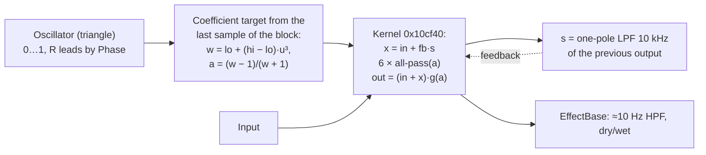

# Phaser (Insert index 8, Master index 9)

Part of [Effects in firmware 1.60](README.md). Findings F045–F050 in the
[findings ledger](../../research-notes/F-effects/findings-ledger.md). Models:
[tools/fx/phaser.py](../../tools/fx/phaser.py) and
[tools/fx/fdlibm_tanf.py](../../tools/fx/fdlibm_tanf.py).

## Summary

The Phaser is **fully reconstructed**. It has six identical first-order all-pass
stages in series, with one coefficient per channel. The coefficient sweeps on a cubic
curve of a triangle oscillator, at 0.01–10 Hz or synced to 64…1/16 beats of the
tempo. Output feedback passes through a 10 kHz one-pole low-pass (0…0.99). The output
is (input + all-pass) times a level-compensation gain, then the shared dry/wet mix
(F046). The Python model is **bit-exact to the 1.60 routine run in a single-function
emulator** in 48 of 48 runs and 297 review random walks of about 2.1 million samples
(F050).

The modulation source is the shared vtable-less oscillator
([oscillator.md](oscillator.md)), **not** the RTTI `LFO` class (F047).

## Signal flow



Per block, `0x10d260` does the following (F046):

1. If the retrigger flag `+0x4ec` is set (slot 10 `0x10cb38`), restart the oscillator
   at its peak (resetPhase 0.25).
2. If Rate, Bpm or Sync changed, update the period (`0x10df00`) and restart the
   coefficient ramp at 3·block = 192 samples. The change tests short-circuit, so a
   change not consumed this block is seen next block.
3. If Phase changed, set the R phase offset to Phase·0.5 cycles and restart the ramp.
4. Run the oscillator for n samples per channel.
5. If Frequency or Width changed, compute new corners and restart the ramp.
6. Target per channel, from the **last** oscillator sample u ∈ [0, 1]:
   w = lo + (hi − lo)·u³, a_t = (w − 1)/(w + 1). The coefficient moves **linearly per
   sample** to a_t, over the ramp count if one is running, else over n.
7. Feedback target = 0.99·Feedback, with its own 192-sample linear ramp.
8. Run the kernel. Then call slot 26 every block (wet = Mixratio, dry = 1 − Mixratio).
   Return 0.

Kernel `0x10cf40` (NEON, L/R lanes, flush-to-zero), per sample (F046):

```
s   = (1 − p)·y + p·s          one-pole LPF of the previous output, p = exp(−2π·10000/fs)
x   = in + fb·s                feedback injected at the chain input
6 × { v = x − a·z;  x = a·v + z;  z = v }     first-order all-pass (a + z⁻¹)/(1 + a·z⁻¹)
g   = 0.7 − ((a − a_lo)/(a_hi − a_lo))·0.2   0.7 at the 100 Hz end … 0.5 at the 20 kHz end
out = (in + x)·g;   y = out
```

Each channel has its own a, z, s and y. One oscillator drives both channels, with the
R offset; the feedback amount is shared. There is no gate, gain ramp or filter block,
and **no start-up gate**: block 0 is fully processed. The ramps start from the
constructor's a = a_hi and fb = 0.495 (F046).

## Parameters

70 of 70 slot-14 readbacks matched, and 48 of 48 synced periods at four tempi (F048).
rint = round half to even.

| Id | Parameter | Formula (float32) | Insert default (F045) |
|---|---|---|---|
| 0 | Rate, Sync off | Hz = rint(1 + 999·v) · 0.01 (0.01…10 Hz); period ms = 1000/Hz | 199/999 (2.00 Hz) |
| 0 | Rate, Sync on | i = rint(11·v); ms = (60000/Bpm) · [64, 32, 16, 8, 4, 2, 1, 3/4, 1/2, 1/4, 1/8, 1/16][i] beats (i > 11 asserts) | — |
| 1 | Width | lo_f = f − (1 − (1 − w)²)·(f − 100); lo = max(tanf(π·lo_f/fs), tanf(π·100/fs)) | 1 |
| 2 | Phase | R offset = Phase/2 cycle (0…180°) | 0 |
| 3 | Frequency | f = powf(60, rint(256·v)/256) · 300 (300 Hz…18 kHz, 257 steps); hi = min(tanf(π·f/fs), tanf(π·20000/fs)) | 1 (18 kHz) |
| 4 | Feedback | fb = 0.99·v, 192-sample linear ramp | 0 |
| 5 | Mixratio | wet = v, dry = 1 − v (EffectBase) | **0** |
| 6 | Sync | ToggleParameter: v ≥ 1 on, v ≤ 0 off, values in between unchanged (returns 3) | 0 (off) |
| 7 | Bpm | tempo 1…999. Used only with Sync on, but any change restarts the ramp | fed every block |

Frequency is the upper sweep corner. Width is the sweep depth down to 100 Hz; Width 0
means no sweep. The sync fraction table lives in `.bss` at `0xf61fcc` and is filled at
start-up by the static initialiser `0x6cb20`, from constants only (F048).

**The Insert default Mixratio is 0**, so with the processor's own defaults the Phaser
is fully dry. Whether a project or UI default overrides this is a *guess* (H032).

**Tempo feed** (F045). Before every block, the Insert processor clamps the current
tempo to 1…999 and sends it to parameter 7 as the BPM value, not a normalised value.

## Object layout (0x4f0 bytes)

| Offset | Contents (F049) |
|---|---|
| `+0x1b8` / `+0x1bc` | fs / ramp length (3·block) |
| `+0x1c0` / `+0x1c4` | t_lo = tan(π·100/fs) / t_hi = tan(π·20000/fs) |
| `+0x1c8` / `+0x1cc` | a_lo / a_hi |
| `+0x1d0` / `+0x1d4` | gains 0.5 / 0.7 |
| `+0x1d8` / `+0x1dc` | coefficient / feedback ramp counters (−1 = idle) |
| `+0x1e0` | feedback, current |
| `+0x1e4` / `+0x1e8` | previous output y, L / R |
| `+0x1ec` / `+0x1f0` | coefficient a, L / R |
| `+0x1f4` | → 6 × (L, R) all-pass states (0x30 bytes) |
| `+0x1f8` / `+0x1fc` | LPF p / 1 − p |
| `+0x200` / `+0x204` | LPF state L / R |
| `+0x208` / `+0x20c` | current lo / hi corners |
| `+0x210` | copy of t_lo (*likely* unused) |
| `+0x214` / `+0x218` | → oscillator output buffers, float[block] |
| `+0x21c` | → oscillator (0x98 bytes) |
| `+0x220` + 0x5c·k (k 0…5), `+0x448`, `+0x470` | parameters Rate…Mixratio, Sync, Bpm |
| `+0x4cc…+0x4e0` | copies: period ms, Width, Phase, Frequency, feedback target, Mixratio |
| `+0x4e4` / `+0x4e8` / `+0x4ec` | Sync copy (byte) / Bpm copy / retrigger flag (byte) |

Vtable `0x8422b8` overrides slots 0/1 (destructors `0x10e074`/`0x10e1a4`), 10
(retrigger `0x10cb38`), 23/24 (`0x10def0`/`0x10def8`, return 0), 25 (`0x10d630`), 26
(`0x10cb48`) and 27 (`0x10cf30`).

**Reset** (slot 27 → `0x10cb78`, emulated, F046): sets the ramp counters to −1,
re-initialises the oscillator with the current period, calls resetPhase(0.25), sets
the phase offset and corners, sets fb to its target, zeroes all filter states, and runs
the oscillator for one sample to seed a. It does not consume the parameter change
flags.

## Oscillator configuration

The Phaser uses waveform 1 (triangle) with amplitude 0.5 and offset 0.5 (output 0…1),
smoothing off (F047). One quirk: the oscillator's setFrequency computes the period
from a literal 44100, not from fs. Built for 48 or 96 kHz, the model still matched
bit for bit, which supports this reading (F047, F050).

## Math library

The 1.60 `tanf` (PLT `0x104c8`) is fdlibm `tanf` and is not correctly rounded. The
model `fdlibm_tanf.py` matched it in 5,221 of 5,221 harness cases plus 10,055 extra
cases. The host `tan` agrees in only 5,020 of 5,221, and the difference matters at
Frequency steps 204, 212 and 248 (F048). `powf` comes from `fdlibm_powf.py`
([parametric-eq.md](parametric-eq.md#math-library)).

## 1.60 code map

| Address | What it is |
|---|---|
| `0x8422b8` | `Phaser` vtable |
| `0x10d654` | Constructor `(obj, fs, block)`; `new(0x4f0)` |
| `0x6cb20` | Static initialiser (sync fraction table `0xf61fcc`) |
| `0x10d630` | Slot 25 → `0x10d260`, then slot 26 |
| `0x10d260` | Block processing: change handling, oscillator, coefficient targets, ramps |
| `0x10cf40` | All-pass kernel |
| `0x10df00` | Rate/Sync/Bpm → period |
| `0x10cb48` | Slot 26 (dry/wet) |
| `0x10cf30` → `0x10cb78` | Slot 27 reset |
| `0x10cb38` | Slot 10 retrigger |
| `0x34c240` / `0x34c2a8` / `0x34c8c8` | Rate / sync / Frequency index → value helpers |
| `0xf1800` / `0xf0738` / `0xf0858` | `ToggleParameter` ctor / setValue / consumeChange |
| PLT `0x104c8` | `tanf` |

## Validation evidence

- **Emulation comparison** (F050): 12 settings × 4 signals, 64 blocks × 64 stereo
  samples (one run 160 blocks). 48 of 48 bit-exact, including all 12 sync divisions,
  4 tempi, mid-run changes, retrigger and reset.
- **Independent review** (F050): 297 of 297 random walks bit-exact (about 2.1 M
  samples; n = 1…64, tempo changes, retrigger/reset, near-denormal input). Constructor
  variants (44100 Hz with blocks 32/128; 48000 and 96000 Hz with 64) also bit-exact.
  Results were insensitive to heap fill and to the FPSCR flush-to-zero setting. 4
  planted errors caught.
- **Refuted alternatives** (F046): 4 stages instead of 6; feedback taken from the last
  all-pass; a linear instead of cubic curve; a sine oscillator; no L/R offset; a
  per-block stepped coefficient. With the coefficient frozen, the notches at 625,
  2,326 and 7,832 Hz match six-stage theory (628, 2,324 and 7,826 Hz).

## Known quirks

- The oscillator period uses a literal 44100 (F047).
- The Insert default Mixratio is 0, so the effect is dry by default (F045).
- Out-of-range values or a BPM sent straight to slot 14 can reach a firmware assert
  (not emulated) or the model's `tanf` range limit (|x| ≥ 3π/4) (F050).

## Unknowns

- Who calls retrigger (slot 10) on the device, e.g. on sequencer start, and whether a
  project or UI default overrides Mixratio 0 (H032).
- The Master context (index 9) was not exercised (F050).
- Block sizes above the constructor's block size are not modelled.
