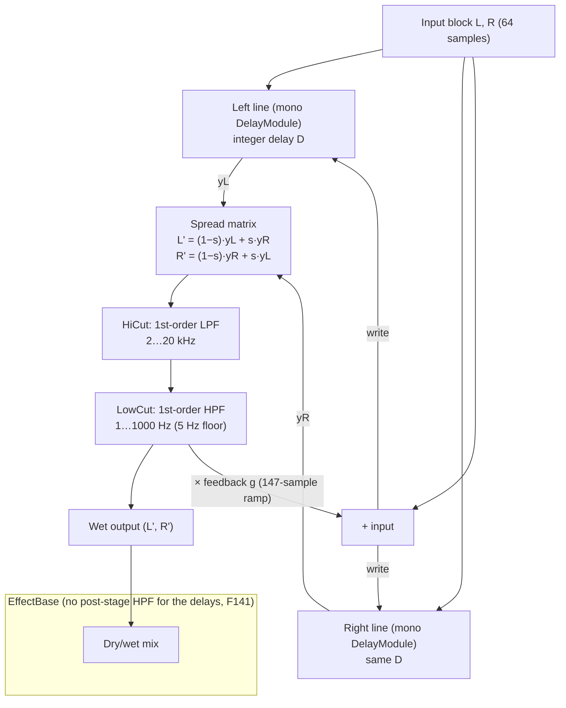

# Send/Master Delay (`SendFxDelay`, Master and Send index 0)

Part of [Effects and mixer in firmware 1.60](README.md). Findings F080 and F115–F120,
with lifecycle facts from F140, F149, F155–F156, F170 and F183–F185, in the
[findings ledger](../../research-notes/F-effects/findings-ledger.md). Model:
[tools/fx/send_delay.py](../../tools/fx/send_delay.py).

## Summary

The Send/Master Delay is **fully reconstructed**: signal flow, all eight parameter
formulas, the object layout, start-up, reset and the tempo feed. The Python model is
**bit-exact to the 1.60 routine run in a single-function emulator** in 92 of 92 runs
(16,384,000 samples, maximum error 0, state and rings equal), plus a 5.4-million-sample
review fuzz (F120). It is also bit-exact through the real shared wrapper (slot 18) and
inside the real Send and Master processors (F120, F149). It has not been compared with
audio recorded from an SP-16.

It is a **stereo pair of mono delay lines with one shared time**, 10 ms to 4 s. The two
line outputs pass through a 2 × 2 "Spread" matrix (straight to cross-fed, so Spread 1 is
ping-pong), then a first-order low-pass (HiCut) and a first-order high-pass (LowCut).
The filtered signal is both the wet output and the feedback source (F117).

It is a **different algorithm** from the [Insert Delay](insert-delay.md): it uses two mono
`DelayModule` lines instead of one `DelayModuleStereo`, has a 4,000 ms maximum instead of
1,000 ms, and its LowCut and Spread are live (F080, F115). The Master "Delay" and the Send
"Delay" are the same class, built the same way; their defaults differ only in MIXRATIO
(F115, F120).

## Where it sits

- **Send FX:** on the send bus (the sum of every track's send tap). Its output is the
  Send FX return, which is added to the main bus **after** the Master FX (F103, F106).
  See [signal-flow.md](signal-flow.md#send-bus-and-master-bus).
- **Master FX:** in place on the main bus before the return is added (F103).
- Index 0 in both the Send and the Master effect arrays (F019, F173). The FX popup offers
  it as "Delay" in both contexts (row list *likely*, F173). A new project's Send FX starts
  Off (F173).

## Signal flow



Per block, EffectBase slot 25 (`0x104e90` → `0x104e98`) updates the dry/wet pair, applies
changed parameters, then runs the core `0x104a30` in chunks. A chunk ends where the left
line's read would wrap past its delay (F117). The output then goes through the shared
`EffectBase` dry/wet mix. The processors do not switch on the wrapper's 10 Hz post-stage
high-pass for the delay (F141) (see
[README](README.md#the-effectbase-interface) and [effectbase.md](effectbase.md)).

## Parameters

Index = the `EffectBase` slot-14 index. Slot 14 is the shared `0x105d24`: it only stores
the value; everything takes effect at the next slot 25 (F115). Index ≥ 8 returns 3.

| # | Parameter | Formula (v = 0…1; float32 unless noted) | Range | Send default | Master default |
|---|---|---|---|---|---|
| 0 | DelayTime | free: ms = rint_even(10 + 3990·v); sync: see below. Samples D = trunc(F(ms·0.001)·fs); the **same** D on both lines | 10…4000 ms, 1 ms steps | 0.122807 (500 ms) | 0.122807 |
| 1 | Feedback | g = v, **not quantised, not clamped** (1.2 stays 1.2); same g on L and R; 147-sample linear ramp | 0…1 (and beyond) | 0.7 | 0.7 |
| 2 | HiCut | step = trunc(999·v) + 1; fc = 2000·10^((step − 1)/999) Hz | 2…20 kHz | 1.0 (20 kHz) | 1.0 |
| 3 | LowCut | x = 1 − v; step = trunc(999·(1 − x⁴)) + 1; fc = 1000^((step − 1)/999) Hz, floored at 5 Hz in the coefficients | 1…1000 Hz | 0 | 0 |
| 4 | Spread | direct gain 1 − v, cross gain v; 147-sample linear ramps | 0…1 | 0 | 0 |
| 5 | Mixratio | v < 0.75: dry 1, wet F(v·1.3333334); else wet 1, dry 1 − 4(v − 0.75) | 0…1 | 1.0 (wet only) | 0.5 (dry 1, wet 0.667) |
| 6 | SYNC | `ToggleParameter`: only v ≤ 0 or v ≥ 1 is accepted (else return 3) | off / on | 0 | 0 |
| 7 | BPM | tempo, written by the processor every block (see [Lifecycle](#lifecycle)) | 1…999 | ctor 120 | ctor 120 |

Sources: F115 (indices, defaults, change detection), F116 (formulas). The defaults are the
processor slot-52 values (Send `0x11a3a8`, Master `0x113438`). MIXRATIO is the **only**
difference between the two contexts (Send getter at `0x11a584`, Master literal at
`0x113610`) (F115).

**Sync time.** With SYNC on: i = rint(7·v), giving 1/8, 1/4, 1/2, 3/4, 1, 2, 4 or 8 beats
(fraction table in `.bss` at `0xf61f94`, filled by `.init_array` code); an index outside
0…7 becomes index 6 (4 beats). Then ms = F(F(F(num/den)·1000)·60)/BPM, clamped to
[10, 4000] (F116). At 120 BPM this is 62.5 ms (1/8) to 4,000 ms (8 beats); below 120 BPM
the longest divisions clamp to 4 s.

**Change detection** applies only to SYNC, BPM and DelayTime (dirty byte `+0x6b8`). When
any of them changes, the time is recomputed and written into both base parameters
`DelayTimeLch` and `DelayTimeRch`. Feedback, HiCut, LowCut, Spread and Mixratio are re-read
every block (F115). A DelayTime write equal to the constructor value 0.5 before the first
block is never applied (F115, the general rule in [README](README.md#the-effectbase-interface)).

**LowCut floor.** The coefficients use fc floored at 5 Hz, so every v ≤ ≈0.0645
(step ≤ 233) sounds identical. Examples: v 0.25 → 111.7 Hz, v 0.5 → 646.9 Hz (F116).

**Hidden base parameters.** The base class `DelayEchoBase` also registers `DelayTimeLch`
(`+0x2c`), `DelayTimeRch` (`+0x88`) (1…4000 ms, ctor 1.0) and `FeedbackGainLch` /
`FeedbackGainRch` (`+0xe4` / `+0x140`, 0…1, ctor 0). Slot 14 cannot reach them. Every
write of the left time in `0x104e98` is followed by the same value into the right time, so
**separate L/R times are refuted on the parameter path**. The class itself would handle
unequal times (emulated by direct writes); a by-name parameter access from elsewhere was
not excluded (*guess*, no such caller known) (F117).

**UI** (F170, F185, F186). The Master/Send Delay parameter box maps encoder 1 Time (k0),
2 Feedback (k1), 3 HiCut (k2), 4 LoCut (k3), 5 Spread (k4) and 6 mix (k5). SYNC is a
button handler that calls the manager's SYNC toggle (widget run-time visibility flags
unread, *likely* visible). The knob moves on an integer grid: i = roundToInt(lo + v·(hi −
1 − lo)) on the range [10, 4001) ms free or [0, 8) divisions sync; v = (i − lo)/(hi − 1 −
lo). In free mode the encoder alone moves 10, 50 or 100 ms per detent (multiplier from
`0x311aa0`), and 1 ms while SHIFT is held; in sync mode one division per detent. The
screen shows free times as an integer ms (*likely* `juce::String(int)`) and sync values
as "%d/%d".

## Processing stages

### Delay lines (`DelayModule`, vtable `0x840028`)

Two mono modules, built by the `DelayEchoBase` constructor `0x104408`: left at `+0x19c`,
right at `+0x1a0`. Stereo input: L feeds the left line, R the right line (F117).

- **Ring:** trunc(4000·0.001·fs) + 2500 = **178,900 frames per line** at 44.1 kHz
  (stereo-interleaved `RingBuffer`, only lane 0 used). The read is at an integer position
  (fraction always 0) (F117).
- **Delay change:** no glide. Both line gates fade out over 147 samples, both read pointers
  jump to the new D (D_L = D_R), and the gates fade in again. The ring is not cleared
  (F117).
- **Warm-up gate:** as in the Insert Delay (F079): a module's gate opens (147-sample
  fade-in) only after the read chunk in which its sample counter reaches D. The gated
  signal is also the feedback source, so an input that arrives inside the muted window is
  never heard. With Send defaults an impulse at t = 0 never echoes; at t = 192 it echoes at
  sample 22,242 (F119).

### Spread matrix

Per chunk, with yL, yR the line outputs, d the direct gain and x the cross gain (F117):

```math
L' = d\,y_L + x\,y_R,\qquad R' = d\,y_R + x\,y_L,\qquad d \to 1 - v,\ x \to v
```

Each gain is a `SmoothFloat` (`+0x1ec` direct, `+0x210` cross) that ramps linearly over
147 samples to its target. Multiplies use `0xf5b9c`; the sums use the NEON vector add
`0x578a6c`, which flushes denormals to zero (see [numerics.md](numerics.md)). Spread 1 is
ping-pong: a left impulse at 300 ms first appears on R at +13,230 samples, then on L
(F117).

### HiCut and LowCut (stepped first-order filters)

Both are `SteppedIirFilter` containers (new 0x48, ctor `0xf3ce4`, process `0xf438c`)
with 1,000 logarithmic steps, shared with the Insert Delay's HiCut (F080, F116):

| Filter | Object | Type | Range | Start step |
|---|---|---|---|---|
| HiCut | `+0x69c` | `IirLpf1stOrder` (vtable `0x840dd8`, coefficients `0xe1b30`) | 2,000…20,000 Hz | top (20 kHz) |
| LowCut | `+0x6a0` | `IirHpf1stOrder` (vtable `0x840db8`, coefficients `0xe1aa0`) | 1…1,000 Hz | bottom |

With d = tan(π·fc/fs) (computed in double precision, stored as float32) and fc clamped to
[5 Hz, fs/2] (F116):

| Type | b0 | b1 | a1 |
|---|---|---|---|
| Low-pass | d/(1 + d) | d/(1 + d) | (d − 1)/(1 + d) |
| High-pass | 1/(1 + d) | −1/(1 + d) | (d − 1)/(1 + d) |

y[n] = b0·x[n] + b1·x[n − 1] − a1·y[n − 1], L and R in two NEON lanes with flush-to-zero.
A step change does not jump: the cut-off moves one step (×10^(1/999) for HiCut,
×1000^(1/999) for LowCut) every ⅓ ms until it reaches the target (F116).

The order is fixed: matrix, then HiCut, then LowCut. With a static Spread the matrix and
the filters commute, so the order shows only in rounding and during Spread ramps (F117).

### Feedback and output

- **Output:** (L', R') after both filters, wet only (F117). The dry part is added by the
  shared `EffectBase` mix.
- **Feedback:** the lines are written with inL + gL·L' and inR + gR·R'. So the cross-feed
  is the Spread matrix itself, before the output and before the feedback tap, and the
  feedback is taken after both filters (F117). The two feedback gains are `SmoothFloat`s
  (`+0x1a4` left, `+0x1c8` right) with 147-sample ramps, both set from the one Feedback
  parameter (F116).

### Dry/wet

The mix law (table above) is computed at the start of each slot 25 and stored at
`+0x6a4` (dry) / `+0x6a8` (wet). Slot 26 (`0x1049e8`) copies them to the `EffectBase`
pair `+0x10` / `+0x14`. Until the first slot 25 the copy gives dry 1, wet 0 (F116, F149).
The slot-18 sum for this class was confirmed in composition through the real wrapper
(F149).

## Object layout (`SendFxDelay`, new 0x6c0)

From emulated memory dumps (64 fields compared after every block of every run, F118).

| Offset | Size | Contents |
|---|---|---|
| `+0x00` | 4 | primary vtable `0x841ea8` (`DelayEchoBase` part) |
| `+0x04` / `+0x08` / `+0x0c` | 4 each | block size, scratch count (7), scratch pointer |
| `+0x10` / `+0x18` | 4 each | fs, 1/fs (set by slot 23 `0x1052c0`) |
| `+0x2c` / `+0x88` / `+0xe4` / `+0x140` | 0x5c each | base parameters `DelayTimeLch`, `DelayTimeRch`, `FeedbackGainLch`, `FeedbackGainRch` |
| `+0x19c` / `+0x1a0` | 4 + 4 | → left / right `DelayModule` |
| `+0x1a4` / `+0x1c8` / `+0x1ec` / `+0x210` | 0x24 each | `SmoothFloat` feedback L, feedback R, direct, cross (target at `+0xc`) |
| `+0x238` | 0x1b8 | `EffectBase` sub-object (secondary vtable `0x841eec`; dry `+0x248`, wet `+0x24c`) |
| `+0x3f0…+0x69b` | — | the eight parameters: indices 0–5 at `+0x3f0 + 0x5c·i`, SYNC (`ToggleParameter`) at `+0x618`, BPM at `+0x640` |
| `+0x69c` / `+0x6a0` | 4 + 4 | → HiCut / LowCut stepped filter containers (0x48 each) |
| `+0x6a4` / `+0x6a8` | 4 + 4 | dry / wet from the mix law |
| `+0x6ac` / `+0x6b0` / `+0x6b4` | 4 each | SYNC, BPM and DelayTime copies (change detection) |
| `+0x6b8` | 1 | dirty byte |

`DelayModule` (mono, new 0x8c, ctor `0xec0fc`) has the same fields as the Insert Delay's
`DelayModuleStereo` (F077): ms `+0x20`, D `+0x24`, pending ms/D/flag `+0x28…+0x30`,
`SignalGate` (N = 147) `+0x34`, warm / full / counter `+0x7c` / `+0x7d` / `+0x80`, maxms
4000 `+0x84`, interpolation flag 1 `+0x88`. Its constructor sets ms = 50, D = 2205 (F118).

## 1.60 code map

| Address | What it is |
|---|---|
| `0x841ea8` / `0x841eec` | Primary (`DelayEchoBase`) / secondary (`EffectBase`) vtable |
| `0x1054ac` | Constructor `(obj, fs, block)`; built by `0x114bfc` (Master) and `0x11bc28` (Send), both `new(0x6c0)` with (44100, 64) |
| `0x104408` | `DelayEchoBase` constructor (base parameters, two modules) |
| `0x104e90` → `0x104e98` | Slot 25 entry → parameter update and process (primary slot 14) |
| `0x104a30` | Core: lines, Spread, HiCut, LowCut, feedback (primary slot 5) |
| `0x104ce4` | Applies the base parameters: `setDelay` ×2, feedback and Spread targets (primary slot 8) |
| `0x1049e8` | Copies dry/wet to `EffectBase` (primary 13 / slot 26) |
| `0x1049fc` → `0x104a04` | Slot 27 reset (primary slot 10) |
| `0x104108` | Line reset (`DelayEchoBase` slot 4): slot 8 again, module reset ×2, snaps the four `SmoothFloat`s (`0xf5584`) |
| `0x104e6c` | Primary slot 9 / secondary 11: writes the DelayTime parameter (role *guess*) |
| `0x1052c0` / `0x105228` | Set fs (slot 23) / set block size (slot 24, *likely*) |
| `0xec0fc`, `0xec384`, `0xec314` | `DelayModule` ctor / `setDelay` (no-op if ms unchanged) / reset |
| `0xec494`, `0xec4bc`, `0xec6d4` | `DelayModule` next chunk / read / write |
| `0xf3ce4`, `0xf41ac`, `0xf438c` | Stepped filter ctor / set step / process |
| `0x34a428`, `0x34a478`, `0x34a498` | Time range spec (10, 4001) / sync range spec (0, 8) / sync-table reader (out of range → 6) |
| `0x11a3a8` / `0x113438` | Send / Master slot-52 defaults (case 0) |
| `0x119a40` / `0x112b4c` | Send / Master `processBlock` jump tables (tempo feed for index 0) |
| `0x841fa8` | maxms literal 4000.0 |

## Lifecycle

- **Construction.** Both processors build the object eagerly in their constructors
  (`EffectBase` gate mode 1, F140, F141).
- **Activation.** `EffectBase` slot 5 runs slot 27 once and starts the in/out gate. In gate
  mode 1 the shared wrapper also ramps the **effect's input** in over 147 samples (and out
  on stop) (F140, F146, F149). Send calls slot 5 with (e, 0, 0), Master with (e, 0, 1); the
  third argument only arms the `+0xa8` skip, which the Master and Send constructors leave
  at 0, so there is no observed difference (F120, F148; H063 refuted).
- **Reset (slot 27, `0x1049fc` → `0x104a04`).** Slot 8, then `0x104108` (slot 8 again,
  module reset on both lines, all four `SmoothFloat`s snapped to their targets). The ring
  indices are rewound (write 0, read −D), the gates closed and the counters zeroed. **The
  ring samples and filter states are kept**, and pending parameter changes are **not**
  consumed (F119). Slot 10 (retrigger) does nothing.
- **Tempo feed.** Every block, before slot 18, the Send (`0x119994`) and Master
  (`0x112acc`) `processBlock` write slot 14 index 7 = tempo clamped to 1…999 BPM to the
  current effect for indices {0, 2, 3, 9} (Delay, Chorus, Flanger, Phaser), also while it
  fades out before a swap (800/800 feeds emulated in both). It is audible only with SYNC on
  (F115, F156).
- **SYNC toggle.** The Master (`0x1208ac`) and Send (`0x12b3b4`) managers' SYNC toggle
  converts the stored time at the press-time tempo T: free → sync beats = (ms·f32(T/60))·0.001,
  sync → free ms = (beats·f32(60/T))·1000, snapped to the nearest step of the new mode by
  linear midpoints, then writes the new value and index 6. In sync mode the delay then
  follows tempo changes itself; a free time produced by SYNC off stays at the press-time
  tempo. On → off → on is exact unless the free range clamps (at 20 BPM, 5 of 8 divisions).
  Model: [tools/fx/sync_convert.py](../../tools/fx/sync_convert.py) (F183, F184; see
  [parameters.md](parameters.md)).
- **Project reload.** The Master/Send manager's reload sends each stored `prj::EffectData`
  value k to slot-14 index k, and the SYNC byte as index 6. On a fresh project the device
  runs the slot-52 defaults (*likely*, H085) (F161, F166, F167).
- **Type switching.** Sequential, not a crossfade: the old effect fades to dry over 147
  samples, then the new one is activated (F149, F154).
- **Disable.** A disabled Master processor passes the bus dry from sample 147; the delay
  tail is **cut**, not left to ring. A disabled (or Off) Send returns exact silence from
  sample 147. Re-enabling is a full re-activation including slot 27 (F155).
- **Bypass.** The processor bypass byte `+0x9c` is read only by the Insert processor; a
  write on Master/Send is inaudible (F157, F182). The `+0x9d` "FX ON/OFF" path (input
  closed, tail rings out) exists but nothing in 1.60 drives it (F176–F178).

## Validation evidence

- **Emulation comparison** (F120): 92 runs, bit-exact to the emulated slot 25 — 12 settings
  × 6 signals (including 4,000 ms with feedback 1.0 over 5,800 blocks, ping-pong, sync at
  87.5, 120, 133.37 and 999 BPM, feedback 1.2) plus 5 mid-run-change runs × 4 signals.
  16,384,000 samples, maximum error 0, object state and rings equal.
- **Read-backs** (F116): 9 parameter sweeps with the full state compared, 0 mismatches.
  Eight planted model errors (mutants) were rejected (F117).
- **Recorded hashes** (F115 evidence): verifier result "0 failed checks" (31 checks);
  report `29227f2c…4b8b`, JSON `0f8fe70a…8ba1`, the 92 sorted float32 outputs
  `b6b3f9b5…53a6f`. The worker's three runs and the review re-run were byte-identical; the
  regression run reproduced the earlier verifiers' hashes.
- **Independent review** (F115 evidence): own fuzz of 14 seeds × 3,000 blocks (5,376,000
  samples) with random mid-run writes to all indices at v ∈ [−1, 3], resets, BPM walks,
  NaN/overflow, denormals and the Master defaults; random block lengths 1…64; a heap filled
  with 0xA5. All bit-exact.
- **Processors** (F120): real Send and Master `processBlock` around a real `SendFxDelay`
  (800 noise blocks, sync 1/2 beat, BPM 120 → 90 → 133.37): slot-25 output equal to the
  model and state equal every block, in both.
- **Wrapper** (F149): bit-exact end to end through the real slot 18.
- **Emulation boundary** (F115 evidence): real 1.60 code and libm; only `memcpy`, `memset`
  and `new` stubbed. One assert/log call in the sync-table reader's out-of-range branch is
  skipped.
- **Refuted:** separate L/R delay times on the parameter path (F117); the "dual cross-fed"
  reading of F080 (the cross gain pair is the Spread matrix, F117).

## Known quirks

- **Feedback is not clamped.** v = 1.2 gives a gain of 1.2 (runaway feedback) (F116). The
  Insert Delay rounds to 0.01 (F076).
- **LowCut below v ≈ 0.0645** has no effect beyond the 5 Hz floor (F116).
- **Warm-up silence.** Input in the first D samples after construction or reset is muted
  and never re-enters through feedback (F119; device audibility open, H045).
- **50 ms first-delay quirk.** If the first time applied after construction equals the
  module constructor value 50 ms, `setDelay` is a no-op and the first echo comes after the
  full ring (192 + 178,900 samples, ≈4.06 s) until the time changes. An activation reset
  before the first block removes it, and both processors reset at block 0, so on the device
  this is *guess* (*likely* never happens) (F119).
- **Stale ring after reset.** The reset keeps the ring samples, so old audio can come back
  after a reset and a time change (F119; same mechanism as the Insert Delay, F079).
- **Out of range** (not reachable through the processor, *likely*): DelayTime v ≤ ≈−0.00238
  gives D = 0 and slot 25 never returns; slightly negative v gives 1…9 ms; |v| ≳ 5.4·10⁵
  wraps `rint` and hangs (F119).

## Unknowns

- Whether the warm-up silence and the stale-ring leak are audible on the device, which
  depends on when the device activates or resets the effect (H045).
- Whether a by-name access could set separate L/R times (*guess*: no caller known, F117).
- On-screen unit suffixes (*guess*: skin images, F186).
- Whether a fresh project's Send/Master Delay really starts from the slot-52 defaults
  (*likely*, H085).

## Model

[tools/fx/send_delay.py](../../tools/fx/send_delay.py), class `SendDelay`: `set_param(index,
v)`, `defaults(master=False)`, `process(L, R)` (one block, returns the wet block),
`reset()` (slot 27). It needs no user-supplied input. It imports the shared blocks of
`insert_delay.py` (ring buffer, `DelayModuleStereo`, stepped filter, own correctly
rounded `tan`/`pow`), `chorus.py` (parameter objects; it imports `osc.py`, whose
user-supplied table is not needed here) and `lofi.py` (`SmoothFloat`, NEON flush-to-zero
arithmetic; it imports `crmath.py` and `fdlibm_powf.py`). The `EffectBase` wrapper (dry/wet mix; its post-stage stays off for this effect, F141)
is in [tools/fx/effectbase.py](../../tools/fx/effectbase.py); the processor shells in
[tools/fx/fx_processors.py](../../tools/fx/fx_processors.py).

Model limits (F119): BPM 0 (the firmware gives 4,000 ms) and a NaN DelayTime raise an
error; a NaN BPM counts as a change in the model but not in the firmware's change test
(`0xf0ffc`).
