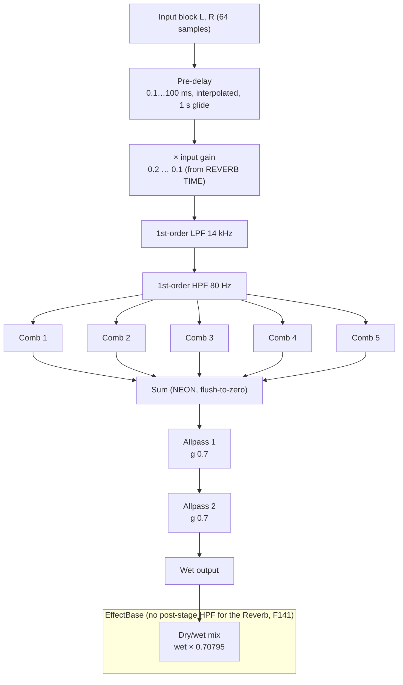
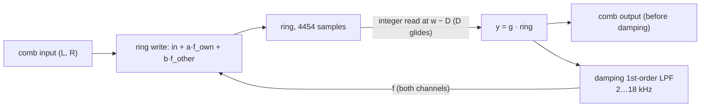

# Send/Master Reverb (`SendFxReverb`, Master and Send index 1)

Part of [Effects and mixer in firmware 1.60](README.md). Findings F121–F127, with
lifecycle facts from F137, F140, F149, F155, F170 and F173, in the
[findings ledger](../../research-notes/F-effects/findings-ledger.md). Model:
[tools/fx/send_reverb.py](../../tools/fx/send_reverb.py).

## Summary

The Send/Master Reverb is **fully reconstructed**: structure, every delay length and gain,
all six parameter formulas, the object layout, start-up and reset. The Python model is
**bit-exact to the 1.60 routine run in a single-function emulator** in 66 of 66 runs
(4,684,800 samples, maximum error 0, state and all 14 delay rings equal), plus a review
fuzz of about 3.2 million samples (F127). It is also bit-exact through the real shared
wrapper (slot 18) and inside the real Send and Master processors (F127, F149). It has not
been compared with audio recorded from an SP-16.

It is **not** JUCE's `juce::Reverb` (Freeverb), although the application links JUCE's
reverb code: none of the reverb's code or tables lies in the JUCE range, and the impulse
responses do not correlate (F121). It is an own design whose core class is named
`Reverb9NXSBase` (F122). The structure is: pre-delay → input gain → fixed 14 kHz low-pass →
fixed 80 Hz high-pass → **five parallel stereo comb filters** (damping low-pass inside the
loop, an L/R "spread" matrix in the feedback) → **two series stereo allpasses** (g 0.7) →
wet × 0.70795 (−3 dB) (F122). The processing is true stereo, with no mono sum and no
modulation.

The Master "Reverb" and the Send "Reverb" are the same class, built the same way; their
defaults differ only in MIX RATIO (F123, F127).

## Where it sits

- **Send FX:** on the send bus; its output is the Send FX return, added to the main bus
  after the Master FX (F103, F106). **Master FX:** in place on the main bus. See
  [signal-flow.md](signal-flow.md#send-bus-and-master-bus).
- Index 1 in both the Send and the Master effect arrays (F019, F173). The FX popup shows a
  Reverb row only in the Send and Master contexts (*likely*, F173). A new project's Send FX
  starts Off (F173).
- Selecting the reverb on Send or Master adds 8 to the score of the 1.60 "master tempo
  quality" heuristic (score = 8·reverb + active inserts + 2·players; Low at ≥ 33). That this
  is a CPU-load heuristic for time-stretching, not a change to the mix, is *likely* (F137).

## Signal flow



Each comb, per channel:



Per block, slot 25 (`0x111730`) runs the reverb's own slot 32 (`0x1120c4`: mix law, slot
26, room target, damping step), then the core's slot 18 (`0x10e2e0`). That re-targets the
room if ROOM SIZE changed, recomputes the comb coefficients (slot 17 = the reverb's slot 33
`0x11185c`) **every block**, and runs the chunk loop (slot 8 `0x10e34c`). Chunks end where
the room size takes a step (slot 6 `0x10e4d8`) (F122).

## Parameters

Six `LinearParameter`s (0…1) at `+0x244 + 0x5c·i`, registered by the constructor
`0x1123d0`. Slot 14 is the shared `0x105d24`: it accepts 0…5 (anything else returns 3) and
**only stores**; everything takes effect at the next slot 25. There is no F026-style
change detection; effective changes are filtered by the integer room compare and the comb
setters' equality tests (F123).

| # | Parameter | Formula (v = 0…1; float32) | Range | Send default | Master default |
|---|---|---|---|---|---|
| 0 | PRE DELAY | ms = 100·v clamped to [0.1, 100]; samples = fs·ms/1000; glides linearly over 44,100 samples (1 s) | 0.1…100 ms | 0 (0.1 ms) | 0 |
| 1 | ROOM SIZE | room = trunc(1 + 99·v); the current room steps ±1 toward it (see below) | 1…100 | 49/99 (room 50) | 49/99 |
| 2 | REVERB TIME | x = 1 + 99·v; T60 polynomial (below); also sets the input gain | 0.1…100.6 s | 49/99 (8.70 s) | 49/99 |
| 3 | COMB FILTER LPF | step = trunc_u32(1 + 99·(1 − v)); damping cut-off 2000·9^((step − 1)/99) Hz | 18 kHz (v 0) … 2 kHz (v ≥ 0.99) | 0 (18 kHz) | 0 |
| 4 | LR SWAP SPREAD | per-comb straight/swapped feedback gains (table below), 132-sample ramps | 0…1 | 0 | 0 |
| 5 | MIX RATIO | v < 0.75: dry 1, wet 4v/3; else wet 1, dry 1 − 4(v − 0.75); then wet × 0.70795 | 0…1 | 1.0 (wet only) | 0.5 (dry 1, wet 0.667·0.70795) |

Sources: F123 (indices, defaults), F124 (formulas), F122 (output gain). The constructor
values are 0.5, 0.5, 0, 0, 0, 0; the processor slot-52 defaults above are written at
activation (Send `0x11baa8` → case `0x11a860`, Master `0x114ad4`) (F123).

**No tempo feed.** The Send and Master `processBlock` jump tables route index 1 past the
tempo feed: 0 tempo calls and 0 slot-14 feeds in 300 emulated blocks (F123). The reverb has
no SYNC.

**UI** (F170). The Master/Send Reverb parameter box maps encoder 1 PreDelay (k0),
2 RoomSize (k1), 3 RevTime (k2), 4 "Damping" (k3, the comb-filter LPF), 5 a Spread widget
(k4, LR SWAP SPREAD) and 6 mix (k5). Widget run-time visibility flags were not read
(*likely* visible). The per-knob step grid of the reverb box was not tabulated.

### REVERB TIME, comb gains and input gain

With x = 1 + 99·v (F124):

```math
T_{60} = 1.740863 - 0.2255314\,x + 0.016808311\,x^2 - 3.3391331\cdot10^{-4}\,x^3 + 2.872803\cdot10^{-6}\,x^4\ \text{s}
```

The coefficients are float32 constants (table at `0x8425f8`); the model evaluates
x⁴·c₀ + c₁x³ + c₂x² + c₃x first and adds 1.740863 last, all in float32. For v ≤ 0.09 the
time is blended toward 0.1 s: T = 0.1 + 10·v·T60. Examples: v 0 → 0.1 s, 0.09 → 0.873 s,
0.0901 → 0.860 s (a dip at the blend edge), 0.3 → 3.55 s, 49/99 → 8.70 s, 1 → 100.6 s
(F124).

Each comb's gain, per channel, from its delay d (ms) (F124):

```math
g = 10^{-3\,d/(1000\,T)}
```

computed with the 1.60 `powf`, which the model reproduces with its fdlibm port (F121,
F124; see [numerics.md](numerics.md)).

The **input gain** also follows REVERB TIME: 0.2 for 0 ≤ v ≤ 0.5137255, then
0.2 − 0.1·2.0564518·(v − 0.5137255), reaching 0.1 at v = 1; 0 for v < 0 or v > 1 (F124).

### ROOM SIZE and the comb delays

Comb delay (ms) = s × base, with the room scale (F122):

```math
s = 0.2 + 0.171\,(1.01 + 0.02306\cdot\text{room})^2
```

| Comb | Base delay L (ms) | Base delay R (ms) | Room 1 (samples L/R) | Room 50 | Room 100 |
|---|---|---|---|---|---|
| 1 | 22.09375 | 38.666668 | 372 / 652 | 974 / 1705 | 2026 / 3547 |
| 2 | 39.916668 | 23.229168 | 673 / 391 | 1760 / 1024 | 3661 / 2131 |
| 3 | 23.854168 | 40.864582 | 402 / 689 | 1052 / 1802 | 2188 / 3748 |
| 4 | 41.5 | 24.802082 | 700 / 418 | 1830 / 1093 | 3807 / 2275 |
| 5 | 21.5 | 23.885418 | 362 / 402 | 948 / 1053 | 1972 / 2191 |

The base delays are the table at `0x842408`; room 50 gives s ≈ 1.00004. Sample counts are
at 44.1 kHz, truncated from D = fs·d/1000 (F122; the room-1 and room-100 rows are computed
from the formula). Every comb ring is 4,454 samples (101 ms at 44.1 kHz; it scales with fs)
(F122).

**Room glide** (F124). When ROOM SIZE changes, the current room steps by ±1 per chunk of
t ms, with t = 40 − ⅔·|current − target| (floor 20); t itself moves toward its new value by
⅔ ms per step (glide-time routine, the reverb's slot 35 `0x111780`). Each step re-targets
the comb delays, which glide linearly over t ms. Because the comb read is truncated, a room
glide gives zipper or pitch artefacts.

### LR SWAP SPREAD

Each comb's feedback matrix (F122, F124):

```math
\text{ring}_L[w] = in_L + a\,f_L + b\,f_R,\qquad \text{ring}_R[w] = in_R + b\,f_L + a\,f_R
```

where f is the damped comb output, a the straight gain and b the swapped gain. SPREAD s sets
(a, b) per comb; in each 0.2-wide band one comb fades its straight gain out while the next
fades its swapped gain in (as implemented in the model's `spread_gains`, which is bit-exact):

| s | Comb 1 | Comb 2 | Comb 3 | Comb 4 | Comb 5 |
|---|---|---|---|---|---|
| s < 0.2 | (1 − 5s, 0) | (1, 0) | (1, 0) | (1, 0) | (0, 5s) |
| 0.2 ≤ s < 0.4 | (0, 5(s − 0.2)) | (1 − 5(s − 0.2), 0) | (1, 0) | (1, 0) | (0, 1) |
| 0.4 ≤ s < 0.6 | (0, 1) | (0, 5(s − 0.4)) | (1 − 5(s − 0.4), 0) | (1, 0) | (0, 1) |
| 0.6 ≤ s < 0.8 | (0, 1) | (0, 1) | (0, 5(s − 0.6)) | (1 − 5(s − 0.6), 0) | (0, 1) |
| s ≥ 0.8 | (0, 1) | (0, 1) | (0, 1) | (0, 5(s − 0.8)) | (0, 1) |

**At SPREAD 0 (the default) comb 5 has a = b = 0**: no feedback, a pure delay tap. There
is no other L↔R path: with SPREAD 0, a left-only input gives a right output of exactly 0
(F124). The comb setters pass gains and spread values through the clamp `0x11031c`
([0, 1], comb delays [0, 100] ms), which also logs a message; it was never triggered in
the tests (model; F121 evidence).

## Processing stages

### Pre-delay (`ReverbPreDelay`, at `+0x474`)

Stereo ring of 4,454 samples (101 ms). Each sample is written first, then read at
(w + 1) − D with **linear interpolation**. A change of D glides linearly over 1 s. During
the 3 ms start-up fade the read position is integer (F122, F124). The read has **no bounds
check** (see [Known quirks](#known-quirks)) (F126).

### Input gain, fixed filters

× input gain (slot 11 `0x10fcf4`, NEON multiply), then a first-order `IirLpf1stOrder` at
14 kHz and a first-order `IirHpf1stOrder` at 80 Hz. Their coefficients are set only by the
core's init (slot 16 `0x10eae0`), with the same bilinear first-order formulas as the
delay's filters ([send-delay.md](send-delay.md#hicut-and-lowcut-stepped-first-order-filters))
(F122, F126).

### Comb filters (`ReverbCombFilter`, `0x110b88`)

Five in parallel (slot 12 `0x10e924`), all fed the same (L, R); their outputs are summed
with the NEON flush-to-zero add `0x578a6c` (F122). Per sample and channel:

1. the delay D (a double) advances one step of its linear glide;
2. idx = trunc(w − D) (wrapped into the ring): an **integer read, no interpolation**;
3. y = g·ring[idx], with g on its own linear glide; **the comb output is y, before damping**;

then, for the chunk, the damping low-pass (a stepped first-order filter with 100 steps,
2 kHz to 18 kHz at 44.1 kHz, gliding one step per ⅓ ms) filters y into f, and the ring is
written with the spread matrix above (F122, F124). The delay and gain glides last t ms
(the room glide time; 100 ms from the constructor until the first ROOM change), the spread
ramps 3 ms (132 samples) (F124, F126).

### Allpass filters (`ReverbAllPassFilter`, `0x1100d0`)

Two in series (slot 13 `0x10fd28`), stereo, fixed delays and g = 0.7 on both channels
(F122):

```math
y = \text{ring}[w - D] - g\,x,\qquad \text{ring}[w] = x + g\,y
```

| Allpass | Delay L | Delay R |
|---|---|---|
| 1 | 6.979 ms (307 samples) | 8.240 ms (363) |
| 2 | 22.740 ms (1002) | 21.479 ms (947) |

D = fs·ms/1000 stays a float (307.8, 363.4, 1002.8, 947.2 at 44.1 kHz); the read index
is trunc(w − D), with no interpolation (F122, model). Rings are 4,454 samples.

### Output gain and dry/wet

The reverb's slot 26 (`0x11169c`) writes `EffectBase` dry = dry and wet = wet × 0.70795
(`0x3f353bef`, −3 dB, stored at core `+0x84` by the init slot 16). Before the first
activation the output gain is 0 (F122). The composition through the real slot 18 is
bit-exact with this law (F149).

## Object layout

`SendFxReverb` (new 0x478) (F125; fields compared every block):

| Offset | Size | Contents |
|---|---|---|
| `+0x000…+0x1b7` | 0x1b8 | `EffectBase` (primary vtable `0x842618`; dry `+0x10`, wet `+0x14`) |
| `+0x1b8` | — | `Reverb9NXSBase` core (secondary vtable `0x8426b0`) |
| `+0x244 + 0x5c·i` | 6 × 0x5c | the six parameters (up to `+0x46b`) |
| `+0x46c` / `+0x470` | 4 + 4 | dry / wet from the mix law |
| `+0x474` | 4 | → `ReverbPreDelay` |

`Reverb9NXSBase`, offsets relative to the core (F125):

| Offset | Contents |
|---|---|
| `+0x04` / `+0x08` / `+0x0c` | block size, scratch count (4), scratch pointer |
| `+0x10` / `+0x18` | fs, 1/fs |
| `+0x1c` / `+0x20` | → 14 kHz LPF, → 80 Hz HPF |
| `+0x24…+0x34` | → comb filters 1–5 |
| `+0x38…+0x48` | → damping filter containers 1–5 |
| `+0x4c` / `+0x50` | → allpass 1, 2 |
| `+0x54` / `+0x58` | fs flag, maximum damping cut-off (18 kHz at 44.1 kHz) |
| `+0x5c` / `+0x60` / `+0x64` | room current / set / target |
| `+0x68` / `+0x6c` | room range 1 / 100 |
| `+0x70` | glide time (ms) |
| `+0x74` / `+0x78` / `+0x7c` | chunk length / remaining / idle flag |
| `+0x80` / `+0x84` / `+0x88` | input gain / output gain 0.70795 / damping step |

`ReverbCombFilter` (0xc8 bytes), `ReverbAllPassFilter` (0x60) and `ReverbPreDelay` (0x68)
hold their rings, write index, warm-up counter / threshold / fade, delays as doubles and
gain / spread ramps. Their per-field offsets were dumped in the research but are not
listed in the ledger; the model's classes carry the same fields in the same roles (F125).

## 1.60 code map

| Address | What it is |
|---|---|
| `0x842618` [36] / `0x8426b0` [19] | `SendFxReverb` primary (`EffectBase`) / secondary (`Reverb9NXSBase`) vtable |
| `0x842380` [19] | `Reverb9NXSBase` vtable |
| `0x1123d0` | Constructor `(obj, fs, block)`; built by `0x114c88` (Master) and `0x11bcb4` (Send), both `new(0x478)` with (44100, 64) |
| `0x10f644` | `Reverb9NXSBase` constructor |
| `0x111730` | Slot 25: audio entry |
| `0x1120c4` | Slot 32: parameter update (mix, slot 26, room target, damping step) |
| `0x11185c` | Slot 33: comb coefficients (RT60 polynomial, comb gains via `powf` `0xff40`, input gain) |
| `0x1117f0` | Slot 34: pre-delay set + process (`0x11138c`) |
| `0x111780` | Slot 35: room-step glide time |
| `0x11169c` | Slot 26: dry/wet → `EffectBase`, wet × 0.70795 |
| `0x11208c` | Slot 27: reset |
| `0x1116c4` | Slot 23: set sample rate (*likely*) |
| `0x10e2e0` | Core slot 18: process (room re-target, slot 17, chunk loop) |
| `0x10e34c`, `0x10e4d8`, `0x10e540`, `0x10e418` | Core chunk loop (s8), step room (s6), apply room (s7), one chunk (s9) |
| `0x10fcf4`, `0x10e924`, `0x10fd28` | Input gain (s11), comb bank (s12), allpasses (s13) |
| `0x10eae0` | Core init (s16): fixed LPF/HPF, allpass delays and gains, output gain |
| `0x10fae0` | Core reset |
| `0x10e5f8` | Core base slot 17: table-driven per-room coefficients (ten rodata tables `0x83ec20…0x83fa30`); overridden, **unused** by `SendFxReverb` |
| `0x1106a0` / `0x110b88` | Comb ctor / process |
| `0x1109d0`, `0x110a7c`, `0x110afc`, `0x110940` | Comb set delay / set gain / set spread / reset |
| `0x10fe44`, `0x11003c`, `0x110090`, `0x1100d0`, `0x11001c` | Allpass ctor / set delay / set gain / process / reset |
| `0x111144`, `0x11131c`, `0x11138c`, `0x1112b8` | Pre-delay ctor / set time / process (no bounds check) / reset |
| `0x11031c` | Clamp to [0, limit] with a log message |
| `0xf3ce4`, `0xf41ac`, `0xf438c`, `0xf40f8` | Stepped damping filter ctor / set step / process / reset |
| `0x842408`, `0x8425f8` | Comb base-delay table / RT60 polynomial |
| `0x11a860` / `0x114ad4` | Send / Master slot-52 defaults (index 1) |

Vtable slot roles are *likely* unless emulated; slots 3, 14 and 15 of the core are *guess*
(F125).

## Lifecycle

- **Construction.** Both processors build the object eagerly (`EffectBase` gate mode 1,
  F140, F141). After construction the reverb is **silent**: the fixed filters, allpass
  delays and gains and the output gain are set only by the core init (slot 16), which runs
  from slot 27 or slot 23 (F126).
- **Activation.** `EffectBase` slot 5 runs slot 27 once; Send passes (e, 0, 0) and Master
  (e, 0, 1), both reset on a fresh object, and both `processBlock`s reset once at block 0
  (F126, F127). In gate mode 1 the wrapper also ramps the effect's input in over 147
  samples (F140, F146).
- **Warm-up gate** (F126). The comb and allpass **outputs** stay gated until their sample
  counter exceeds the ring length (4,454 samples), then fade in over 3 ms. So the first
  reverb output appears at block 69 (≈101 ms) after activation, whatever the input. Ring
  **writes are not gated**: an input is lost only if it reaches the combs earlier than
  about 4,455 − (longest comb delay) samples after activation (≈60 ms at room 50; it
  depends on the room and the pre-delay). An impulse at sample 3,000 (68 ms) is heard at
  almost full level.
- **Reset (slot 27, `0x11208c`).** Slot 32, then the core reset `0x10fae0` (init,
  coefficients, IIR states cleared, combs snapped with write index, counter and fade 0,
  damping containers reset, allpasses reset, current room := target, glide time 40) and
  the pre-delay reset `0x1112b8`. **The rings are not cleared** (only the constructors
  clear them). With PRE DELAY 0 the warm-up overwrites the comb and allpass rings before
  the gate opens, so an old tail never comes back; with PRE DELAY 100 ms, stale pre-delay
  content does reach the combs (F126). Slot 10 (retrigger) is the `EffectBase` default: it
  returns 2 and changes nothing.
- **Parameter changes never clear buffers**: ROOM glides the delays, PRE DELAY glides over
  1 s, REVERB TIME ramps the gains, the damping moves in ⅓ ms steps, SPREAD ramps over 3 ms
  (F126).
- **Type switching.** Sequential: the old effect fades to dry over 147 samples, then the
  new one is activated (F149, F154).
- **Disable.** A disabled Master processor passes the bus dry from sample 147 and **cuts**
  the reverb tail. A disabled (or Off) Send returns exact silence from sample 147.
  Re-enabling is a full re-activation including slot 27, so the warm-up restarts (F155).
- **Bypass.** `+0x9c` is not read by the Master/Send processors (inaudible, F157, F182).
  The dormant `+0x9d` path would close the input and let the tail decay; nothing in 1.60
  drives it (F176–F178).
- **Project reload.** The Master/Send manager's reload sends each stored value k to
  slot-14 index k (F161, F166). A fresh project gives the slot-52 defaults (*likely*, H085).

## Validation evidence

- **Emulation comparison** (F127): 66 runs bit-exact to the emulated slot 25 — 9 settings ×
  6 signals (including all-minimum, all-maximum, boundary values and a 1,200-block tail)
  plus 3 event runs × 4 signals. 4,684,800 samples, maximum error 0, state and rings equal.
- **Formulas** (F124): 59 sweep steps with the full state equal, 56 direct calls of the
  comb-coefficient routine over REVERB TIME × room, 140 calls of the glide-time routine;
  constants re-read statically by the reviewer. About 100 fields compared every block
  (F122).
- **Mutants caught** (F127): mono-summed input, damping outside the loop, interpolated comb
  read, spread ignored, no delay glide, Freeverb comb lengths, allpass g 0.5, fixed input
  gain, no warm-up gate, integer pre-delay read.
- **Recorded hashes** (F121 evidence): verifier result "0 failed checks" (24 checks);
  report `099e46ae…c53f`, JSON `a6c1e847…f304`, the 66 sorted float32 outputs
  `9d751574…91fa`. Worker and review runs identical; the regression run reproduced the
  Send Delay verifier and its own regression set.
- **Independent review** (F121 evidence): own fuzz of 21 seeds, ≈3.2 million samples, Send
  and Master defaults, ≈4,300 random parameter changes including boundary values, resets,
  loud, denormal and DC input: bit-exact, state and all 14 rings equal.
- **Processors** (F127): real Send and Master `processBlock` around a real `SendFxReverb`
  (300 noise blocks, ROOM change at block 150): output equal to the model, state equal
  every block, one activation reset, no feeds.
- **Wrapper** (F149): bit-exact end to end through the real slot 18.
- **Emulation boundary** (F121 evidence): real 1.60 code and libm; only `memcpy`, `memset`
  and `new` stubbed; `powf` modelled with the fdlibm port. The clamp-and-log routine
  `0x11031c` was never triggered (in-range values only).
- **Refuted:** "the reverb is `juce::Reverb` / Freeverb" (H005). There are no Freeverb
  tuning arrays in the file; the Freeverb tunings appear only as immediates in JUCE library
  code (`0x585680`, *likely* `juce::Reverb::setSampleRate`), reached from
  `juce::ReverbAudioSource`, which the effects never use. The correlation of the Freeverb
  impulse response with the real one is −0.015; the first arrival is at 1,116 vs 952
  samples (F121).

## Known quirks

- **Comb 5 is a plain delay tap at SPREAD 0** (the default): no feedback (F124).
- **Ramp counter quirk.** A comb's spread, gain and delay ramps share one counter but keep
  per-channel increments. A channel whose target did not change keeps its stale increment
  until the counter expires, then snaps (for example, comb 1's straight gain briefly reaches
  −0.37 during a spread sweep). The model reproduces this (F124).
- **Blend-edge dip.** REVERB TIME 0.0901 gives a shorter time (0.860 s) than 0.09
  (0.873 s) (F124).
- **Zipper during room changes**, because the gliding comb delay is read at integer
  positions (F124).
- **Pre-delay one-past-end read** (F126). At PRE DELAY 0.1, 0.2, 0.3, 0.4, 0.6, 0.8 and 0.9
  the delay target lies just above an integer, and once per ring cycle the read position
  rounds to 4,454.0. The routine `0x11138c` then reads the float **after** its ring at full
  weight. The emulator and the model use 0.0 there; with a heap word of 0.747 (0x3f fill)
  the output differs in 26,638 samples (maximum 0.062). The effect on the device is
  *guess* (it depends on the heap).
- **Comb glide time** stays at the constructor value 100 ms until the first ROOM change
  (reset does not touch it), so REVERB TIME gain ramps take 4,410 samples until then and
  t (20–40 ms) afterwards (F126).
- **101 ms of silence** after every activation (warm-up gate), including every re-enable
  of a disabled processor (F126, F155).

## Unknowns

- The device effect of the pre-delay one-past-end read (*guess*; depends on heap
  contents, F126).
- The reverb knob step grid and on-screen formats (not tabulated, F170, F186).
- Whether a fresh project's Send/Master Reverb really starts from the slot-52 defaults
  (*likely*, H085).
- Roles of core vtable slots 3, 14 and 15 (*guess*, F125).

## Model

[tools/fx/send_reverb.py](../../tools/fx/send_reverb.py), class `SendReverb`:
`set_param(index, v)`, `defaults(master=False)`, `process(L, R)` (one block, returns the
wet block), `reset()` (slot 27). **Call `reset()` before the first block**, as the
processors do; without it the reverb is silent (F126). It needs no user-supplied input:
it contains only the documented numeric constants (comb base delays, RT60 polynomial,
allpass delays, gains). It imports `lofi.py`, `chorus.py`, `insert_delay.py`,
`send_delay.py` (stepped filter) and `fdlibm_powf.py` (the 1.60 `powf`). The `EffectBase`
wrapper (dry/wet mix; its post-stage stays off for the Reverb, F141) is in [tools/fx/effectbase.py](../../tools/fx/effectbase.py);
the processor shells in [tools/fx/fx_processors.py](../../tools/fx/fx_processors.py).
The model returns 0.0 for the pre-delay's one-past-end read and counts the events (F126).
