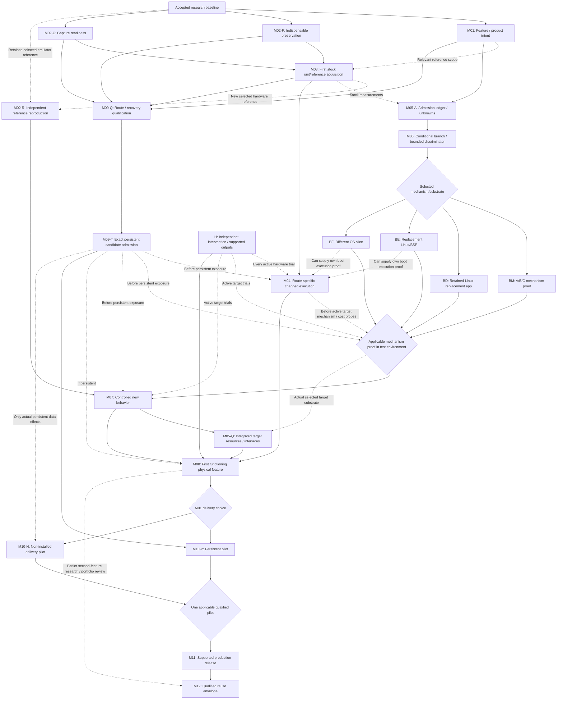

<!-- source: ../PioneerSP16Review/04-DEPENDENCY-MAP.md | scrubbed -->

# Stage 4 — Dependency map

Revision 2, proposed for independent review. October 9, 2026, America/Chicago. This is a review instruction document, not execution authority. It incorporates RC01–RC08 from the unchanged [Stage 5 corrections] `Review/05-REQUIRED-CORRECTIONS.md` (evidence not published). The original Stage 5 verdict does not approve this revision.

Milestone contracts, staged readiness definitions and the sole correction-disposition table are in the [master roadmap] `Review/04-MASTER-ROADMAP.md` (evidence not published). [Next actions] `Review/04-PRIORITIZED-NEXT-ACTIONS.md` (evidence not published) decomposes the next questions; the [risk register] `Review/04-RISK-REGISTER.md` (evidence not published) defines K IDs.

## Reading the joins

Solid edges require the stated evidence; dashed edges apply only to the indicated method/exposure. An edge constrains acceptance or an exposed trial, not all preliminary analysis. Replacement and delivery branches are **OR selections**; other applicable prerequisites are AND joins. Partial M02/M05/M09 contracts are subsets of one authoritative package, not additional competing packages. A completed subset does not mark the whole milestone complete.

M02-P preserves indispensable inputs/evidence; M02-C validates capture; M02-R independently restores/reproduces the relevant reference. First M03 acquisition consumes P/C and can supply R's reference. M05-A is the measured/bounded/unknown admission ledger, while M05-Q is actual integrated target qualification. Conditional M06 can select a bounded discriminator with missing evidence explicitly pending; that is not a passed feasibility or broad implementation gate. H is independent intervention/operating-envelope readiness for every active hardware trial. M09-Q qualifies route/recovery; exact M09-T binds every persistent candidate before exposure.

ENV is an OR join. R uses the reference appropriate to its selected method: new hardware acquisition or existing retained emulator evidence, not both as prerequisites. A bounded off-device M07 may precede target proof; it leaves the physical substrate/mechanism unknown. M08 requires the actual selected BM/BD/BE/BF target evidence. M05-Q can be observed during substrate/M07/M08 integration rather than requiring another run; its arrow shows the final qualification join, not a ban on earlier measurements. M09-Q preparation uses a static candidate write map, not an already successful modified installation. H and M09-T apply to every exposed branch/probe even where the diagram groups them at ENV. The table below is authoritative.

## Authoritative prerequisites

| Gate | Admission / prerequisite evidence | Acceptance and conditional exposure joins | Work that can begin earlier |
|---|---|---|---|
| M01 | Reviewed baseline; human feature and delivery intent | Observable state/output, compatibility, persistence and workload contract | Product scenarios; unit/access inventory |
| M02 | Source locators and chosen method | P/C before first acquisition; R after reference exists and before reproducibility-dependent comparisons; full selected-method/off-device restoration before M11 | Preservation and reporting design without a selected emulator |
| M03 | M02-P/C, suitable unit, authorized observation and connection conditions | Supplies actual target facts/reference; M02-R can then reproduce it | Existing inventory; passive access evidence |
| M04 | Relevant M03 facts, M02-P/C, selected-layer acceptance and H | Actual changed execution; M09-Q/T before persistent effects. BE/BF may provide their own boot proof; stock-userspace success is not mandatory there | Static checks, write map, compatible harmless-probe design |
| M05 | M01, M02-P/C; M03 for measured stock target evidence | A separates capacity/candidate costs/bounds/unknowns/margin; Q proves integrated target state/output/deadlines. Custom target probes need M04/H and M09-Q/T if persistent; comparison reproduction needs R | Static contracts, component lineage, conservative-cost justification |
| M06 | M01, P/C and available M05-A/access ledger | Conditional branch may select only bounded pending probes. Broad feature commitment needs applicable mechanism/substrate proof and meaningful admission basis; resource-dependent commitment remains conditional until unknowns close | Option comparison; probe rejection thresholds |
| BM | Conditional M06, exact original/candidate/runtime, affected interface contract | Applicable A/B/C mechanism proof before substantial M07; target probe needs M04/H/T as applicable. Physical claim cannot inherit off-device loading proof | Data/ABI/control-transfer analysis, isolated mechanism test design |
| BD | Conditional M06 selects D, relevant M03/M05-A, target M04 | Independent affected-device ownership/initialization; H and T if persistent; Q at integrated join | Source/ABI/interface assessment |
| BE | Conditional M06 selects E with demonstrated platform requirement; relevant target/source/build ledger | Actual permitted alternate boot may establish M04; H/T as applicable; relevant drivers/storage/app ABI; Q at integrated join | Specific board/driver lineage and bounded port feasibility |
| BF | Conditional M06 selects F with measured need/function boundary; relevant target/interface ledger | Actual branch boot can establish M04; H/T as applicable; indispensable services/interfaces and measured benefit; Q at integrated join | Required-service/driver inventory; alternative-OS discriminator |
| M07 | M01; P/C/R for reference comparison; relevant A and conditional M06; applicable mechanism proof in claimed environment | Meaningful changed software behavior; H/M04/T before on-unit exposure. Offline proof leaves target acceptance/resources pending; replacement module proof does not close full BD/BE/BF | Narrow independent oracle and mechanism/cost prototype |
| M08 | M07, actual M03/M04, applicable R, selected physical mechanism/substrate, M05-Q and H | Exact T if persistent; real affected output, concurrent workload, preserved regressions, fresh-session repeat and return to stock | Integration/reference protocol design |
| M09 | M01 scope, P/C, relevant M03 unit state and candidate write map; H for active qualification tests | Q actual unchanged-route acceptance plus scoped independent recovery; T exact candidate/installer/unit/differences/effects→qualified envelope before every persistent attempt | Offline metadata/encoding/routing and recovery design |
| M10-P | M08; M01 selects persistent product; M09-Q/T | Exact pilot install/restart/state/failure/rollback qualification | Offline lifecycle/migration tests |
| M10-N | M08; M01 explicitly selects non-installed product; H | Acquisition/launch/fresh stock restart/relaunch, state integrity/failure intervention/eligibility; Q/T only for actual persistent data effects | Repeatable launch/state preservation protocol |
| M11 | Either qualified M10-P or M10-N; full relevant M02; finalized support/distribution scope | Artifact reproduction, load/reliability/compatibility and advertised claims; install/startup claims only on qualified persistent route | Release/reproduction/oracle design |
| M12 | M08 for early direction; M11 for production envelope; selected second-feature claim | Materially different relevant dependency/condition tests reuse; scope claims to demonstrated contracts. Layer pivot re-enters M06/selected branch/Q/T | Second-feature and reusable-interface assessment |

## Critical path walks

There are no durations supporting a scheduling critical path. These are logical gates and potential bottlenecks. No path is an execution authorization.

### Hardware-first acquisition

`M02-P + M02-C + suitable unit/access → first M03 reference acquisition → M02-R independent restoration/reproduction`.

M01 defines feature-specific coverage but general stock/access inventory can start without it. No first stock capture must reproduce a reference it is meant to create. P/C retain preservation, source binding, truthful reporting and applicable connection conditions. Candidate/reference acceptance relying on reproducibility waits for R. Broad emulator restoration does not enter a hardware-only path.

### Emulator-assisted local change

`M01 + M02-P/C → selected-emulator reference reproduction (M02-R) + relevant M05-A → conditional M06 → applicable BM → M07 software proof`.

For the physical gate, join with `M03 + route-specific M04 + H + physical mechanism proof + M05-Q → M08`. Selected emulator timing/device repairs are required only by the claimed inference. There is no automatic successor whole-machine emulator. Software proof cannot supply target authentication, codec clocks or real latency.

### No system writes: first physical feature

Obtain stock reference and R, select only the necessary BM/BD or boot-substrate discriminator, and close integrated target costs at M05-Q. The final AND join is:

`M01 + applicable M02-P/C/R + M03 + selected route M04 + H + selected physical mechanism/substrate + M05-Q + M07 → M08`.

No repacker is required if no route uses one. H remains mandatory even with zero persistent writes: intervention must survive the candidate that may hang, and supported output/clock/gain/connection limits must be established. Any data writes are separately scoped and require matching admission; a temporary executable alone is not a no-write classification.

### Persistent first attempt

`M01 + P/C + M03 + candidate checks/write map → M09-Q actual unchanged-route acceptance and recovery → exact M09-T → first persistent M04/BM/branch/M07/M08 attempt`.

M09-T is renewed for each exact candidate/exposure, reusing Q where assumptions still apply. Actual unchanged-route acceptance is distinct from a byte-equal ISO→UPD transform. Existing matching acceptance receipts avoid a redundant stock reflash. If no suitable recoverable arrangement exists, persistent exposure remains pending. M10 does not retroactively bind earlier candidates.

### Replacement substrates

| Route | Required additional proof | Execution relation | What is not automatically required |
|---|---|---|---|
| D | BD independent retained-Linux devices/initialization and accepted function scope | Target M04 before its custom device probe | New kernel, panel rewrite, full exact BSP rebuilding if runtime reuse suffices |
| E | BE actual board boot, source/build correspondence, required ports/storage and app ABI | BE can establish its own M04; actual alternate-boot policy required | Successful stock-userspace utility; F as successor; unrelated driver rebuilds |
| F | BF essential board/services/instrument slice and measured benefit | BF can establish its own M04; branch boot policy required | Stock-userspace foothold; prior BE implementation |

Conditional M06 can select a bounded substrate probe before viability is demonstrated. It withholds broad feature commitment and requires a stop decision. H and exact persistent admission apply before the probe. A selected replacement branch's successful integrated measurements can close M05-Q; they cannot be replaced by stock headroom or a generic board benchmark.

### Supported release alternatives

- Owner chooses installed persistence: `M08 + M09-Q/T → M10-P persistent pilot → M11`.
- Owner chooses genuinely non-installed delivery: `M08 + H + applicable data-state admission → M10-N repeated acquisition/launch/restart/relaunch qualification → M11`.

Both require full relevant M02 reproduction, artifact identity, state preservation, failure intervention, compatibility and M11 sustained-load/support qualification. Persistent launcher/configuration/automatic-start integration selects P regardless of RAM-loaded executable. N excludes installed-firmware/automatic-start claims. Neither product intent is assumed here.

## Branch decisions and parallel opportunities

A/B/C require the actual selected BM discriminator: functional data loading, independent service coexistence, loaded interception, exact in-place change or added-code loading/transfer/return. An unrelated identity program establishes execution only. D remains the principal alternative when private invariants broaden and independent hardware support is usable. E requires a platform-level reason; F requires measured benefit sufficient to justify services/board reconstruction. A missing static trace does not automatically select a rewrite.

Independent static feature maps, acceptance/write analysis, one required component's lineage, preservation and oracle design can proceed against immutable inputs. Hardware observation can share compatible stock captures; device handoff, recovery and output testing need one session owner. Independent reproduction and controlled comparisons remain distinct when their evidence requires independence. One package owner binds accepted results; no racing shared guest, database, device or installer state is proposed.

Minimal mechanism and representative cost probes may precede substantial feature implementation after their own method/access/H/Q/T prerequisites. Record workload, exclusions and decision value; do not treat every probe as authority for a port or broad feature. Stock configuration, measured/bounded candidate cost, instrumentation effects, integration uncertainty, reserved margin and rejection thresholds remain distinct ledger fields.

## Replanning propagation

- Product/compatibility/delivery changes reopen workload, mechanism, resource and write-state scope.
- P/C failure blocks observations using that method; R failure blocks reproduction claims/comparisons, not initial stock acquisition from a ready P/C method.
- Target/release changes reopen selected-layer policy/ABI, interfaces and candidate/recovery applicability.
- Mechanism failure rejects that mechanism; no route passing M04 leaves physical delivery pending without automatic rewrite permission.
- Integrated M05-Q exceeds thresholds: reopen M06; preserve narrower algorithm/demo evidence and compare reduced scope or algorithm before platform escalation.
- H unavailable or observability/output leaves its envelope: stop the active trial through the applicable independent intervention protocol; no-write status does not waive it.
- Candidate/installer/destination/failure assumptions change: recheck M09-T and requalify changed Q coverage before exposure.
- M10 or M11 fails: retain M08's bounded physical result and withhold wider delivery/reliability claims.
- Second feature only confirms the same narrow contract: narrow M12's claim, rather than infer whole-OS extensibility from a feature count.
- Feasibility tranche ends: stop/review/narrow/acquire access/pivot by owner decision. Pending questions cannot renew their own effort ceiling.

The revised paths are ready for independent review. Product decisions and physical capabilities remain open until separately authorized evidence exists.
